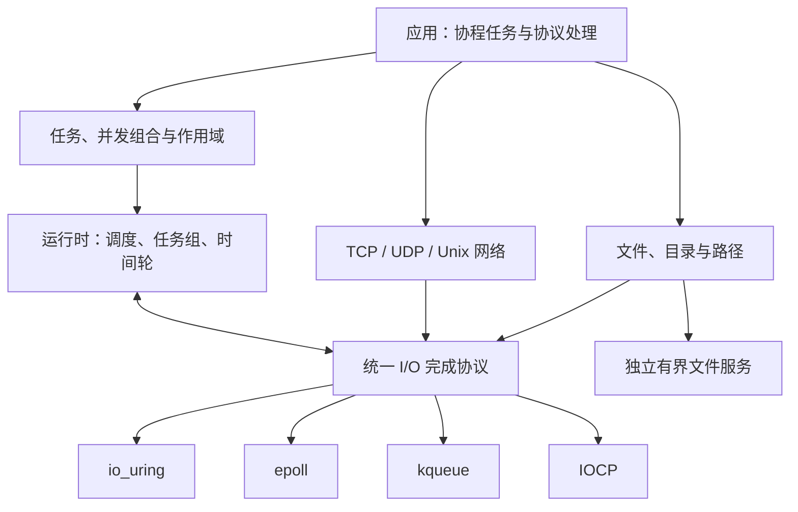

# 架构与阅读路线

faio 从用户协程到操作系统事件分层组织。业务代码面对统一的任务与 I/O 语义，平台后端承担原生请求、取消与完成排空。

## 从使用到实现

| 模块讲解 | 解决的问题 | 建议前置阅读 |
| --- | --- | --- |
| [协程封装](协程封装.md) | task、promise、帧所有权、对称转移、结果传播 | [任务 API](api/tasks.md) |
| [协程并发](协程并发.md) | spawn、join、select、scope 与取消排空 | 协程封装 |
| [异步运行时](异步运行时.md) | 多 / 单线程调度、任务窃取、事件循环、停机 | 协程并发 |
| [异步 I/O](异步IO.md) | 请求生命周期、资源控制块、后端完成协议、文件服务 | 运行时 |
| [网络 I/O](网络IO.md) | 资源包装、CRTP mixin、方向约束、TCP / UDP / Unix | I/O 协议 |
| [定时器](定时器.md) | 分层时间轮、到期处理、deadline 与取消 | 运行时 |
| [协程同步](协程同步.md) | 等待队列、通知、互斥许可、唯一恢复权 | 协程封装与运行时 |
| [实验性特性](实验性特性.md) | 反射注解入口与 Sender/Receiver 桥接 | 核心任务与运行时 |

这些讲解沿用仓库已有 Markdown。图表在浏览器中使用随站点分发的 Mermaid 渲染，指向头文件的链接在构建时转换为 GitHub 源码链接。

## 源码入口

公共聚合头位于 [include/faio](../include/faio/)，实现主要位于 [include/faio/detail](../include/faio/detail/)。`detail` 是源码组织与实现边界，用户应优先通过公共入口使用库。

文件系统目前可从 [文件 API](api/filesystem.md)、[完整文件例程](examples/files.md) 与 [异步 I/O](异步IO.md) 的文件服务章节串联阅读；网络、文件、DNS 和用户阻塞函数有各自的资源与队列约束。

## 用例程对照实现

先运行 [官方例程](examples/index.md)，再根据对应操作定位章节。例如：从 TCP 的 `read()` 追踪 mixin → I/O awaiter → 资源控制块 → 后端协议；从 `join()` 追踪任务启动 → 结果发布 → 异常 / 取消传播 → 任务组排空。
