# 异步 IO

faio 的 I/O 层是纯头文件的异步 I/O 引擎：对上提供协程可直接 `co_await` 的中立原语，对下把 Linux io_uring、Windows IOCP 两种原生 Proactor，与 Linux epoll、macOS/FreeBSD kqueue 两种就绪型 reactor，收敛成同一套提交/完成协议。

本文不按文件层级平铺，而是按**读者理解路径**组织：先看控制面与辅助类型（词汇层），再看统一抽象（合同层），然后沿同一条 IO 的两个端点走完整流程——提交端的协程桥、完成端的域状态机，最后才打开两条后端主线与文件目录封装。这个顺序的依据是：**抽象层只描述"一次 IO 被拆成哪几个动作"，真正的复杂度在"这些动作由谁按什么顺序调用"**，因此先给合同，再给生产者和消费者，最后给两种实现的内部机制。每章开头标注"本章依赖"，标明读这一章之前需要哪些前置概念。

| 平台 | 网络及可非阻塞描述符 | 普通文件及路径操作 | 构建选择 |
| --- | --- | --- | --- |
| Linux io_uring | 原生 SQE/CQE Proactor；readiness 用 POLL_ADD | 文件、属性、路径变更使用原生 opcode；无 opcode 的操作走有界 fallback | `FAIO_ENABLE_IO_URING=ON`，Linux 5.10+ |
| Linux epoll | 非阻塞 syscall 与就绪代际缓存 | 独立有界文件线程池 | `FAIO_ENABLE_IO_URING=OFF` |
| macOS / FreeBSD | kqueue，非阻塞 syscall，就绪代际缓存 | 独立有界文件线程池 | kqueue |
| Windows | IOCP 原生收发、AcceptEx、ConnectEx；ready 为非消费 WSAPoll | OVERLAPPED 文件数据 IO；路径、元数据、目录操作使用独立有界服务 | IOCP，MSVC / clang-cl / MinGW-w64 |

后端在**编译期**固定为具体类型：`FAIO_HAS_IO_URING` 选 uring，否则选 epoll；Darwin/BSD 选 kqueue；Windows 选 IOCP。`resolve_io_backend` 只验证显式配置与构建是否匹配，uring 构建额外检查内核版本不低于 5.10。没有旧内核自动回退，也没有运行时后端切换；初始化失败或配置不匹配明确报错，改用其他后端必须重新构建。

## 0. 分层全景与阅读路线

### 0.1 模块入口

应用可包含 `<faio/faio.hpp>` 使用完整库，也可按模块包含 [`<faio/io.hpp>`](../include/faio/io.hpp)、[`<faio/fs.hpp>`](../include/faio/fs.hpp)、[`<faio/net.hpp>`](../include/faio/net.hpp)。模块入口只做聚合：具体后端、请求状态和平台实现都在 `detail` 下，应用不需要直接选择内部头。

`detail/io/` 目录的职责划分：

| 目录 | 职责 | 代表文件 |
| --- | --- | --- |
| `protocol/` | 后端中立的请求、事件与提交结果等**数据协议**，不含逻辑 | `request.hpp`、`backend.hpp`、`reactor.hpp` |
| `traits/` | 命名 concept 与编译期接口检查，不包含具体实现 | `backend.hpp`、`reactor.hpp`、`awaitable.hpp` |
| `base/` | 静态包装（`backend_api`/`reactor_api`）、缓冲类型、readiness 适配 | `backend.hpp`、`reactor.hpp`、`readiness_adapter.hpp`、`buffer.hpp` |
| `core/` | 稳定槽、资源控制块、上下文、方向租约、驱动会话、放置表 | `operation_state.hpp`、`resource_state.hpp`、`context.hpp`、`domain.hpp` |
| `awaiter/` | 协程提交/完成握手与各具体操作适配 | `request.hpp`、`native_file.hpp`、`recv.hpp` |
| `stream/` | 组合算法、缓冲流、内存流、字节序工具 | `algorithms.hpp`、`buffered.hpp`、`memory_stream.hpp` |
| `backend/` | 按完成机制分类的具体实现与工厂 | `epoll/`、`kqueue/`、`uring/`、`iocp/`、`factory.hpp` |
| `platform/` | 原生类型、错误、系统调用适配与编译期选择 | `native_types.hpp`、`backend.hpp`、`unix/`、`linux/`、`windows/` |

`backend/` 按**完成机制**分类，`platform/` 按**操作系统差异**分类；kqueue 后端由 macOS/FreeBSD 共用。协议和约束不反向包含工厂或具体后端，具体后端只通过中立请求与完成事件接入域。`fs` 管理文件游标、租约和路径语义，`net` 管理地址、连接与网络接口，两者使用 IO 引擎；IO 核心不包含 FS/NET 实现。

### 0.2 一份合同、两个端点、两条实现

整篇文档围绕一个判断展开：IO 层不是"一堆按平台分叉的封装"，而是**一份合同、两个端点、两条实现**。

- **一份合同**：`backend_api` 声明的方法集与 `backend_event` 描述的事件形状。合同只回答"一次 IO 被拆成哪几个动作"，不回答动作怎么实现。
- **两个端点**：**提交端**是 `IORegistrantAwaiter`，它是全库唯一把协程参数变成稳定槽请求的地方；**完成端**是 `io_domain`，它是全库唯一仲裁接受、取消、关闭、停机并发布终态的地方。中间不存在第三个角色。
- **两条实现**：原生 Proactor（uring / IOCP）直接产生完成；Reactor（epoll / kqueue）只能产生就绪提示，由域内的 `attempt` 补上"就绪→syscall→完成"这一段。

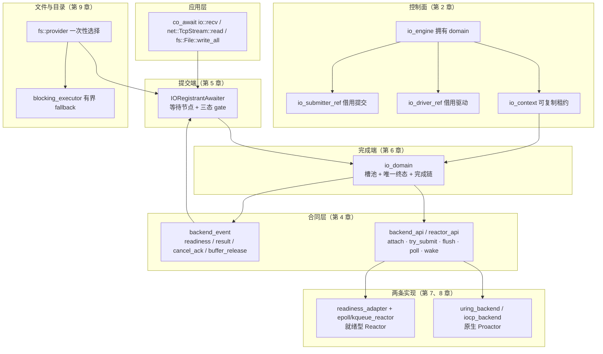

图中三条边值得单独记住：

1. `DM --> EV --> B`：完成结果从域回到协程，**只经由一个函数指针加一个 `void*`**，域不知道协程句柄、调度器或任何网络类型。
2. `F1 --> B` 与 `F1 --> F2`：文件请求在**提交前**选一次路径，选中后不再改道。
3. `E --> C` 与 `C --> DM`：控制面只转发，不持有后端、不持有线程。

### 0.3 三条阅读路线

| 目的 | 建议路径 | 关键章节 |
| --- | --- | --- |
| 想改后端 / 加新后端 | 第 4 章合同 → 第 6 章域如何消费事件 → 第 7 或 8 章同类实现 | 4.2、6.6、7.2 |
| 想用 API | 第 2 章控制面 → 第 5 章等待语义 → 第 9 章文件语义 | 2.2、5.3、9.5 |
| 想查竞态 / 调性能 | 第 5 章 gate → 第 6 章仲裁与完成链 → 第 3.5 节方向租约 | 5.4、6.4、6.7 |

### 0.4 分层对照表

| 类型 / 文件 | 职责 | 所有权 |
| --- | --- | --- |
| `io::io_engine` / [engine.hpp](../include/faio/detail/io/engine.hpp) | 拥有 domain；提供 context、driver、submitter、能力；析构前停机排空 | 拥有 `shared_ptr<io_domain>` |
| `io::io_context` / [core/context.hpp](../include/faio/detail/io/core/context.hpp) | 可复制的 domain 与服务租约；显式保存归属，不依赖恢复线程的 TLS | 拥有 `shared_ptr<io_domain>` |
| `io_driver_ref` / [core/driver_ref.hpp](../include/faio/detail/io/core/driver_ref.hpp) | 借用驱动入口：`drive`、`wait_and_drive`、`wake`、`quiescent` | 持有 `io_domain*` |
| `io_submitter_ref` / [core/submitter_ref.hpp](../include/faio/detail/io/core/submitter_ref.hpp) | 借用提交与取消入口 | 持有 `io_domain*` |
| `FileDescriptor` / [core/file_descriptor.hpp](../include/faio/detail/io/core/file_descriptor.hpp) | 描述符包装所有者基类；共享资源控制块 | 拥有 `resource_ptr` |
| `io_request` / [protocol/request.hpp](../include/faio/detail/io/protocol/request.hpp) | 后端中立的完整请求参数 | 见 3.2 |
| `operation_state` / [core/operation_state.hpp](../include/faio/detail/io/core/operation_state.hpp) | 稳定槽、终态标志及字节进度 | 槽池拥有节点 |
| `resource_state` / [core/resource_state.hpp](../include/faio/detail/io/core/resource_state.hpp) | fd 所有权、不可变域归属、方向执行权、就绪代际、关闭状态 | 见 3.4 |
| `direction_lease` / [core/direction_lease.hpp](../include/faio/detail/io/core/direction_lease.hpp) | 组合 IO 的方向排他租约（RAII） | 拥有 `resource_ptr` |
| `backend_box` / [platform/backend.hpp](../include/faio/detail/io/platform/backend.hpp) | Proactor 提交型静态接口别名 | 拥有具体后端 `unique_ptr` |
| `reactor_box` / [platform/reactor.hpp](../include/faio/detail/io/platform/reactor.hpp) | 就绪型静态接口别名 | 拥有具体 reactor `unique_ptr` |
| `readiness_adapter` / [base/readiness_adapter.hpp](../include/faio/detail/io/base/readiness_adapter.hpp) | 把 reactor 提升为 `backend_box` 形状 | 拥有 `reactor_box` |
| `io_domain` / [core/domain.hpp](../include/faio/detail/io/core/domain.hpp) | 唯一终态状态机 | 见第 6 章 |
| `IORegistrantAwaiter` / [awaiter/request.hpp](../include/faio/detail/io/awaiter/request.hpp) | 保存请求与调度器，实现提交/完成的挂起握手 | 见第 5 章 |
| `execution::blocking_executor` | 固定数量线程、有界 FIFO 等待队列、关闭排空 | 拥有线程池 |
| `execution::execute` | 文件服务请求桥，拥有函数与结果，展开 `expected<T>` | 拥有函数 |

---

## 1. 所有权词汇

### 1.1 持有与拥有

后文每个类的成员表都用两个词标注生命周期，这是贯穿全文的词汇表：

- **持有（borrow）**：成员只保存地址或引用，不管理对象生命周期。被指向对象的存活由**宿主**保证，覆盖该成员的全部使用区间。
- **拥有（own）**：成员生命周期与类对象生命周期绑定——或是值内嵌，或由 `unique_ptr`/`shared_ptr` 负责析构。

判断标准只有一条：**类对象析构时，该成员指向的资源是否随之释放**。释放就是拥有，不释放就是持有。裸指针一律是持有，`shared_ptr` 一律是拥有（哪怕它可能与他人共享）。

这个约定不是文档洁癖。IO 层有大量"指针指向别人的状态"的场景：`operation_state*` 指向槽池节点、`resource_state*` 指向共享控制块、`void* consumer` 指向协程帧内的等待器。这些指针在何时失效，决定了哪把锁必须覆盖哪段代码，也决定了取消路径能不能安全访问它们。

### 1.2 三种"租约"

"租约"（lease）在库内被用于三类完全不同的对象，混用会造成严重误解：

| 租约 | 载体 | 作用 | 何时失效 |
| --- | --- | --- | --- |
| **domain 租约** | `io_context` / `shared_ptr<io_domain>` | 保活 domain，并**记录请求归属** | 到最终完成与清理结束，或显式释放 |
| **资源租约** | `resource_ptr`（`shared_ptr<resource_state>`） | 保活 fd，并记录 owner 与活跃计数 | 到操作完成、包装对象析构 |
| **方向租约** | `direction_lease` / `read_reserved` | 组合 IO 期间排他占用一个读写方向 | 到组合操作结束（RAII 释放） |

三者的区别在"保活什么"：domain 租约保活**引擎**，资源租约保活**句柄**，方向租约保活**执行权**。第 2.2 节解释第一种为何不能依赖 TLS，第 3.4 节解释第二种的发布协议，第 3.5 节解释第三种与 `reader`/`writer` 的关系。

---

## 2. 对外控制面

> **本章依赖**：只依赖第 1 章的所有权词汇。控制面是 `io_domain` 之上的四个薄包装，本章把它们当作黑盒引用，内部实现在第 6 章。
>
> **读完之后你应该能回答**：`io_engine` 与 `io_context` 的生命周期差别是什么；为什么 `io_context` 必须能复制、而 `io_engine` 不能；驱动和提交为什么拆成两个借用类型。

### 2.1 io_engine：拥有型引擎

[engine.hpp](../include/faio/detail/io/engine.hpp) 的 `io_engine` 只有一个数据成员：`std::shared_ptr<detail::io_domain> domain_`。它的全部工作是**转发**——不持有后端、不持有线程、不做仲裁。

| 成员 / 接口 | 类型 | 所有权 | 说明 |
| --- | --- | --- | --- |
| `domain_` | `shared_ptr<io_domain>` | **拥有** | 唯一数据成员；`shared_ptr` 让 `io_context`、资源控制块、取消回调都能各自持有一份租约 |
| `io_engine(config)` | 构造 | — | 直接 `make_shared<io_domain>`；失败抛出，不静默降级 |
| `create(config)` | 静态工厂（仅 Windows） | — | 把 `WSAStartup`/`CreateIoCompletionPort` 失败装进 `expected`，不降级后端 |
| `context()` | `io_context` | 返回值拥有 | 复制一份 domain 租约 |
| `driver()` / `submitter()` | 引用类型 | 返回值持有 | domain 为空时返回可安全调用的空引用 |
| `capabilities()` / `statistics()` | 快照 | — | 向后端逐项查询，不是按平台名猜的常量 |
| `begin_shutdown(policy)` / `shutdown()` | 控制 | — | 转发到域；完整顺序由域实现 |
| `binding` | 嵌套类 | 持有 `io_domain*` | 临时安装 TLS 默认 context，析构恢复原值 |

```cpp
class io_engine {
 public:
  explicit io_engine(engine_config config = {})
      : domain_(std::make_shared<detail::io_domain>(std::move(config))) {}   // ①

  ~io_engine() { shutdown(); }                                               // ②

  io_context context() const noexcept { return io_context{domain_}; }         // ③
  io_driver_ref driver() const noexcept {
    return domain_ ? io_driver_ref{*domain_} : io_driver_ref{};               // ④
  }

  class binding {                                                            // ⑤
   public:
    explicit binding(const io_engine& engine) noexcept : previous_(detail::current_domain) {
      detail::current_domain = engine.domain_.get();
    }
    ~binding() { detail::current_domain = previous_; }
   private:
    detail::io_domain* previous_;  // 持有：仅用于恢复原 TLS 值。
  };

 private:
  std::shared_ptr<detail::io_domain> domain_;  // 拥有：共享租约。
};
```

① 引擎**构造即启动**：`io_domain` 构造函数会创建后端、预热槽池、按后端模型决定是否预热服务线程。这是"构造失败就抛异常"而不是"惰性初始化"的原因——半初始化状态下的 domain 无法定义行为。

② 析构只调 `shutdown()`。`shutdown` 的语义是"拒绝新请求、按策略取消、排空在途操作、关闭服务、销毁驱动器"，顺序不可调换：先关后端就没人收割 CQE，先关服务就会让 fallback 请求永远等不到线程。

③ `context()` 每次调用都**复制**一份 `shared_ptr`。这是有意为之：调用方拿到的 `io_context` 必须能在引擎对象销毁后继续保活 domain，否则"创建了 File，引擎先析构"就会变成悬垂。

④ 空引用不是错误，而是可安全调用的 no-op：`drive()` 返回 `ECANCELED`，`submit()` 什么也不做。这消除了"每个调用点都要判空"的样板代码。

⑤ `binding` 只做一件事：把 `detail::current_domain` 这个 TLS 指针临时指向自己，析构时恢复。它不改变**已有资源**的归属——归属在 `prepare_locked` 里第一次绑定时就固定了，之后协程迁移到别的 worker 也不会迁移资源。

### 2.2 io_context：租约究竟在做什么

`io_context` 是本文最容易被误读的类型。"租约"这个词让读者以为它在做引用计数管理，实际上它解决的是**一个具体故障**：

> 协程在 worker A 上 `co_await` 一次 IO，挂起后可能被调度到 worker B 恢复。如果每次提交都读"当前线程的 domain"，那么同一个 socket 的第二次读写会落到另一个 domain，进入另一个后端的就绪注册表，而这个 socket 只在 A 的 epoll 里注册过。结果是第二次读写永远等不到事件。

`io_context` 的做法是把归属**显式保存到对象里**：`File`、`TcpStream` 在创建时复制一份 context，此后所有提交、清理、停机回调都用这份租约，绝不读恢复线程的 TLS。

```cpp
class io_context {
 public:
  static io_context current();                        // ①
  bool valid() const noexcept { return !!domain_; }
  bool stopped() const noexcept;                      // ②
  execution::blocking_executor_ref blocking() const noexcept;    // ③
  execution::blocking_executor_ref resolver() const noexcept;
  execution::blocking_executor_ref cleanup() const noexcept;
  io_context balanced_context() const noexcept;       // ④
  void defer_cleanup(::faio::move_only_function<void()> cleanup) const noexcept;   // ⑤
  std::uint64_t register_shutdown_cleanup(::faio::move_only_function<void()> cleanup) const;
  const std::shared_ptr<detail::io_domain>& domain() const noexcept { return domain_; }

 private:
  std::shared_ptr<detail::io_domain> domain_;  // 拥有：domain 租约。
};
```

① `current()` 读 TLS（`detail::current_domain`），为空则返回空 context。它是**唯一**允许读 TLS 的地方；`File`/`Socket` 内部一律用自己保存的那份。

② `stopped()` 与 `valid()` 是两个独立问题，这是最容易踩的坑：持有 context **只保证 domain 对象存活**，不保证 domain 仍在接受请求。`shutdown()` 之后 context 依然 `valid()`，但所有提交都会被拒绝并返回 `ECANCELED`/`EBADF`。这就是源码注释"存活不等于 runtime 仍接受新请求"的含义。

③ 三类阻塞服务各一个访问器。它们返回**引用**（`blocking_executor_ref`），不延长服务生命周期；服务的生死由 domain 的 `own_fs_`/`own_dns_`/`own_cleanup_` 标志决定——注入共享服务时由注入者负责关闭。

④ `balanced_context()` 用于"新建连接该落到哪个 shard"：有 placement 组时轮转选一个未停止的 domain，独立引擎时返回自身。注意它只影响**新资源**，已有资源不会被迁移。

⑤ `defer_cleanup` 走**保留清理通道**。这一点很关键：普通文件服务队列可能已满，如果关闭 fd 也排在这个队列里，就可能永远关不掉。清理通道独立于普通队列，保证"必须完成的清理"不会因背压丢失。

`io_context` 还必须可比较（`operator==` 默认实现）：`fs::File::try_clone` 之类操作需要判断两个包装是否属于同一域。

### 2.3 io_driver_ref / io_submitter_ref：为什么拆成两个

运行时 worker 只需要"驱动完成队列"，网络/定时器子系统只需要"提交或取消"。把两者合成一个 `io_domain&` 会让任何持有者都能做任何事，也无法表达"driven by exactly one thread"这个约束。

```cpp
class io_driver_ref {
 public:
  drive_result drive(drive_budget budget = {}) const noexcept {              // ①
    return domain_ ? domain_->drive(budget) : drive_result{0, false, false, ECANCELED};
  }
  drive_result wait_and_drive(std::optional<int> timeout = {}, drive_budget budget = {}) const noexcept {
    return domain_ ? domain_->drive(budget, timeout) : drive_result{0, false, false, ECANCELED};
  }
  void wake() const noexcept { if (domain_) domain_->wake(); }               // ②
  bool quiescent() const noexcept { return !domain_ || domain_->quiescent(); }
 private:
  detail::io_domain* domain_{};  // 持有：宿主 owning engine 覆盖借用 session 生命周期。
};

class io_submitter_ref {
 public:
  void submit(operation_token token) const noexcept { if (domain_) domain_->submit(token); }
  void request_cancel(operation_token token, cancel_reason reason = cancel_reason::user) const noexcept {
    if (domain_) domain_->request_cancel(token, reason);
  }
 private:
  detail::io_domain* domain_{};  // 持有。
};
```

① `drive` 内部先抢 `driver_mutex_`：**一个域同时只有一个 CQ 消费者**。这不是性能选择而是正确性要求——`io_uring_peek_batch_cqe` 与 `GetQueuedCompletionStatusEx` 都不是为多消费者设计的，两个线程同时收割会破坏 CQE/完成包的归属。

② `wake` 是唯一允许从任意线程调用的方法，它只写控制通道（eventfd / `NOTE_TRIGGER` / `PostQueuedCompletionStatus`），不碰业务状态。

两个类型都**持有**裸指针。这意味着调用方必须保证 owning engine 活得比借用更久。如果后台回调需要在引擎可能销毁后仍提交，必须额外保存 `io_context` 来保活 domain，而不是保存 `io_submitter_ref`。这是"借用 vs 拥有"在 API 层的直接体现。

### 2.4 io_placement_group：多线程分片

多线程运行时每个 worker 一个 domain，文件/DNS/清理服务在同一 runtime 内共享。shard 之间唯一的控制面连接是这张**弱引用注册表**：

```cpp
class io_placement_group {
 public:
  explicit io_placement_group(std::size_t count) : domains_(count) {}

  void register_domain(std::size_t index, const std::shared_ptr<io_domain>& domain) noexcept {
    std::lock_guard lock(mutex_);
    domains_[index] = domain;  // 启动屏障前登记，不延长已退出域的生命期。
  }

  std::shared_ptr<io_domain> select() noexcept;   // 轮转选一个未停止的域
  resource_ptr find_resource(native_descriptor fd, const io_domain* skipped) noexcept;

 private:
  std::mutex mutex_;                                // 拥有
  std::vector<std::weak_ptr<io_domain>> domains_;   // 拥有容器；weak_ptr 防止与 runtime 形成强引用环
  std::size_t next_{};
};
```

用 `weak_ptr` 而不是 `shared_ptr` 的理由是**避免引用环**：runtime 拥有 domain，domain 若反过来强引用 runtime 的 placement 组，两者会互相保活，停机时谁也析构不了。弱引用让"域已被销毁"变成一次 `lock()` 失败，而不是崩溃。

`select()` 在组锁内轮转，跳过已停止或已过期的域；`find_resource(fd, skipped)` 用于 raw fd 的冷路径——**只提升租约，不建立新注册**，也不跨独立 engine 查找。普通已注册 IO 的热路径完全不访问这张表：归属在首次注册时写进 `resource_state::owner`，此后提交、取消、关闭全部沿用保存的 domain。

### 2.5 capabilities：能力来自探测而非平台名

```cpp
io_capabilities capabilities() const noexcept {
  io_capabilities c;
  c.backend = backend_.name();
  c.native_filesystem = backend_.native() && supports_native(operation_kind::read)
                        && supports_native(operation_kind::write)
                        && supports_native(operation_kind::open)
                        && supports_native(operation_kind::fsync);   // ①
  c.zero_copy = supports_native(operation_kind::send_zc);
  c.native_accept_nowait = supports_native(operation_kind::accept_nowait);
  return c;
}
```

① `native_filesystem` 要求四个 opcode **同时**支持，而不是"平台是 Linux 就算支持"。这防止旧内核上 `read` 走原生、`open` 走 fallback 时，上层误以为整条文件路径都是原生的。

能力不是常量表，而是每次调用时向后端 `supports(opcode)` 逐项询问。代价是几次 if 判断，收益是"模型是 native 不代表每个 opcode 都已实现"这一事实能被上层看见（`supports` 的实现见 7.2）。

---
## 3. 辅助类型与结构体

> **本章依赖**：只依赖第 1 章的所有权词汇。本章**只立词汇，不解释仲裁**——凡是"由域在锁内决定"的语义，本章只给出类型形状与所有权，细节留给第 6 章对应小节。
>
> **为什么把这些类型放在最前面**：它们脱离了"Proactor / Reactor / 异步"三种封装，是两条主线、协程桥、文件服务共同引用的数据面。不理解 `io_request` 里哪个字段是借用的，就无法判断取消后能否立刻唤醒调用方；不理解 `resource_state::handle` 的 `exchange(-1)` 是唯一接管点，就无法理解为什么 close 只能成功一次。

### 3.0 本章地图

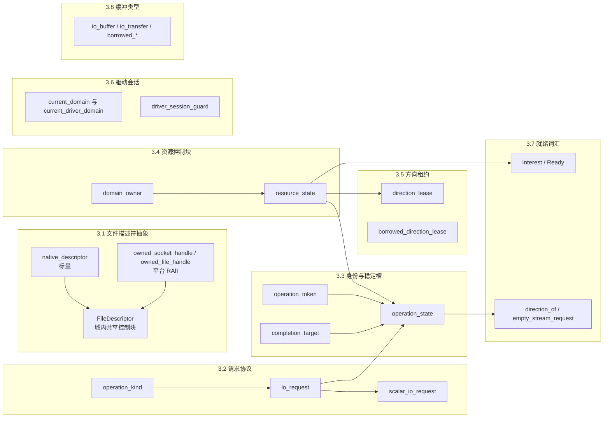

### 3.1 描述符抽象：三层与三种职责

fd 在库内有三层表示，各有明确职责，混用会造成跨平台截断或重复关闭：

| 层 | 类型 | 位置 | 职责 | 所有权 |
| --- | --- | --- | --- | --- |
| 原生标量 | `native_descriptor` | [platform/native_types.hpp](../include/faio/detail/io/platform/native_types.hpp) | 承载完整位宽的句柄数值 | 无（值） |
| 平台 RAII | `OwnedFd`、`owned_socket_handle`、`owned_file_handle` | `platform/unix/owned_fd.hpp`、`platform/windows/handle.hpp` | 独立使用时的独占所有权 | **拥有** |
| 域内控制块 | `FileDescriptor` + `resource_state` | `core/file_descriptor.hpp`、`core/resource_state.hpp` | 在域内登记、共享、排空 | **拥有** `resource_ptr` |

第一层最关键的一点：**Windows 上不能用 `int`**。

```cpp
namespace faio::io::detail {
#if defined(_WIN32)
using native_descriptor = std::intptr_t;  // SOCKET/HANDLE 的完整位宽。
#else
using native_descriptor = int;
#endif
}
```

Win64 的 `SOCKET` 是 `UINT_PTR`，高 32 位可能非零。把它截断成 `int` 会造成两种故障：句柄值被破坏后 `closesocket` 关错对象；或者两个不同 socket 低位相同，被误判为同一个资源。源码里 `native_registration` 的注释"不得把 HANDLE 或 Win64 SOCKET 缩窄为 int"针对的正是这一点。

句柄种类由 `native_handle_kind` 区分，它决定用哪个 API 关闭：

```cpp
enum class native_handle_kind : std::uint8_t { posix_descriptor, windows_handle, windows_socket };
```

这个标签不只为关闭服务，也是**注册校验**的一部分：`native_registration` 同时带值和种类，后端可以拒绝"用文件句柄标签注册 socket"这类错误。

#### FileDescriptor：域内包装基类

[core/file_descriptor.hpp](../include/faio/detail/io/core/file_descriptor.hpp) 是 `AsyncFd`、`TcpSocket` 等所有"包装一个长期资源"的类型的共同基类。它**不**直接持有 fd，而是持有一个共享控制块：

| 成员 | 类型 | 所有权 | 说明 |
| --- | --- | --- | --- |
| `resource_` | `resource_ptr` | **拥有** | 跨挂起固定句柄身份与域归属；引用计数由所有包装副本共享 |

三个受保护构造函数对应三种来源：原生 fd + context（在域内 `adopt`）、context 在前（参数顺序变体）、已有 `resource_ptr`（从一个包装复制而来）。三者共同的动作是 `wrappers.fetch_add(1)`——记录"有多少个包装对象正在使用这个控制块"，这个计数决定了最后一个包装析构时是否要请求关闭。

```cpp
class FileDescriptor {
 protected:
  explicit FileDescriptor(native_descriptor fd,
                          io_context context = io_context::current(),
                          bool regular = false)
      : resource_(adopt_resource(context, fd, true, regular)) {       // ①
    resource_->wrappers.fetch_add(1, std::memory_order_relaxed);
  }

  ~FileDescriptor() { release(); }

  void release() noexcept {
    if (!resource_) return;
    if (resource_->wrappers.fetch_sub(1, std::memory_order_acq_rel) == 1 && resource_->owner)
      resource_->owner->request_close(resource_);                     // ②
    resource_.reset();
  }
```

① `adopt_resource` 在 context 有效时走 `domain->adopt`（登记到域、可能注册就绪），无 context 时创建一个"未归属"的控制块，等第一次 `co_await` 再绑定（见 3.4 与 5.3）。注意 `regular` 参数：普通文件不能走就绪路径，必须在创建时就标出来。

② **只有最后一个包装**（`fetch_sub` 返回 1）才请求关闭。这条规则让 `try_clone`、`dup` 出来的多个包装共享同一个 fd 生命周期：关掉其中一个不会关掉其他。

导出所有权走另一条路，且必须让域知道：

```cpp
  expected<native_descriptor> into_native() noexcept {
    if (!resource_) return std::unexpected{make_error(EBADF)};
    if (resource_->owner)
      return resource_->owner->detach(*resource_);   // ① 域内资源：经域摘除登记
    const native_descriptor value = resource_->handle.exchange(-1);   // ② 未归属：直接接管
    resource_->owns_handle = false;
    if (value < 0) return std::unexpected{make_error(EBADF)};
    return value;
  }
```

① 域内资源必须经 `detach`：域要撤销后端注册、从两张索引表移除、检查是否还有活跃操作。直接 `exchange(-1)` 会留下指向已释放 fd 的就绪注册，之后 fd 号被复用时迟到事件会命中错误的资源。

② 未归属资源没有后端注册，`exchange(-1)` 就是全部工作；`owns_handle = false` 表示"这个控制块不再负责关闭"。

`close()` 返回一个 awaiter 而非立即关闭：

```cpp
  auto close() noexcept { return Close{resource_}; }
```

这与其他语言的 `close()` 语义差别很大：关闭是**异步**的，要等活跃操作排空、要等原生 CLOSE 的真实完成。返回 awaiter 让调用方决定是 `co_await` 还是丢弃。

#### 平台 RAII：独立使用时的所有权

`OwnedFd` 用于"还没有进入域"的场景，例如 `AsyncFd<OwnedFd>` 的模板参数、或用户在 `into_inner()` 之后自行管理：

```cpp
class OwnedFd {
 public:
  explicit OwnedFd(int descriptor = -1) noexcept : descriptor_(descriptor) {}
  OwnedFd(OwnedFd&& other) noexcept : descriptor_(other.release()) {}
  ~OwnedFd() { if (descriptor_ >= 0) ::close(descriptor_); }    // ①
  [[nodiscard]] int get() const noexcept { return descriptor_; }
  int release() noexcept { return std::exchange(descriptor_, -1); }
 private:
  int descriptor_;  // 独占拥有的 POSIX 描述符。
};
```

① 析构只 `close` 一次，**不重试**。POSIX 规定 `close` 返回 `EINTR` 时 fd 状态不确定（可能已关闭，也可能未关闭），重试可能关闭另一个线程刚复用的同号 fd。这个判断在全库一致：`close_work`、`close_descriptor` 都只调用一次。

Windows 侧分成两个类而不是一个，因为 SOCKET 与 HANDLE 的无效值、关闭 API 都不同：

| 类型 | 无效值 | 关闭 | 说明 |
| --- | --- | --- | --- |
| `owned_socket_handle` | `INVALID_SOCKET` | `closesocket` | 只支持显式 release 和恰好一次关闭 |
| `owned_file_handle` | `INVALID_HANDLE_VALUE` | `CloseHandle` | 文件句柄，`operator bool` 额外判空 |

### 3.2 请求协议：一次 IO 要携带什么

#### operation_kind：请求种类

```cpp
enum class operation_kind : std::uint8_t {
  recv, send, recvfrom, sendto, recvmsg, sendmsg, send_zc, sendmsg_zc,
  connect, accept, accept_nowait, read, write, readv, writev,
  open, open2, fsync, close, shutdown, socket, ready, cancel,
  getsockopt, setsockopt, socket_inq, socket_outq,
  statx, mkdirat, unlinkat, renameat, linkat, symlinkat, ftruncate, unsupported
};
```

按语义分四组，这个分组决定了后文的很多分支：

| 分组 | opcode | 方向执行权 | 说明 |
| --- | --- | --- | --- |
| 网络数据 | `recv`/`send`/`recvfrom`/`sendto`/`recvmsg`/`sendmsg`/`send_zc`/`sendmsg_zc` | 读或写 | 前两个有紧凑描述（`scalar_io_request`）；其余走完整请求 |
| 连接与描述符 | `connect`/`accept`/`accept_nowait`/`socket`/`shutdown` | 写（connect）/ 读（accept）/ 无（socket、shutdown） | `accept` 的返回值是 fd，**不是**传输字节数 |
| 文件数据 | `read`/`write`/`readv`/`writev`/`open`/`open2`/`fsync`/`close`/`ftruncate` | 读或写 | 普通文件在 reactor 后端走 fallback 服务 |
| 路径与元数据 | `statx`/`mkdirat`/`unlinkat`/`renameat`/`linkat`/`symlinkat` | 无 | 没有 opcode 支撑的操作在提交前改走 fallback |
| 控制 | `ready`/`cancel`/`getsockopt`/`setsockopt`/`socket_inq`/`socket_outq` | 无 | 不消费数据，`ready` 只登记观察者 |

`unsupported` 是默认值，表示"未初始化"。它存在的原因不是容错，而是让"忘记设置 kind"在 `supports()` 处被明确拒绝，而不是被当作某个合法 opcode 执行。

#### io_request：完整拥有型请求

`io_request` 的构造函数什么也不做——只保存参数，**没有注册、没有系统调用**。这保证"构造了但没 `co_await` 就销毁"的等待器不会留下任何内核引用。

| 成员 | 类型 | 所有权 | 说明 |
| --- | --- | --- | --- |
| `kind` | `operation_kind` | — | 默认 `unsupported` |
| `bypass_resource_registration` | `bool` | — | File 外层已持有租约，raw fd 桥不再注册第二个拥有者 |
| `uncancellable` | `bool` | — | 已接管关闭责任，不能被停机/父任务取消跳过 |
| `internal_control` | `bool` | — | 析构 close/半关闭可使用独立有界控制记录 |
| `validation_error` | `int` | — | 参数错误在 await 时交付，不执行 syscall |
| `observed_would_block` | `bool` | — | 瞬时调用已真实返回 EAGAIN |
| `observed_readiness_generation` | `std::uint64_t` | — | 观察到的就绪代际；代数未变才可复用该观察 |
| `empty_success` | `bool` | — | 仅流接口启用空缓冲区成功；UDP 保留零长报文语义 |
| `establish_reservation` | `bool` | — | 首次组合 IO 在取得执行权的同一锁内建立方向租约 |
| `reservation` | `void*` | **持有** | 组合 IO 方向租约标识，地址在持有它的协程帧里稳定 |
| `resource` | `resource_ptr` | **拥有** | 稳定归属及资源共享租约 |
| `fd` | `native_descriptor` | — | 完整宽度原生句柄 |
| `native_kind`（仅 Windows） | `native_handle_kind` | — | 与关闭器一起固定的资源种类 |
| `windows_implicit_cursor`（仅 Windows） | `bool` | — | 仅低层默认偏移使用系统隐式游标 |
| `native_completion_key` | `std::uint64_t` | — | 仅原生后端锁内写；取消据此 O(1) 找回原记录 |
| `buffer` / `const_buffer` | `void*` / `const void*` | **持有** | 借用调用方数据区，覆盖到最终完成 |
| `length` | `std::size_t` | — | 字节数 |
| `offset` | `std::uint64_t` | — | `UINT64_MAX` 表示流式读写，否则 positional |
| `flags` / `argument` / `argument2` / `argument3` | `int` | — | 原生参数，由具体 opcode 解释 |
| `address` / `address_length` | `sockaddr_storage` / `socklen_t` | **拥有** | 地址值内嵌，提交期间不借用临时对象 |
| `output_address` / `output_address_length` | `sockaddr*` / `socklen_t*` | **持有** | 借用输出缓冲 |
| `message` | `msghdr` | **拥有** | 值内嵌；`msg_iov` 指向 `vectors` 或调用方 |
| `scalar_vector` | `iovec` | **拥有** | 原生 recvfrom/sendto 的单元素描述符，随槽固定 |
| `output_message` | `msghdr*` | **持有** | 借用输出消息头 |
| `vectors` | `std::vector<iovec>` | **拥有** | iovec 数组由请求拥有；**payload 遵守借用契约** |
| `extension_flags` / `extension_mode` / `extension_resolve` | `std::uint64_t` | — | 原生扩展操作参数（open_how、权限、解析约束） |
| `path` / `path2` | `std::string` | **拥有** | 路径拥有到最终 CQE，不借用 `string_view::data()` |
| `deadline` | `optional<time_point>` | **拥有** | 单调时钟绝对截止时间 |

这张表里最容易违反的是三处：

1. **`vectors` 拥有数组、不拥有数据**。iovec 描述符在请求移入稳定槽后由域拥有，但它指向的 payload 仍是调用方的借用内存。取消并不等于 payload 可以立刻释放——必须等内核真正解除引用（见 6.9 的 `buffer_release`）。
2. **`path` 必须是 `std::string`**。若存 `string_view`，调用方的临时字符串销毁后，内核读到的就是已释放内存。文件路径操作把这个坑放大到必现。
3. **`address` 是值内嵌**。`connect` 提交后调用方的 `sockaddr` 变量可以立即销毁，因为域里存的是一份拷贝。

#### scalar_io_request：紧凑的 RECV/SEND 描述

`recv`/`send` 是最高频的两个操作。若每次都为它们构造完整 `io_request`（含两个 `std::string`、一个 `std::vector`、若干 `sockaddr` 字段），热路径会付出可观的构造与析构成本。

`scalar_io_request` 只保留这两个 opcode 真正需要的字段，并且**每个字段都有确定初始值**——不使用 union，因此不存在"读未激活成员"的问题：

```cpp
struct scalar_io_request {
  operation_kind kind{operation_kind::unsupported};
  bool bypass_resource_registration{}, uncancellable{}, internal_control{};
  int validation_error{};
  bool observed_would_block{};
  std::uint64_t observed_readiness_generation{};
  bool empty_success{}, establish_reservation{};
  void* reservation{};
  resource_ptr resource;      // 拥有：调用时捕获的强租约
  native_descriptor fd{-1};
  void* buffer{};
  const void* const_buffer{};
  std::size_t length{};
  int flags{};
  std::optional<std::chrono::steady_clock::time_point> deadline;

  io_request into_request() && noexcept {          // ①
    io_request full;
    full.kind = kind;
    full.bypass_resource_registration = bypass_resource_registration;
    full.uncancellable = uncancellable;
    full.internal_control = internal_control;
    full.validation_error = validation_error;
    full.observed_would_block = observed_would_block;
    full.observed_readiness_generation = observed_readiness_generation;
    full.empty_success = empty_success;
    full.establish_reservation = establish_reservation;
    full.reservation = reservation;
    full.resource = std::move(resource);           // ②
    full.fd = fd;
    full.buffer = buffer;
    full.const_buffer = const_buffer;
    full.length = length;
    full.flags = flags;
    full.deadline = deadline;
    return full;
  }
};
```

① `into_request()` 只在**要进入稳定槽**时调用。readiness 后端的瞬时成功路径根本不需要完整请求，所以这个物化被推迟到最后一步。`&&` 限定符表示调用后原对象被移空，防止复用。

② `resource` **只移动不复制**。复制会多一次引用计数增减，而这里恰恰要求"稳定请求接管调用时捕获的同一个控制块"——若复制，调用时那份租约要等紧凑对象销毁才释放，关闭检查会多等一个并不存在的持有者。

### 3.3 身份与稳定槽

#### operation_token：槽位加代际

```cpp
struct operation_token { std::uint64_t value{}; };
```

64 位整数，高 32 位是**代际**，低 32 位是**槽号 + 1**。低 32 位保留 `UINT32_MAX` 给原生控制记录（见 6.2），所以普通槽号最大是 `UINT32_MAX - 1`。

代际解决的是槽复用导致的 ABA：

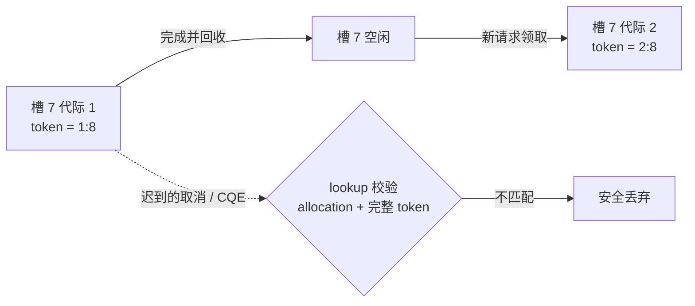

取消、完成、关闭查找一律按**完整 token** 校验，从不只比槽号。代际耗尽（`generation == UINT32_MAX`）的槽**永久退休**：`prepare_locked` 把它从空闲栈弹出、`++retired_slots_`、继续找下一个，绝不回绕。这保证"最旧的迟到事件也不能命中最新的请求"。

#### completion_target：消费者函数表

```cpp
struct completion_target {
  void* consumer{};  // 持有：指向 awaiter，不拥有。
  void (*publish)(void*, std::int64_t, std::uint64_t) noexcept {};
};
```

核心不认识 `coroutine_handle`，也不认识 `scheduler`，只会在锁外调这个函数指针。三个参数分别是消费者地址、结果、已传输字节数。

`consumer` 是**持有**：它指向协程帧内的等待器对象。这个对象的生存期由 gate 协议保证——只有 `gate` 已经进入 `suspended` 状态，发布者才会调度恢复；`arming` 阶段的同步完成由 `await_suspend` 自己消费（见 5.4）。

#### operation_state：稳定槽

域在构造时一次性创建所有槽，此后节点地址永不变动。这是"内核只持有整数 key、不持有指针"的另一半：

| 成员 | 类型 | 所有权 | 说明 |
| --- | --- | --- | --- |
| `request` | `io_request` | **拥有** | 请求移入槽；内核完成前参数与资源租约都留在这里 |
| `target` | `completion_target` | 持有 consumer | 只由用户态统一发布链调用一次 |
| `control_completion` | `move_only_function<void(int)>` | **拥有** | 孤立 close 的 CQE 回调 |
| `token` / `slot` / `generation` | 标量 | — | 身份 |
| `result` / `transferred` | 标量 | — | 结果与字节进度（失败时进度仍有效） |
| `cancellation` | `int` | — | 首次记录的取消原因，后续事件不得覆盖 |
| `counts_active` | `bool` | — | 是否已计入资源活跃借用，回收时成对归还 |
| `allocated` / `accepted` / `terminal` | `bool` | — | 三段生命周期状态 |
| `running_file` | `bool` | — | 阻塞文件调用仍在执行，结束前不能释放借用缓冲 |
| `connecting` | `bool` | — | 连接已进入等待阶段，重试需查询真实 socket 错误 |
| `uses_reader` / `uses_writer` / `observer` | `bool` | — | 本操作占用的执行权种类 |
| `queued_completion` | `bool` | — | 已链接到待发布链，防止重复领取 |
| `native_inflight` / `native_pending` | `bool` | — | 后端已接受 / 因容量留在待提交队列 |
| `native_cancel_requested` | `bool` | — | 取消已发出，避免重复占用控制提交容量 |
| `native_waiting_release` | `bool` | — | 业务已完成但内核尚未解除负载借用 |
| `native_close` | `bool` | — | 本操作承担原生关闭的唯一责任 |
| `next` | `operation_state*` | **持有** | 内嵌完成链后继，发布时无需分配 |
| `completed_previous` | `operation_state*` | **持有** | 双向完成链，允许 O(1) 摘除自己 |
| `observer_next` | `operation_state*` | **持有** | 同一资源的观察者链后继 |

这四个布尔标志（`allocated`/`accepted`/`terminal`/`queued_completion`）构成操作的四段生命周期，是所有竞态判断的锚点：

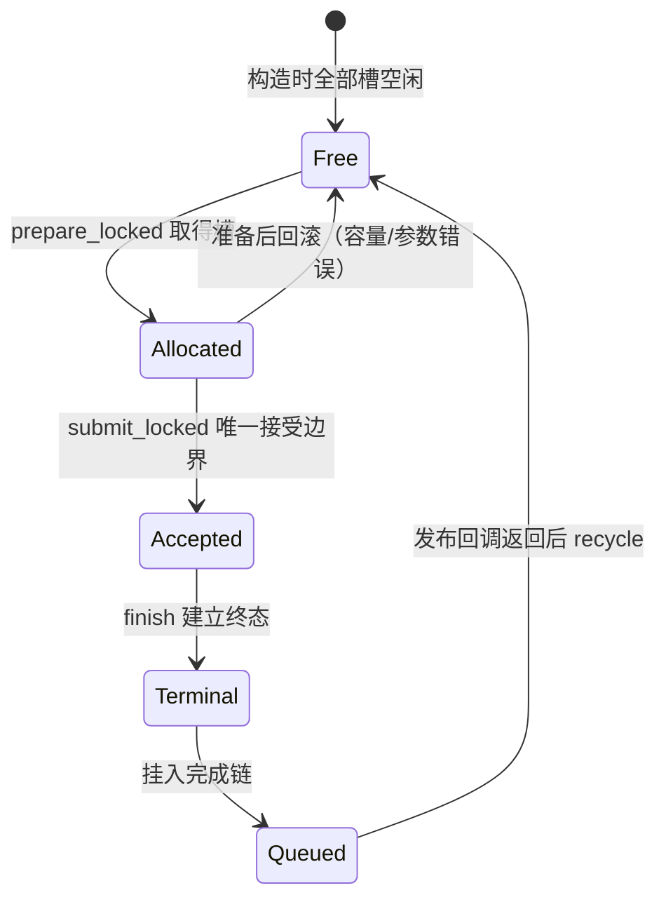

关键不变式：**`accepted == false` 时失败，调用方仍能安全回滚；`accepted == true` 之后任何路径都必须经 `finish` 交付一次结果**。这正是"不存在静默丢弃"的结构保证——`finish` 内部第一件事就是检查 `terminal || running_file || native_inflight`，三者都为假才建立终态，因此重复调用安全且幂等。

`immediate_result` 与 `claimed_completion` 是两个纯数据快照，分别用于"同步完成"和"锁外发布"：

```cpp
struct immediate_result { std::int64_t result{}; std::uint64_t transferred{}; };

struct claimed_completion {                 // 域锁内摘链、锁外发布
  operation_state* operation{};             // 持有：节点仍 allocated 到回调返回
  completion_target target{};               // 值拷贝，不访问已回收的槽
  std::int64_t result{};
  std::uint64_t transferred{};
};
```

`claimed_completion` 把 `target` 按值复制，是刻意的：回调可能恢复协程并**立即销毁 awaiter**，所以发布时不能再回到槽里读 `target`。

### 3.4 资源控制块：resource_state 与 domain_owner

#### domain_owner：一次发布、永不修改

```cpp
class domain_owner {
 public:
  domain_owner& operator=(std::shared_ptr<io_domain> value) noexcept {
    value_ = std::move(value);                          // ① 只在局部首次绑定锁内写一次
    published_.store(true, std::memory_order_release);
    return *this;
  }
  io_domain* get() const noexcept {
    return published_.load(std::memory_order_acquire) ? value_.get() : nullptr;   // ②
  }
  operator std::shared_ptr<io_domain>() const noexcept {
    return published_.load(std::memory_order_acquire) ? value_ : std::shared_ptr<io_domain>{};
  }
 private:
  std::shared_ptr<io_domain> value_;      // 拥有：首次绑定后不可变
  std::atomic<bool> published_{};         // 一次发布标志
};
```

① 为什么需要 `published_` 这个额外的原子布尔？因为**如果直接对 `shared_ptr` 做跨线程读写，就是数据竞争**：`shared_ptr` 的拷贝构造不是原子的，一个线程正在拷贝控制块指针时另一个线程写入，是未定义行为。

② 解法是把"写"限制在 `binding_mutex` 串行区内、只写一次，然后用 release/acquire 发布。读者先看 `published_`，为真才允许读 `value_`；为假时**完全不碰**那个 `shared_ptr`。这使普通热路径的代价降为一次 acquire 读。

首次绑定的并发场景是这样的：两个 worker 同时第一次使用同一个 raw fd，都尝试 `bind`。先拿到 `binding_mutex` 的一方完成发布；后到的一方发现 `owner` 已被别人设置，得到 `EXDEV`。这不是错误——`await_suspend` 把 `EXDEV` 且 `owner` 非空解释为"跟随已发布的稳定归属"（见 5.3）。

#### resource_state：fd 的唯一用户态所有权点

```cpp
struct resource_state {
  domain_owner owner;        // 拥有：首次归属发布后不可变，租约覆盖所有完成与清理
  std::mutex binding_mutex;  // 拥有：仅首次绑定控制面取得，不进普通 IO 热路径
  std::atomic<native_descriptor> handle{-1};   // 拥有：exchange(-1) 是关闭/导出的唯一接管点

#if defined(_WIN32)
  native_handle_kind native_kind{native_handle_kind::windows_socket};
#endif
  std::atomic<std::size_t> wrappers{0};  // 包装对象数量，与操作租约区分
  std::uint64_t id{};                    // 单调资源 token，fd 重用不能命中旧注册事件
  bool owns_handle{}, regular_file{}, registered{}, closing{}, close_pending{}, write_shutdown{};
  bool write_shutdown_issued{};
  std::size_t active{};                  // 活跃操作计数；close 必须等待归零
  int socket_family{};
  std::uint32_t readiness{};             // 粘性就绪提示
  std::uint64_t readiness_generation{};  // 每批事件递增
  void* read_reserved{};                 // 组合读的独占身份
  void* write_reserved{};                // 组合写的独占身份
  operation_state* reader{};             // 持有：当前持有读方向执行权的槽
  operation_state* writer{};             // 持有
  operation_state* observers{};          // 持有：观察者链
  operation_state* close_waiter{};       // 持有
};
```

四个字段必须成组理解：

| 字段组 | 解决的问题 | 违反后果 |
| --- | --- | --- |
| `handle` | 谁唯一接管关闭 | 双重关闭 / 关闭后被复用 |
| `id` | fd 数值复用后的事件归属 | 迟到事件命中新资源 |
| `wrappers` | 什么时候该请求关闭 | 提前关闭 / 永不关闭 |
| `active` | 什么时候真正可以关闭 | 内核仍借用时释放，UAF |

`handle.exchange(-1)` 是**唯一接管点**，这个设计的价值在于：任何读到有效 fd 的代码，都能确定此刻没有并发的 close 或复用。`close_handle` 先 `exchange(-1)` 再撤销注册、再发起关闭，顺序不可换——如果先撤销注册再取 fd，中间窗口里 `close` 可能被另一个线程执行，取到的就是复用后的新句柄。

`id` 与 `fd` 严格分离，是 reactor 路径的正确性基础：epoll 的 `event.data.u64` 存的是 `id` 而不是 fd，因此"关闭 fd 后同一个号码被新 socket 复用"不会让旧事件命中新资源。

#### with_resource：把"在资源保护下执行"变成一处实现

大量辅助操作（`set_nonblocking`、`nonblocking`、`AsyncFdReadyGuard::try_io`）都需要"在取得方向执行权的前提下执行一段代码"，并且失败要返回统一的 `expected`。这段逻辑被提取成一个模板：

```cpp
template <class F>
auto with_resource(const resource_ptr& resource,
                   Interest interest,
                   F&& function,
                   void* reservation = nullptr) -> std::invoke_result_t<F> {
  using result_type = std::invoke_result_t<F>;
  if (!resource)
    return result_type{std::unexpected{make_error(EBADF)}};      // ①
  if (resource->owner)
    return resource->owner->with_resource(                        // ②
        resource, interest, std::forward<F>(function), reservation);
  if (resource->fd() < 0)
    return result_type{std::unexpected{make_error(EBADF)}};       // ③
  return std::invoke(std::forward<F>(function));                  // ④
}
```

① 空资源在进入任何锁之前就被拒绝，避免后续每个分支都要判空。

② 已归属资源交给域：域会在锁内检查方向冲突、设置 `reader`/`writer`、执行函数、再释放。这是唯一能看到 `reader`/`writer` 竞争的地方。

③ 未归属资源（例如尚未 `bind` 的 raw fd）没有执行权竞争可言，只要 fd 有效就直接执行。

④ 返回值类型由 `F` 推导，所以同一个辅助函数既可用于 `expected<void>` 也可用于 `expected<int>`，不需要为每种返回类型各写一份。

### 3.5 方向租约：组合 IO 怎么保持排他

#### 问题

`read_exact` 需要多次 `read` 才能读满。如果每次 `read` 都独立申请执行权、完成后立刻释放，那么两次 `read` 之间就存在窗口：另一个协程可以插入一次 `read`，把数据抢走。结果是两方都读到"一部分"，谁都不完整。

解法是让**组合操作**持有方向租约，跨多次底层 IO 保持排他。

```cpp
class direction_lease {
 public:
  direction_lease(resource_ptr resource, Interest interest, void* owner) noexcept
      : resource_(std::move(resource)), interest_(interest), owner_(owner) {}

  ~direction_lease() {                                          // ①
    if (resource_ && resource_->owner)
      resource_->owner->unreserve(*resource_, interest_, owner_);
  }
 private:
  resource_ptr resource_;  // 拥有：跨挂起固定句柄身份与归属
  Interest interest_;      // 排他方向
  void* owner_;            // 稳定的组合身份，用于核对
};
```

① 析构自动释放，这是 RAII 的核心价值：无论组合操作是正常返回、抛异常还是被取消，只要 `direction_lease` 离开作用域就必然释放方向。若改成显式 `release()` 调用，取消路径漏掉一次就会让该资源永久 `EBUSY`。

#### borrowed_direction_lease：不重复持有资源

在组合协程内部，资源已经由协程帧的按值参数持有。再构造一个 `direction_lease` 会多做一次引用计数，而这次计数其实冗余。为此有借用版本：

```cpp
class borrowed_direction_lease {
 public:
  borrowed_direction_lease(resource_state& resource, Interest interest, void* owner) noexcept
      : resource_(resource), interest_(interest), owner_(owner) {}

  ~borrowed_direction_lease() {
    if (auto* domain = resource_.owner.get())
      domain->unreserve(resource_, interest_, owner_);          // 只释放匹配身份
  }
 private:
  resource_state& resource_;  // 持有：创建处的协程参数保持强拥有租约
  Interest interest_;
  void* owner_;
};
```

析构顺序的正确性依赖一个 C++ 语言事实，源码注释把它写清楚了：**局部守卫先于协程参数销毁**。协程函数体的局部对象在退出函数体时析构，而按值参数属于 promise，要等 `promise` 销毁才析构。因此取消、异常、正常返回三条路径都先释放方向，再归还最后一份资源租约。如果反过来，就会出现"资源被释放时方向仍被占用"的悬垂。

#### reserve_direction：对外取得租约

```cpp
inline expected<direction_lease> reserve_direction(resource_ptr resource,
                                                   Interest interest,
                                                   void* owner) noexcept {
  if (!resource) return std::unexpected{make_error(EBADF)};
  if (!resource->owner) {                       // ① 首次使用：先绑定
    auto context = io_context::current();
    if (!context) return std::unexpected{make_error(ECANCELED)};
    try {
      context.domain()->bind(resource);
    } catch (const std::system_error& error) {
      if (error.code().value() != EXDEV || !resource->owner)
        return std::unexpected{make_error(error.code().value())};
      // 并发首次绑定已被其他 worker 获胜，跟随它发布的不可变 owner。
    } catch (...) { return std::unexpected{make_error(ENOMEM)}; }
  }
  if (auto result = resource->owner->reserve(*resource, interest, owner); !result)
    return std::unexpected{result.error()};     // ② 方向冲突 → EBUSY
  return direction_lease{std::move(resource), interest, owner};
}
```

① 与普通 `co_await` 的归属解析完全一致：未归属资源用当前 context 首次绑定。这种一致性很重要——否则"先 `read_exact` 再 `read`"和"先 `read` 再 `read_exact`"会得到不同的归属结果。

② `reserve` 在域锁内检查冲突：同方向已有 `reader`/`writer`，或 `read_reserved`/`write_reserved` 已被其他身份占用，都返回 `EBUSY`。

#### 两种排他与它们的分工

`resource_state` 里有两组字段，含义不同：

| 字段 | 由谁设置 | 生命周期 | 用途 |
| --- | --- | --- | --- |
| `reader` / `writer` | `submit_locked` 在取得执行权时设置 | 单个操作，`finish` 释放 | 防止两个操作同时读写同一方向 |
| `read_reserved` / `write_reserved` | `establish_reservation` 在同一锁内设置 | 整个组合操作，`unreserve` 释放 | 跨多次底层 IO 保持排他 |

两者的判断在 `submit_locked` 里合并成一次检查：`reader` 非空、或 `read_reserved` 存在且不等于本次 `reservation`，都算冲突。这样"组合中间的某次 read"既不会与自己冲突（身份相同），也不会被别的读插入。

### 3.6 驱动会话与两个 TLS

`core/session.hpp` 定义了两个线程局部指针，它们解决的是两类不同的问题：

```cpp
inline thread_local io_domain* current_domain{};         // ① 业务默认归属
inline thread_local io_domain* current_driver_domain{};  // ② CQ 消费者重入标记

class driver_session_guard {                             // ③
 public:
  explicit driver_session_guard(io_domain* domain) noexcept
      : previous_(std::exchange(current_driver_domain, domain)) {}
  ~driver_session_guard() { current_driver_domain = previous_; }
 private:
  io_domain* previous_;  // 持有：仅用于恢复原值
};
```

① `current_domain` 是"当前协程运行在哪个域上"，供 `io_context::current()` 读取。它只在 `await_suspend` 的归属解析里被读，不作为长期归属依据。

② `current_driver_domain` 表示"当前线程正在消费某个域的 CQ"。它存在的唯一原因是**防止重入**：`drive` 持有一把非递归的 `driver_mutex_`，如果在驱动过程中某个回调又触发 `drive`，同线程 `try_lock` 会失败，返回 `EBUSY`。有了这个标记，重入点就能提前返回，而不是靠锁失败来发现。

③ guard 用 `std::exchange` 保存旧值、析构恢复，因此可以嵌套（虽然实际不会嵌套）。构造函数不检查是否已有 session——源码注释明确写着"已有 session 时调用者应直接跳过新 session"，因为此时 `try_lock` 必然失败。

这个标记还决定了一个优化：低负载即时完成机会（6.8）只在 `current_domain == this && !current_driver_domain` 时尝试。也就是说，只有"业务协程在自己的域上、且当前不在驱动栈里"才走快路径；驱动栈内的提交一律走批量路径。

### 3.7 就绪词汇与两条判定规则

#### Interest 与 Ready

```cpp
enum class Interest : std::uint32_t { none = 0, readable = 1, writable = 2, read_write = 3 };
```

`Interest` 是**请求方**的表达：我要等哪个方向。它有三个合法值（0、1、2、3），非零值才会建立观察。

`Ready` 是**完成方**的表达，带 5 个位：

```cpp
struct Ready {
  std::uint32_t flags{};
  std::uint64_t generation{};
  bool is_readable() const noexcept { return flags & 1; }
  bool is_writable() const noexcept { return flags & 2; }
  bool is_error() const noexcept { return flags & 4; }
  bool is_read_closed() const noexcept { return flags & 8; }
  bool is_write_closed() const noexcept { return flags & 16; }
};
```

`read_closed_bit` 与 `write_closed_bit` 分开，是必须的：TCP 半关闭下，对端关掉写方向只意味着"你读不到更多数据了"，本端仍可以继续写。如果合成一个 `closed` 位，`write_all` 会在收到 EOF 时被错误地判定为不可写。

`generation` 是就绪缓存的条件清除凭证：guard 只能清除**自己观察到的那一代**，之后到达的新事件不会被旧 guard 抹掉（见 8.4）。

#### direction_of：opcode 到方向

```cpp
inline std::uint32_t direction_of(operation_kind kind) noexcept {
  switch (kind) {
    case operation_kind::recv: case operation_kind::recvfrom: case operation_kind::recvmsg:
    case operation_kind::accept: case operation_kind::accept_nowait:
    case operation_kind::read: case operation_kind::readv:
      return 1;
    case operation_kind::send: case operation_kind::sendto: case operation_kind::sendmsg:
    case operation_kind::send_zc: case operation_kind::sendmsg_zc:
    case operation_kind::connect: case operation_kind::write: case operation_kind::writev:
      return 2;
    default:
      return 0;
  }
}
```

返回 1/2/0 而不是位掩码，因为它只描述**单方向**。`connect` 归入写方向是刻意的：连接建立本质上是"可以向对端写"的前置条件，与 `send` 争同一执行权能防止 "connect 未完成就开始 send"。

#### empty_stream_request：空缓冲的语义边界

```cpp
inline bool empty_stream_request(const io_request& request) noexcept {
  if (!request.empty_success) return false;          // ① 必须显式启用
  switch (request.kind) {
    case operation_kind::recv: case operation_kind::send: case operation_kind::send_zc:
    case operation_kind::read: case operation_kind::write:
      return request.length == 0;
    case operation_kind::readv: case operation_kind::writev:
    case operation_kind::sendmsg: case operation_kind::sendmsg_zc:
      return std::all_of(request.vectors.begin(), request.vectors.end(),
                         [](const iovec& v) { return v.iov_len == 0; });
    case operation_kind::recvmsg:
      if (!request.output_message) return false;
      if (static_cast<std::uint64_t>(request.output_message->msg_iovlen) > native_iov_limit)
        return false;                                 // ② 非法长度交回内核拒绝
      for (std::size_t i = 0; i < request.output_message->msg_iovlen; ++i)
        if (!request.output_message->msg_iov || request.output_message->msg_iov[i].iov_len != 0)
          return false;
      return true;
    default:
      return false;                                   // ③ 数据报不套用此规则
  }
}
```

① `empty_success` 必须由**流接口**显式打开。默认关闭，因为零长度 `sendto` 在 UDP 上是合法报文，不能当无操作。

② Darwin 的 `msg_iovlen` 是有符号 `int`，负值转成 `uint64_t` 后会变成巨大值。这里显式比较 `native_iov_limit`，把畸形输入交回内核拒绝，而不是自己去遍历一个不存在的数组。

③ 这个函数只被 `submit_native` 调用（见 6.4），因此"空缓冲立即成功"只发生在原生后端路径上。readiness 后端走 `attempt`，空缓冲区会真实调用一次 `recv` 并立即返回 0。

### 3.8 缓冲类型：借用与拥有的分界

`base/buffer.hpp` 定义了一组缓冲区类型，它们的差别只在"谁拥有内存"：

| 类型 | 所有权 | 有效期契约 | 典型用途 |
| --- | --- | --- | --- |
| `std::span<char>` / `borrowed_buffer` | 借用 | 覆盖等待、取消与排空全过程 | `read` 到调用方栈上数组 |
| `std::span<const char>` / `borrowed_const_buffer` | 借用 | 等待期间不能修改或销毁 | `send` 常量字符串 |
| `io_buffer` | 移动独占 | 移交给操作后调用方不再访问 | 需要跨帧保活的读缓冲 |
| `shared_const_buffer` | 共享不可变 | 引用计数归零前有效 | 一份数据多次发送 |
| `io_transfer` | 拥有 | 返回时把缓冲所有权交回 | 读操作返回新分配的载荷 |
| `read_buf` | 借用适配 | 记录已填充区与剩余可写区 | `BufReader` 内部 |

`io_buffer` 区分 `capacity` 与 `size`，这个区分在异步读里是必需的：

```cpp
class io_buffer {
 public:
  explicit io_buffer(std::size_t capacity = 0)
      : storage_(capacity ? std::make_unique_for_overwrite<char[]>(capacity) : nullptr),
        capacity_(capacity) {}

  static io_buffer copy(std::span<const char> bytes) {   // ①
    io_buffer result(bytes.size());
    if (!bytes.empty()) std::memcpy(result.data(), bytes.data(), bytes.size());
    result.size_ = bytes.size();
    return result;
  }

  [[nodiscard]] char* data() noexcept { return storage_.get(); }
  [[nodiscard]] std::size_t size() const noexcept { return size_; }          // ② 已初始化、可读取
  [[nodiscard]] std::size_t capacity() const noexcept { return capacity_; }  // ③ 可写空间
  [[nodiscard]] std::span<const char> bytes() const noexcept { return {data(), size_}; }

 private:
  std::unique_ptr<char[]> storage_;  // 拥有
  std::size_t capacity_{}, size_{};
};
```

① `make_unique_for_overwrite` 而不是 `make_unique`：读缓冲不需要零初始化，省掉一次 memset。

②③ 读操作写入 `capacity` 范围，但只有前 `n` 字节被内核写过，所以 `size` 必须由调用方（或 `io_transfer`）在完成后设置。若混用，`bytes()` 会暴露未初始化内存。

`io_buffer` 禁止复制、允许移动，语义是"唯一可变访问权"。一旦移交给异步操作，调用方就不能再访问——不是约定，而是对象已经被移空。

### 3.9 数据流小结

把本章类型串起来，一次典型 `co_await recv` 的数据流是：

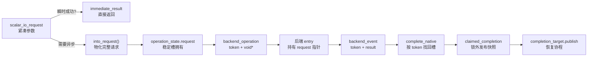

这条链上没有任何一步传递协程地址或 `io_domain` 指针给内核。内核对整个用户态的唯一认知是"一个整数 key"，这是全库最重要的隔离边界。

---
## 4. 统一抽象：一份合同

> **本章依赖**：第 3 章的请求、事件形状与所有权词汇。
>
> **本章只回答三个问题**：一次 IO 在抽象层被拆成哪几个动作；这些动作的输入输出是哪些固定形状的数据；为什么这层能做到"零虚函数、零函数表、零字符串比较"。
>
> **本章不回答**：谁在什么时候调用这些动作（第 5、6 章）；动作内部怎么和内核打交道（第 7、8 章）。

### 4.1 一次 IO 只有三段

抽象层把"一次 IO"压缩成三个必备动作加三个控制动作：

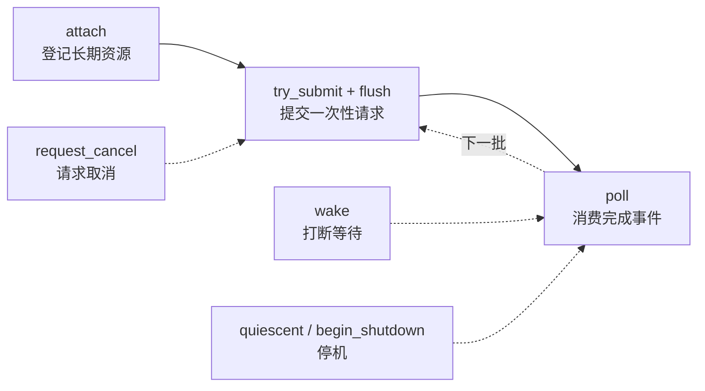

| 动作 | 语义 | 谁调用 |
| --- | --- | --- |
| `attach(handle, key)` | 把长期资源与一个单调 `key` 关联，供后续事件识别 | 域，在资源首次需要就绪观察时 |
| `try_submit(op)` | 尝试接受一个一次性请求，返回**已接受 / 暂满 / 拒绝** | 域，在 `submit_locked` 内 |
| `flush()` | 把已准备但未交给内核的提交推下去 | 域，仅当 `poll_flushes_submissions == false` |
| `poll(out, timeout)` | 在预算内消费一批事件 | 域，在 `drive` 内，且只有一个线程 |
| `request_cancel(op)` | 请求取消某个已接受请求 | 域，在 `request_cancel` / `close` / 停机路径 |
| `wake()` | 从任意线程打断 `poll` 的等待 | 域，在跨线程提交或取消后 |
| `begin_shutdown()` / `begin_failure(e)` | 停止接受新请求 / 声明永久故障 | 域，在停机与故障路径 |
| `quiescent()` | 是否已无未归还的内核引用与完成责任 | 域，在排空等待中 |

注意"三段"里没有 `read`、没有 `recv`、没有 `open`。**抽象层不知道 opcode 语义**，它只知道"有个请求要提交、有个事件要消费"。opcode 的解释权在后端（`opcode_for` 映射）和域（仲裁规则）手里。这是新增后端只需要实现 8 个方法的原因。

#### `try_submit` 的三态是必须的

```cpp
enum class backend_submit_status : std::uint8_t { accepted, would_queue, rejected };

struct backend_submit_result {
  backend_submit_status status{backend_submit_status::rejected};
  int error{};  // 正 errno；仅 rejected 使用。
};
```

三态对应三种完全不同的责任归属：

| 状态 | 内核是否已引用 payload | 域的责任 | 典型原因 |
| --- | --- | --- | --- |
| `accepted` | **是**（或即将） | 必须等到最终 CQE/NOTIF | 正常提交 |
| `would_queue` | **否** | 排入 `native_pending_`，稍后重试 | SQ 满 / 池节点耗尽 |
| `rejected` | **否** | 立即 `finish(-error)` | 不支持的 opcode / 参数非法 |

如果只有 bool，就无法区分"稍后重试"和"永久失败"。`accepted` 的语义尤其重要：**一旦返回 accepted，即使 SQE 还没 `io_uring_submit` 进内核，请求与缓冲租约也不能释放**——因为后端已经占用了 SQ 槽并记录了 key，释放后内核可能写入已释放内存。

### 4.2 四类事件，绝不合并

```cpp
enum class backend_event_kind : std::uint8_t { readiness, result, cancel_ack, buffer_release };

struct backend_event {
  backend_event_kind kind;
  std::uint64_t key;      // readiness 为资源 id，其余为操作 token；零为控制通道
  std::int64_t result;    // 字节数 / 原生结果；失败为负错误码
  std::uint32_t flags;    // 中立就绪位或原生完成通知标记
};
```

| 事件 | 含义 | 是否解除 payload 租约 | 常见误解 |
| --- | --- | --- | --- |
| `readiness` | 某个资源某方向可能就绪 | 不适用（没有 payload） | 以为它是"完成"，直接当字节数用 |
| `result` | 业务请求的真实完成 | **是**（除 MORE 情况） | 以为 ACK 也能解除 |
| `cancel_ack` | 取消命令本身完成 | **否** | 以为取消成功就能恢复协程 |
| `buffer_release` | 零拷贝发送的内核已释放 payload | **是** | 把 NOTIF 的 `res` 当成发送字节数 |

这四类必须分开，原因各不相同：

- **`cancel_ack` 不能解除 payload**：取消只是"请求内核别再做了"，内核可能已经在 DMA 中被中断，也可能正好在完成边界。只有原请求的 `result` 才能证明引用结束。
- **`buffer_release` 不能当业务结果**：`IORING_OP_SEND_ZC` 分两次 CQE——第一次带发送字节数与 `IORING_CQE_F_MORE`，第二次是 `IORING_CQE_F_NOTIF`，其 `res` 无业务含义。
- **`readiness` 不能伪造字节数**：`result` 字段恒为 0，真实字节数由域在 `attempt` 里执行 syscall 得到。

### 4.3 backend_api：显式对象参数而不是虚函数

```cpp
template <class Derived>
class backend_api {
 public:
  backend_submit_result try_submit(this Derived& self, backend_operation op) noexcept {
    return self.object().try_submit(op);          // ①
  }
  bool native(this const auto&) noexcept {
    return Derived::backend_type::native_proactor;  // ②
  }
  int poll(this Derived& self, std::span<backend_event> out, std::optional<int> timeout) noexcept {
    return self.object().poll(out, timeout);
  }
  void wake(this const auto& self) noexcept { self.object().wake(); }   // ③
};
```

① `this Derived& self` 是 C++23 的显式对象参数。它的作用是让基类成员函数**直接拿到派生类的静态类型**，从而调用 `self.object()` 得到具体后端引用。传统 CRTP 的写法是 `static_cast<Derived*>(this)->object()`，需要一次向下强转；显式对象参数把这件事交给语言，没有转换、没有额外模板实例。

② 编译期常量直接读派生类的 `backend_type::native_proactor`，运行时没有任何分支。`types.hpp` 里没有枚举、没有 tag，`native()` 就是一次常量折叠。

③ `this const auto& self` 用于查询和跨线程 `wake`：`const` 不改变"通知状态"这一合同，因此 `wake()` 可以是 const 成员。这是少数几个"逻辑上修改、但语义上是通知"的接口。

`basic_backend_box` 是唯一的拥有者：

```cpp
template <class B>
class basic_backend_box : public backend_api<basic_backend_box<B>> {
 public:
  using backend_type = B;
  explicit basic_backend_box(std::unique_ptr<B> object) noexcept
    requires backend_implementation<B>                    // ①
      : object_(std::move(object)) {}
  basic_backend_box(basic_backend_box&&) noexcept = default;
  basic_backend_box& operator=(basic_backend_box&&) = delete;
 private:
  friend class backend_api<basic_backend_box<B>>;
  B& object() const noexcept { return *object_; }         // ②
  std::unique_ptr<B> object_;                             // 拥有
};
```

① `requires backend_implementation<B>` 在**构造点**检查完整协议。这解决了一个真实的排序问题：`platform/backend.hpp` 需要先声明别名（`using backend_box = basic_backend_box<uring_backend>`），而 `uring_backend` 的完整定义在更靠后的头文件里。把检查放在构造函数而不是类定义上，别名可以先成立，错误在第一次真正构造时才暴露。

② `object()` 是 `const` 成员但返回非 const 引用。这不是疏忽：`const backend_box&` 仍然需要 `wake()` 这类通知操作，而通知会改内部原子与 eventfd。整个 box 的 const 语义是"不能替换所拥有的对象"，不是"对象本身不可变"。

#### 为什么不用虚基类

| 方案 | 调用成本 | 类型信息 | 可内联 | 跨 TU |
| --- | --- | --- | --- | --- |
| 虚基类 + `unique_ptr<Base>` | 一次间接跳转 + 不可预测 | 丢失 | 否 | 是 |
| 手写函数表 | 一次间接调用 | 丢失 | 否 | 是 |
| `std::function` | 可能堆分配 + 间接 | 丢失 | 否 | 是 |
| **CRTP + 显式对象参数** | **零** | **完整保留** | **是** | 纯头文件 |

选择最后一行的直接后果是：`backend_.native()` 编译成常量、`backend_.try_submit(...)` 可以内联进 `submit_locked`、`supports(kind)` 可以被常量折叠掉。对于每个 IO 都要走一遍的路径，这不是微优化。

代价是**后端类型必须在编译期确定**，因此没有运行时切换后端的能力。这个取舍在库的设计里是明确的：`resolve_io_backend` 只验证配置与构建是否匹配，不匹配就抛异常要求重新构建。

### 4.4 编译期能力：三个静态常量

后端用三个 `static constexpr` 声明自己的模型，域据此选择路径：

```cpp
class uring_backend {
 public:
  static constexpr bool native_proactor = true;
  static constexpr bool poll_flushes_submissions = true;
  static constexpr const char* backend_name = "uring";
};

template <class R>
class basic_readiness_adapter {
 public:
  static constexpr bool native_proactor = false;
  static constexpr bool poll_flushes_submissions = true;
  static constexpr const char* backend_name = "readiness";
};
```

| 常量 | 为真时域的行为 | 为假时域的行为 |
| --- | --- | --- |
| `native_proactor` | 请求交给 `submit_native`，绝不做同步 syscall 冒充完成 | 走 `attempt`，先真实 syscall、EAGAIN 才登记 |
| `poll_flushes_submissions` | `poll` 自己先提交，域不再单独 `flush` | 域在 `poll` 前先取域锁 `flush` |
| `backend_name` | 仅用于诊断与能力报告 | 同左 |

`readiness_adapter` 的 `poll_flushes_submissions = true` 需要单独解释：它没有提交队列，因此"flush 是空操作"。把它设为真，域就不会为了执行一个空 `flush` 而去取一次域锁——这在高频 `drive` 下是可观测的开销。

`native()` 的实现在 `backend_api` 里读的是 `Derived::backend_type::native_proactor`，因此它作用于**被包装的具体类型**。对 `basic_backend_box<basic_readiness_adapter<basic_reactor_box<epoll_reactor>>>` 来说，`backend_type` 是 adapter，`native_proactor` 为假，整个链路正确。

### 4.5 readiness_adapter：把"就绪"提升为"完成形状"

Reactor 与 Proactor 的接口形状不同：前者返回 `readiness_event{key, flags}`，后者返回 `backend_event{kind, key, result, flags}`。域只想面对一种形状，因此需要一层适配。

但适配**只改形状，不改语义**：

```cpp
template <class R>
class basic_readiness_adapter {
 public:
  explicit basic_readiness_adapter(R reactor) : reactor_(std::move(reactor)) {}

  int attach(int fd, std::uint64_t key) noexcept { return reactor_.attach(fd, key); }
  void detach(int fd) noexcept { reactor_.detach(fd); }

  backend_submit_result try_submit(backend_operation) noexcept {
    return {backend_submit_status::rejected, EOPNOTSUPP};   // ①
  }
  backend_flush_result flush() noexcept { return {}; }      // ②

  int poll(std::span<backend_event> out, std::optional<int> ms) noexcept {
    auto convert = [](std::uint64_t key, std::uint32_t flags) noexcept {
      return backend_event{backend_event_kind::readiness, key, 0, flags};   // ③
    };
    if constexpr (requires { reactor_.poll_into(out, ms, convert); }) {
      return reactor_.poll_into(out, ms, convert);          // ④
    } else { /* 中间数组 + 逐条转换 */ }
  }

  void request_cancel(std::uint64_t) noexcept {}           // ⑤
  void begin_shutdown() noexcept {}
  bool quiescent() noexcept { return true; }                // ⑥
  bool supports(std::uint32_t) noexcept { return false; }   // ⑦
 private:
  R reactor_;  // 拥有：唯一实际内核就绪队列
};
```

① **明确拒绝原生提交**，而不是"假装接受然后不做"。如果这里返回 accepted，域会认为请求已进入异步管线，再也不会 `attempt`，协程永久挂起。返回 `EOPNOTSUPP` 让域在 `can_native_request` 处就判定为非原生，改走 `attempt`。

② `flush` 是真空操作。readiness 没有 SQ。

③ 转换函数把 `result` 写成 0、`kind` 写成 `readiness`。**绝不**把 flags 塞进 `result` 冒充字节数。

④ `poll_into` 让 reactor 在**解析原生事件的同时**直接写出 `backend_event`，省掉一个 256 元素的中间数组和一次拷贝。这不是所有 reactor 都必须实现的能力，所以用 `requires` 检测，退化路径用中间数组。

⑤ `request_cancel` 空实现：readiness 后端在取消时不需要通知内核，因为执行权在域手里——域记录 sticky 取消原因，下次 `attempt` 看到它就直接 `finish(-ECANCELED)`。

⑥ `quiescent()` 返回 `true`，注释说明得准确：这只表示**后端**没有未归还的内核引用。域的整体排空还要看操作槽、文件服务、清理服务。

⑦ `supports()` 恒为假，防止上层误以为某个 opcode 可走原生路径。

### 4.6 平台别名与工厂：类型在编译期确定

```cpp
namespace faio::io::detail {
#if defined(__linux__) && defined(FAIO_HAS_IO_URING) && FAIO_HAS_IO_URING
using backend_box = basic_backend_box<uring_backend>;
#elif defined(__linux__)
using backend_box = basic_backend_box<basic_readiness_adapter<basic_reactor_box<epoll_reactor>>>;
#elif defined(__APPLE__) || defined(__FreeBSD__)
using backend_box = basic_backend_box<basic_readiness_adapter<basic_reactor_box<kqueue_reactor>>>;
#elif defined(_WIN32)
using backend_box = basic_backend_box<windows::iocp_backend>;
#endif
}
```

四种平台的类型组合可以用一张图概括：

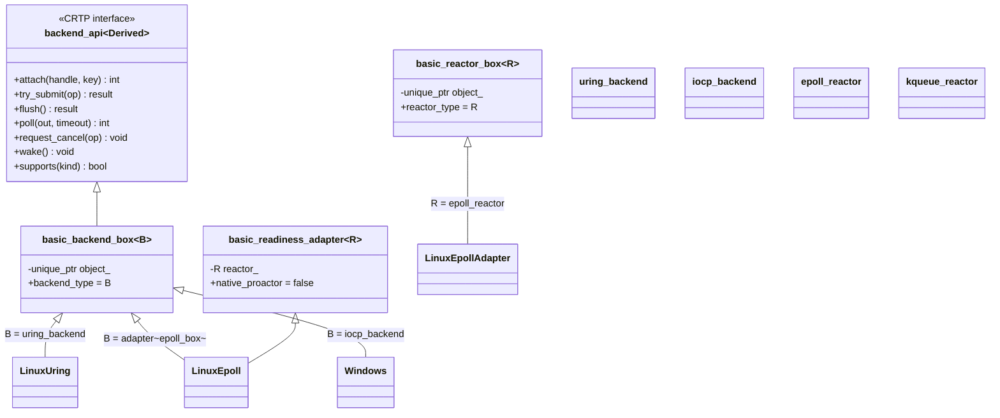

三层包装各自只做一件事：`basic_reactor_box` 拥有 reactor 并暴露 `reactor_api`；`basic_readiness_adapter` 拥有 box 并把就绪形状转成完成形状；`basic_backend_box` 拥有最外层并暴露 `backend_api`。**每层都是值语义 + `unique_ptr`**，所以移动只转交所有权，不会迁移内核队列对象。

工厂只做构造，不做选择：

```cpp
inline backend_box make_platform_backend(
#if defined(__linux__)
    std::optional<runtime::io_backend> requested = {},
#endif
    [[maybe_unused]] unsigned ring_capacity = 256) {
#if defined(__linux__)
  (void)resolve_io_backend(requested);          // 只验证，不切换
#if defined(FAIO_HAS_IO_URING) && FAIO_HAS_IO_URING
  return backend_box{std::make_unique<uring_backend>(ring_capacity)};
#else
  return backend_box{make_epoll_backend()};
#endif
#elif defined(__APPLE__) || defined(__FreeBSD__)
  return backend_box{make_kqueue_backend()};
#elif defined(_WIN32)
  auto backend = windows::make_iocp_backend();
  if (!backend) throw std::system_error(backend.error(), "IOCP 初始化失败");
  return std::move(*backend);
#else
#error "faio has no IO backend for this platform"
#endif
}
```

最后那个 `#error` 是有意的：没有后端的平台在编译期就失败，而不是运行到第一次 `poll` 才崩溃。

### 4.7 合同矩阵

| 方法 | uring | iocp | epoll/kqueue（经 adapter） | 说明 |
| --- | --- | --- | --- | --- |
| `attach` | 空实现 | 关联完成端口 + 缓存 skip 模式 | `epoll_ctl ADD` / `kevent ADD` | 原生后端不需要就绪注册 |
| `detach` | 空实现 | 只删用户态缓存 | `DEL` / `EV_DELETE` | IOCP 的内核关联不可解除 |
| `try_submit` | 写 SQE | 取池节点 + 调原生 API | 恒拒绝 | 见 7.2、7.3、4.5 |
| `flush` | `io_uring_submit` | 空（原 API 已提交） | 空 | 由 `poll_flushes_submissions` 决定是否调用 |
| `poll` | 先 flush 再收割 CQE | 先合成完成再取完成包 | `epoll_wait` / `kevent` | 唯一 CQ 消费者 |
| `request_cancel` | 排入 cancel 队列 | `CancelIoEx` + 移除 ready | 空 | ACK 不解除 payload |
| `wake` | eventfd 写入 | `PostQueuedCompletionStatus` | eventfd / `NOTE_TRIGGER` | 可跨线程 |
| `quiescent` | entries 与 SQ 均空 | `active_ == 0` | 恒真 | 只描述后端 |

---

## 5. 提交端：IORegistrantAwaiter

> **本章依赖**：第 3 章的请求、token、方向租约；第 4 章的 `try_submit` 三态。
>
> **读完之后你应该能回答**：为什么 `await_ready` 恒返回 false；`arming`/`suspended`/`completed` 三态各自阻止了哪个竞态；为什么 `handle_` 和 `scheduler_` 必须在 `prepare_submit` **之前**赋值；取消回调为什么保存 token 而不是槽地址。

### 5.1 职责与成员

[awaiter/request.hpp](../include/faio/detail/io/awaiter/request.hpp) 的 `IORegistrantAwaiter<IO, Request>` 是**全库唯一的协程提交点**。它的模板参数有两个：`IO` 是 CRTP 派生类型（用于 `set_timeout` 等 fluent 接口返回正确类型），`Request` 是请求策略（完整 `io_request` 或紧凑 `scalar_io_request`）。

| 成员 | 类型 | 所有权 | 说明 |
| --- | --- | --- | --- |
| `_user_data` | `user_data{result, transferred}` | — | 统一完成结果槽，发布握手前写入 |
| `request_` | `Request` | **拥有** | 完整请求或紧凑描述 |
| `context_` | `io_context` | **拥有** | 显式/默认归属租约 |
| `cancellable_` | `bool` | — | 是否订阅任务取消 |
| `domain_` | `shared_ptr<io_domain>` | **拥有** | 取消回调的保活租约 |
| `token_` | `operation_token` | — | 槽位 + 代际 |
| `scheduler_` | `scheduler_ref` | **持有** | 恢复目标调度器（类型擦除的借用引用） |
| `handle_` | `coroutine_handle<>` | — | 协程帧句柄 |
| `gate_` | `std::atomic<unsigned char>` | — | 0=arming，1=suspended，2=completed |
| `stop_callback_` | `optional<stop_callback<...>>` | **拥有** | 按需就地保存的取消订阅 |

`domain_` 用 `shared_ptr` 而不是裸指针，原因只有一个：`stop_callback` 可能在**任意时刻、任意线程**被触发，触发时要调 `domain->request_cancel(token)`。如果此时 domain 已析构，就是 UAF。持有强租约保证回调执行期间域一定存活。

`scheduler_` 是 `scheduler_ref`（类型擦除的借用），不是 `shared_ptr`：调度器属于运行时，运行时保证比所有协程活得久，因此借用足够，且避免每次 IO 都增减引用计数。

### 5.2 构造与 `await_ready`

```cpp
explicit IORegistrantAwaiter(Request request,
                             io_context context = {},
                             bool cancellable = true) noexcept
    : request_(std::move(request)), context_(std::move(context)), cancellable_(cancellable) {}

bool await_ready() const noexcept { return false; }
```

构造函数只移动参数。**没有注册、没有 syscall、没有副作用**。这带来一个重要的安全性质：

```cpp
{
  auto awaiter = socket.recv(buffer);   // 构造后从未 co_await
}                                        // 析构：无任何内核引用需要解除
```

如果构造函数里就提交了 IO，这个作用域结束时会留下一个指向已销毁协程帧的内核引用。

`await_ready` 恒返回 `false` 也是同一考虑：C++ 允许 `await_ready` 返回 `true` 时完全跳过挂起，但这意味着副作用必须发生在 `await_ready` 里。对所有 Io 操作来说，"可能立即完成"不等于"不需要走提交协议"——readiness 后端的 `try_immediate` 要取得执行权、要更新就绪缓存；原生后端根本不存在同步路径。因此把判断全部推迟到 `await_suspend`。

### 5.3 `await_suspend` 的四个阶段

完整的 `await_suspend` 源码见下，随后逐段解析。它被拆成四个阶段，顺序不可调换：

```cpp
bool await_suspend(std::coroutine_handle<> handle) noexcept {
  // ── 阶段 A：确定归属 ─────────────────────────────────────────────
  auto* domain = request_.resource ? request_.resource->owner.get() : nullptr;   // A1
  io_context context;
  if (!domain) {
    context = context_ ? context_ : io_context::current();                       // A2
    if (!context) { _user_data.result = -ECANCELED; return false; }
    domain = context.domain().get();
  }
  if (!request_.resource && !request_.bypass_resource_registration && request_.fd >= 0
      && request_.kind != operation_kind::open && request_.kind != operation_kind::open2
      && request_.kind != operation_kind::socket) {
    request_.resource = domain->find_raw_resource(request_.fd, !context_);       // A3
    if (request_.resource) domain = request_.resource->owner.get();
  }
  if (request_.resource && !request_.resource->owner) {
    try { domain->bind(request_.resource); }                                     // A4
    catch (const std::system_error& e) {
      if (e.code().value() != EXDEV || !request_.resource->owner) {
        _user_data.result = -e.code().value(); return false;
      }
      // 另一 worker 已完成首次绑定，跟随该稳定归属。
    } catch (...) { _user_data.result = -ENOMEM; return false; }
  }
  if (request_.resource && request_.resource->owner) domain = request_.resource->owner.get();

  // ── 阶段 B：瞬时尝试 ─────────────────────────────────────────────
  const auto& stop = ::faio::detail::current_stop_token;                          // B1
  if (const auto immediate =
          domain->try_immediate(request_, cancellable_ && stop.stop_requested())) {
    _user_data = {immediate->result, immediate->transferred};
    gate_.store(2, std::memory_order_release);                                    // B2
    return false;
  }

  // ── 阶段 C：进入稳定槽 ───────────────────────────────────────────
  handle_ = handle;                                                               // C1
  scheduler_ = ::faio::detail::current_scheduler();
  domain_ = domain->shared_from_this();                                            // C2
  int error{};
  const auto token = [&] {
    if constexpr (std::same_as<Request, io_request>) {
      return domain->prepare_submit(std::move(request_), {this, &publish}, error, stop, cancellable_);
    } else {
      auto full = std::move(request_).into_request();                              // C3
      const auto prepared =
          domain->prepare_submit(std::move(full), {this, &publish}, error, stop, cancellable_);
      if (!prepared.value) request_.resource = std::move(full.resource);           // C4
      return prepared;
    }
  }();
  if (!token.value) { _user_data.result = -error; return false; }                   // C5
  token_ = token;

  // ── 阶段 D：交接挂起资格 ─────────────────────────────────────────
  if (gate_.load(std::memory_order_acquire) != 2 && cancellable_ && stop.stop_possible())
    stop_callback_.emplace(stop, cancel_callback{domain_, token});                 // D1
  unsigned char arming = 0;
  return gate_.compare_exchange_strong(arming, 1, std::memory_order_acq_rel);      // D2
}
```

#### 阶段 A：归属确定先于一切副作用

**A1** 已绑定资源直接用 `resource->owner`。这是热路径——`File`、`TcpStream` 的每次读写都走这里，代价是一次原子 acquire 读，**不取锁、不加引用计数**。

**A2** 只有未归属资源（raw fd、新建对象）才读 `context_` 或 TLS。注意 `context_ ? context_ : io_context::current()` 的顺序：显式上下文优先，其次才是线程默认。没有可用 domain 时以 `ECANCELED` 完成且**不挂起**——因为没有 domain 就没有任何异步引用，当前帧可以安全继续。

**A3** raw fd 的冷路径查找。三个 opcode 被排除（`open`/`open2`/`socket`），因为它们的"输出是一个新 fd"，不是"使用一个已有 fd"。`find_raw_resource(fd, !context_)` 的第二个参数决定是否跨 shard 查找：显式指定 context 时限定在调用方选择的域，隐式 current 时才允许在同一 runtime 内查找。

**A4** 首次绑定。`bind` 失败时只有一种情况可以继续：`EXDEV` **且** `owner` 已被别人设置。这说明另一个 worker 抢先完成了绑定，此时"跟随已发布的稳定归属"是正确行为，不是错误。

#### 阶段 B：`try_immediate`

**B1** 读 TLS 的 `current_stop_token`。这里用的是 `const auto&` 借用，不复制 `stop_token`（复制会增引用计数）。

**B2** `try_immediate` 返回非空表示**已经完成**。此时：

- 不保存 `handle_`、不保存 `scheduler_`、不建立 `domain_` 租约；
- 不占用稳定槽、不注册取消回调；
- `gate_` 直接置 2，返回 `false` 让当前执行流继续。

这条路径的存在意义是消除"本地就绪 socket 的读也要经过一轮调度"的延迟。对已经可读的 socket，`recv` 在 `await_suspend` 里就完成了，协程根本没有挂起。

#### 阶段 C：先保存恢复目标，再提交

**C1** 赋值顺序是这段代码里最容易被误改的一处。`handle_` 和 `scheduler_` 必须在 `prepare_submit` **之前**初始化，因为 `prepare_submit` 可能在域锁内直接完成请求并调用 `publish`：

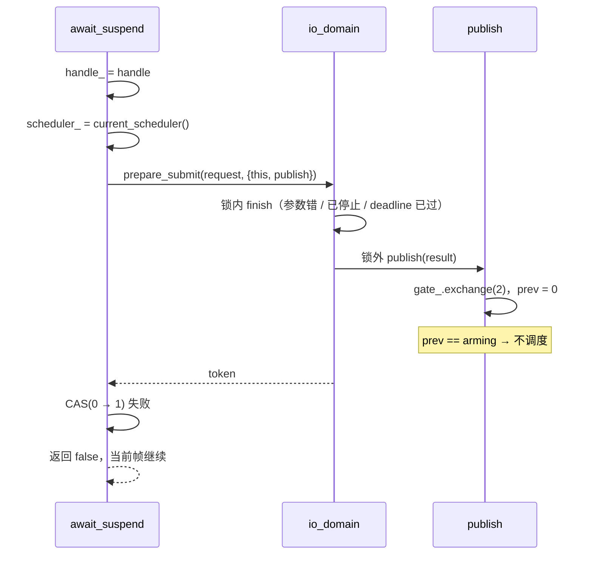

如果 `handle_` 在 `prepare_submit` 之后才赋值，上图中 `publish` 读到的就是未初始化的句柄与调度器。

**C2** `domain_` 同样在此刻建立强租约。为什么不在阶段 A 就建立？因为瞬时成功路径根本不需要它——在那里建立会多一次原子增减，而瞬时成功恰恰是最需要低延迟的路径。

**C3** 紧凑请求在此刻物化为完整请求。`std::move(request_).into_request()` 之后 `request_` 被移空。

**C4** 准备失败时把 `resource` **移回** `request_`。这一步保证命名 awaiter 在失败后仍持有参数，调用方可以重试或检查。

**C5** 零 token 表示未取得稳定槽（容量耗尽 `EAGAIN`）。此时域尚未接管完成责任，因此直接返回 `false`。

#### 阶段 D：原子交接挂起资格

**D1** 注册取消回调前先读一次 `gate_`：如果已经是 2（`prepare_submit` 期间同步完成），就不再订阅停止——订阅了也会立刻注销，纯属浪费一次锁。

**D2** 这是整个握手的**唯一原子点**：

```cpp
unsigned char arming = 0;
return gate_.compare_exchange_strong(arming, 1, std::memory_order_acq_rel);
```

- CAS 成功（0→1）：当前线程获得"挂起"资格，返回 `true`，协程挂起。
- CAS 失败（值已是 2）：结果已到达，返回 `false`，协程**不挂起**，继续执行下一条语句。

CAS 之后**不能再访问任何成员**——因为另一线程可能已经恢复并销毁了协程帧。源码注释把这句写在返回语句上方："CAS 成功后另一线程可立即恢复/销毁帧；之后只返回局部值"。

### 5.4 三态 gate 与唯一发布边界

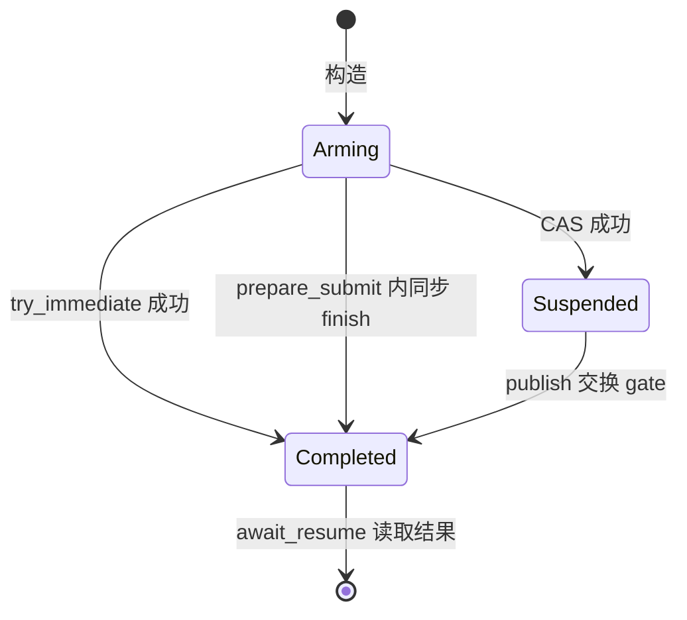

| gate | 含义 | 谁可以恢复协程 | 谁可以销毁帧 |
| --- | --- | --- | --- |
| 0 `arming` | 提交进行中 | 谁都**不**能 | 只有当前线程 |
| 1 `suspended` | 已挂起 | 完成方 | 恢复线程 |
| 2 `completed` | 结果已发布 | 不需要 | 恢复后的帧自身 |

三个状态覆盖了全部时序组合：

| 完成时刻 | gate 转移 | 由谁继续执行 |
| --- | --- | --- |
| `try_immediate` 内 | 0 → 2（直接 store） | `await_suspend` 返回 false |
| `prepare_submit` 内（同步 finish） | 0 → 2（`exchange`） | `await_suspend` 的 CAS 失败 |
| CAS 之后、其他线程 | 1 → 2（`exchange`） | `publish` 调度 |

`publish` 是唯一的完成边界：

```cpp
static void publish(void* consumer, std::int64_t result, std::uint64_t transferred) noexcept {
  auto& awaiter = *static_cast<IORegistrantAwaiter*>(consumer);
  awaiter._user_data = {result, transferred};                        // ①
  const auto previous = awaiter.gate_.exchange(2, std::memory_order_acq_rel);  // ②
  if (previous == 1) {                                               // ③
    auto scheduler = awaiter.scheduler_;                             // ④
    const auto handle = awaiter.handle_;
    try { scheduler.schedule_io(handle); }
    catch (...) { std::terminate(); }                                // ⑤
  }
}
```

① 先写结果、后改 gate，顺序不可换。gate 的 release 语义保证结果写入对其他线程可见。

② `exchange` 的返回值是**转移前**的状态，这决定了接下来要不要调度。

③ 只有 `previous == 1` 才调度。`previous == 0` 说明还在 arming，当前线程会自己继续；`previous == 2` 说明已经有别的发布者完成过（理论上不该发生，但这样处理是幂等的）。

④ `scheduler` 和 `handle` 必须先复制到局部变量。`schedule_io` 之后 awaiter 可能立刻被销毁（协程恢复、执行到 `await_resume`、离开作用域），此时再访问成员就是 UAF。源码注释写得很直接："schedule 后 awaiter 可能立刻销毁，先复制引用"。

⑤ `schedule_io` 抛异常时 `std::terminate()`。这里没有合理的降级——协程已经挂起，无法恢复意味着永久泄漏，终止进程比静默挂死更可诊断。

内存序配对：

| 位置 | 操作 | 作用 |
| --- | --- | --- |
| `publish` | 写 `_user_data`，再 `exchange(2, acq_rel)` | 结果写入先于 gate 变化 |
| `await_suspend` | `compare_exchange(0→1, acq_rel)` | 与 publish 的 exchange 排序 |
| `await_resume` | 在 gate == 2 之后读结果 | 与 release 配对，保证读到完整结果 |

### 5.5 `await_resume`：只读取已发布结果

基类不实现 `await_resume`，由具体 awaiter 按返回类型解码（[awaiter/recv.hpp](../include/faio/detail/io/awaiter/recv.hpp)）：

```cpp
auto await_resume() const noexcept -> expected<std::size_t> {
  if (this->_user_data.result < 0)
#if defined(_WIN32)
    return std::unexpected{windows::make_io_error(
        static_cast<int>(-this->_user_data.result), this->_user_data.transferred)};
#else
    return std::unexpected{Error{static_cast<int>(-this->_user_data.result),
                                 this->_user_data.transferred}};
#endif
  return static_cast<std::size_t>(this->_user_data.result);
}
```

三个约束：

1. **不重试、不提交、不访问后端**。此时内核借用已经排空，任何重试都必须在新的 `co_await` 里做。
2. **负结果在公共边界解码**。内部一律用负 errno 协议（见 7.4），到 `await_resume` 才变成 `Error`。POSIX 直接是 errno 加进度；Windows 还要还原 Win32/Winsock 来源。
3. **`transferred` 在失败时仍然有效**。这是"失败保留进度"的实现点：`read_exact` 读到 500 字节后出错，`Error::progress() == 500`。

### 5.6 fluent 配置：不改请求语义，只填字段

`set_timeout`、`reservation`、`establish_reservation`、`empty_success`、`with_resource`、`with_context` 全部是**返回 `IO&`/`IO&&` 的纯字段赋值**：

```cpp
auto set_timeout(std::chrono::milliseconds duration) && noexcept -> IO {
  return std::move(*this).set_timeout_at(std::chrono::steady_clock::now() + duration);
}

auto establish_reservation(void* owner) && noexcept -> IO {
  request_.reservation = owner;              // 只保存身份
  request_.establish_reservation = true;     // 标记"首个真实 IO 时建立租约"
  return std::move(*this);
}
```

两个细节：

- **返回 `IO` 而不是 `IORegistrantAwaiter`**：`IO` 是 CRTP 派生类型（如 `RecvAwaiter`），这样链式调用后类型不丢，`co_await` 仍能匹配正确的 `await_resume`。
- **`establish_reservation` 本身不建立租约**。它只写标记，真正建立发生在 `submit_locked` 取得执行权的同一把锁内（见 6.4）。如果在这里就 `reserve`，从构造到 `co_await` 之间会有一段"已占方向但没有任何 IO 在执行"的窗口，其他协程会被无理由地 `EBUSY`。

`set_timeout` 保存的是**单调时钟绝对时间**，不是时长。这样无论请求在队列里排多久，超时点都是确定的；如果存时长，每次重试都要重新起算，超时会被无限推后。

### 5.7 awaiter 家族

`awaiter/` 目录有 22 个头文件，但只有三种构造模式：

| 模式 | 代表 | 说明 |
| --- | --- | --- |
| 直接继承基类 | `recv.hpp`、`send.hpp`、`read.hpp`、`write.hpp`、`readv.hpp`、`writev.hpp`、`sendto.hpp`、`recvfrom.hpp`、`sendmsg.hpp`、`recvmsg.hpp` | 只实现 `await_resume` 的返回类型解码 |
| 组合/重试逻辑 | `connect.hpp`（SOCKET + CONNECT + 失败清理）、`accept.hpp`（归属决策）、`open.hpp`、`cmdsock.hpp` | 内部 `co_await` 多个基类等待器 |
| 特殊生命周期 | `native_file.hpp`（`bypass_resource_registration`）、`close.hpp`（不可取消）、`cancel.hpp`、`ready.hpp`、`fsync.hpp`、`shutdown.hpp`、`socket.hpp` | 改写请求标志，仍走同一套握手 |

因此"22 个 awaiter"不需要逐个解析源码——**握手协议只有一份，差异全在请求构造与结果解码**。第 9 章会讲 `native_file_awaiter` 如何通过 `bypass_resource_registration` 复用同一协议但不建立第二个资源拥有者。

---
## 6. 完成端：io_domain

> **本章依赖**：第 3 章的 `operation_state`/`resource_state`/`token`；第 4 章的 `try_submit` 三态、四类事件；第 5 章的 `prepare_submit` 调用点。
>
> **`io_domain` 是整库唯一的状态仲裁者**：唯一分配稳定槽、唯一接受请求、唯一建立终态、唯一发布结果、唯一接管 fd 关闭。它同时是 POSIX（2226 行）与 Windows（2223 行）两份实现，共同部分提取在 `core/`。本章以 POSIX 版本为主，差异集中在 6.10。

### 6.1 职责与成员

`io_domain` 做五件事，别的一概不做：

1. **资源管理**：`adopt`/`borrow`/`bind`/`detach`，维护 fd 生命周期与域归属。
2. **接受仲裁**：在唯一域锁内决定一个请求是执行、等待、排队还是失败。
3. **驱动**：`drive` 消费后端事件，把就绪转成 `attempt`、把完成转成发布。
4. **终态与发布**：`finish` 建立唯一终态，完成链在锁外调用消费者。
5. **停机**：拒绝新请求、按策略取消、等待排空、关闭资源与服务。

它**不**做的事同样重要：不恢复协程（那是 `publish` 的事）、不认识 `TcpStream`/`File`（那是 net/fs 层的事）、不创建线程（服务是构造时注入或创建的独立执行器）。

| 成员 | 类型 | 所有权 | 说明 |
| --- | --- | --- | --- |
| `backend_` | `backend_box` | **拥有** | 唯一后端；`unique_ptr` 在其内 |
| `operations_` | `vector<unique_ptr<operation_state>>` | **拥有** | 稳定槽池，节点地址固定 |
| `free_` | `vector<uint32_t>` | **拥有** | 空闲槽下标栈 |
| `retired_slots_` | `size_t` | — | 代际用尽的槽数，既不算容量也不算在途 |
| `native_pending_` | `deque<operation_token>` | **拥有** | 因 SQ 满留在待提交队列的责任 |
| `native_controls_` | `unordered_map<uint64, unique_ptr<operation_state>>` | **拥有** | 独立控制记录（异步 close、内部请求） |
| `next_control_` | `uint32_t` | — | 控制记录代际，永不与业务 token 冲突 |
| `resources_` | `unordered_map<uint64, weak_ptr<resource_state>>` | **弱引用** | 按资源 id 索引，不拥有 |
| `descriptors_` | `unordered_map<int, weak_ptr<resource_state>>` | **弱引用** | 按 fd 数值索引，只用于复用既有归属 |
| `next_resource_` | `uint64_t` | — | 单调资源 id；**零保留给唤醒通道** |
| `max_resources_` | `const size_t` | — | 资源容量上限 |
| `completed_head_` / `completed_tail_` | `operation_state*` | **持有** | 双向完成链，节点由槽池拥有 |
| `next_deadline_` | `optional<time_point>` | **拥有** | 最早截止时间，用于收紧内核等待 |
| `mutex_` | `recursive_mutex` | **拥有** | 控制面锁；可重入因为释放资源租约可能重入注销 |
| `driver_mutex_` | `mutex` | **拥有** | 唯一 CQ 消费者 |
| `quiescent_cv_` | `condition_variable_any` | **拥有** | 排空等待 |
| `stop_` | `stop_source` | **拥有** | 停机/取消信号源 |
| `stopped_` | `atomic<bool>` | — | 停止标志，跨线程发布 |
| `fatal_error_` | `int` | — | 首次永久故障；内核引用排空前禁止回收 |
| `draining_` | `bool` | — | 是否处于排空阶段 |
| `publishers_` | `atomic<size_t>` | — | 仍在锁外发布的线程数，静止必须等它们退出 |
| `fs_` / `dns_` / `cleanup_` | `shared_ptr<blocking_executor>` | **拥有**（可共享） | 三类隔离服务 |
| `own_fs_` / `own_dns_` / `own_cleanup_` | `bool` | — | 决定析构时是否 `close()` 服务 |
| `placement_` | `shared_ptr<io_placement_group>` | **拥有**（可共享） | 多 shard 弱注册表 |
| `shutdown_cleanups_` | `unordered_map<uint64, move_only_function<void()>>` | **拥有** | 停机清理回调 |
| `deferred_cleanup_` | `deque<shared_ptr<move_only_function<void()>>>` | **拥有** | 服务饱和时保留的清理任务 |

三处设计需要单独说明：

**`mutex_` 是可重入的**。原因在注释里：释放资源租约（`resource_state::~resource_state` → `release_resource`）可能发生在某个已经持有域锁的状态转换内部，此时再次进入 `release_resource` 就会自锁。用 `recursive_mutex` 而不是"绝不在锁内释放资源"，是因为资源释放的触发点是引用计数归零，而引用计数归零的时机由外部决定。

**`resources_`/`descriptors_` 是弱引用**。域不拥有资源——资源由 `FileDescriptor`/`io_request` 持有。如果域强引用，那么一个泄漏的包装对象会让整个域无法析构。弱引用让"资源已销毁"表现为 `lock()` 失败，迟到事件被安全丢弃。

**`publishers_` 独立于 `quiescent_cv_`**。`quiescent()` 的条件不只是"槽都空闲"，还要"没有线程正在锁外发布结果"。否则域可能在某个消费者还在读 `claimed_completion` 时就宣布排空并被销毁。

### 6.2 槽池与 token 编码

```cpp
explicit io_domain(engine_config config)
    : backend_(config.backend_factory ? config.backend_factory()
                                      : make_platform_backend(config.requested_backend,
                                                              config.native_queue_entries)),
      fs_(/* 注入或自建 */), dns_(...), cleanup_(...),
      own_fs_(!config.filesystem_service), own_dns_(!...), own_cleanup_(!...),
      placement_(std::move(config.placement_service)) {
  if (!config.max_operations || !max_resources_ || config.max_operations >= UINT32_MAX)
    throw std::invalid_argument("IO 容量无效或超出稳定token范围");   // ①
  operations_.reserve(config.max_operations);
  free_.reserve(config.max_operations);
  for (std::size_t i = 0; i < config.max_operations; ++i) {
    auto operation = std::make_unique<operation_state>();
    operation->slot = static_cast<std::uint32_t>(i);
    operations_.push_back(std::move(operation));
    free_.push_back(static_cast<std::uint32_t>(i));                  // ②
  }
}
```

① `max_operations >= UINT32_MAX` 被拒绝，因为低 32 位要保留 `UINT32_MAX` 给控制记录，槽号编码是 `slot + 1`。

② 全部槽在构造期创建，热路径不向堆申请。这是"稳定槽"这个名字的来源：地址固定 → 后端可以持有 `io_request*` → 内核可以只回传整数 key。

服务线程的启动策略由后端模型决定：

```cpp
fs_(config.filesystem_service ? config.filesystem_service
                              : std::make_shared<blocking_executor>(
                                    config.filesystem_threads, config.blocking_queue_limit, 1,
                                    backend_.native() ? executor_startup::on_demand
                                                      : executor_startup::preheated))
```

原生后端用 `on_demand`：uring/IOCP 的绝大多数请求不需要辅助线程，只在第一次真实 fallback 时启动，纯原生负载下服务线程数为零。reactor 后端用 `preheated`：普通文件 IO 必然走服务（readiness 对磁盘文件没有意义），构造期预热可以避免首个文件请求的启动延迟。

#### token 的三个字段

```cpp
op.token = {static_cast<std::uint64_t>(op.generation) << 32 | (index + 1)};
```

| 位段 | 内容 | 特殊值 |
| --- | --- | --- |
| 高 32 位 | 代际 `generation` | — |
| 低 32 位 | 槽号 + 1 | `UINT32_MAX` 表示"控制记录" |

控制记录的 token 形如 `(++next_control_ << 32) | UINT32_MAX`。这样 `lookup` 可以只看低 32 位就分流：

```cpp
operation_state* lookup(operation_token token) noexcept {
  const auto index = static_cast<std::uint32_t>(token.value);
  if (index == UINT32_MAX) {                            // ① 控制记录
    const auto found = native_controls_.find(token.value);
    return found == native_controls_.end() ? nullptr : found->second.get();
  }
  if (!index || index > operations_.size()) return nullptr;   // ② 拒绝零与越界
  auto* op = operations_[index - 1].get();
  return op->allocated && op->token == token ? op : nullptr;  // ③ 必须校验完整代际
}
```

① 控制记录不占普通业务槽。这解决了一个真实困境：**所有槽都用满时，close 责任必须仍然能提交**。如果 close 也要抢业务槽，那么在容量耗尽时就无法关闭任何 fd。

② `!index` 拒绝零 token——零值表示"未初始化"，绝不能命中槽 0。

③ `allocated && token ==` 两个条件都要。只比槽号会让迟到的旧代际事件命中新请求；只比 `allocated` 会让同槽的过期 token 通过。

### 6.3 `prepare_submit`：一把锁内完成准备与接受

协程桥只调用一次 `prepare_submit`，而不是 `prepare` + `submit` 两次。原因是两次调用意味着**两次锁往返**，而中间的空档里需要额外的状态标记来防止"已准备但未接受"的请求被误操作。

```cpp
operation_token prepare_submit(io_request&& request,
                               completion_target target,
                               int& error,
                               const std::stop_token& stop = {},
                               bool cancellable = true) noexcept {
  operation_token token;
  bool wake_needed = false;
  bool native_completion_opportunity = false;
  {
    std::lock_guard lock(mutex_);                       // ① 全程唯一域锁
    token = prepare_locked(std::move(request), target, error);
    if (!token.value) return {};                        // ② 无槽：不提交、不保存 consumer

    if (cancellable && stop.stop_requested()) {         // ③ accepted 前观察停止
      auto* operation = lookup(token);
      if (operation && !operation->request.uncancellable && !operation->cancellation)
        operation->cancellation = ECANCELED;
    }

    if (!submit_locked(token, wake_needed, native_completion_opportunity))
      std::terminate();                                 // ④ 刚分配的 token 不可能被拒绝
  }
  finish_submission(token, wake_needed, native_completion_opportunity);  // ⑤ 锁外
  return token;
}
```

① `prepare_locked` 与 `submit_locked` 共享同一把锁，中间不存在"已分配但未接受"的可见窗口。

② 失败时连 consumer 都不保存。这意味着"准备失败"永远不会产生一次虚假完成。

③ 停止检查放在 `prepare` 之后、`submit` 之前。这个位置是唯一的：放在 `prepare` 之前，就无法把取消原因写进刚分配的槽；放在 `submit` 之后，请求可能已经被原生命令接受了。

④ 这里 `std::terminate()` 是合理的。`prepare_locked` 刚返回一个有效 token，紧接着 `lookup` 必然成功且 `accepted == false`，`submit_locked` 不可能返回 false。若真发生，说明槽池被破坏，继续运行只会产生更隐晦的错误。

⑤ 发布与唤醒全部在锁外。这是全库一致的纪律：**回调可能在任意线程恢复协程，绝不能持域锁调用**。

#### `prepare_locked` 的四件事

```cpp
operation_token prepare_locked(io_request&& request, completion_target target, int& error) noexcept {
  operation_state* selected = nullptr;
  while (!free_.empty()) {
    const auto candidate_index = free_.back(); free_.pop_back();
    auto& candidate = *operations_[candidate_index];
    if (candidate.generation == UINT32_MAX) { ++retired_slots_; continue; }   // ① 永久退休
    selected = &candidate; break;
  }
  if (!selected && backend_.native() && (request.kind == operation_kind::close
                                         || request.internal_control)) {
    // ② 控制记录：不占业务槽，容量受资源与操作容量共同约束
  }
  if (!selected) { error = EAGAIN; return {}; }        // ③ 容量耗尽仍可安全回滚

  auto& op = *selected;
  const auto index = op.slot;
  if (index != UINT32_MAX) ++op.generation;            // ④ 控制记录已有不可复用 token
  op.request = std::move(request);                     // ⑤ 直接从调用者移入
  op.target = target;
  if (index != UINT32_MAX)
    op.token = {static_cast<std::uint64_t>(op.generation) << 32 | (index + 1)};
  op.allocated = true; op.accepted = false; op.terminal = false;
  op.running_file = false; op.native_inflight = false; op.native_pending = false;
  op.native_cancel_requested = false; op.native_waiting_release = false; op.native_close = false;
  op.counts_active = false; op.connecting = false;
  op.uses_reader = false; op.uses_writer = false; op.observer = false;
  op.queued_completion = false; op.completed_previous = nullptr;
  op.result = 0; op.transferred = 0; op.cancellation = 0;
  op.next = nullptr; op.observer_next = nullptr;
  return op.token;
}
```

① 代际耗尽的槽**不回到 `free_`**。它们被计数为 `retired_slots_`，既不提供容量也不算在途，因此 `quiescent()` 的判断要写成 `free_.size() + retired_slots_ == operations_.size()`。

② 控制记录只在原生后端需要：异步 close 要用稳定的 `io_request` 保存 fd 直到真实 CQE。容量上限是 `max_resources_ + operations_.size()`，超限时 `std::terminate()`——关闭责任不能因为分配失败而丢失。

③ 容量耗尽返回 `EAGAIN`，此时**尚未设置 `allocated`**，调用方仍可安全回滚。这是"accepted 之前失败可回滚"的具体形态。

④ 每分配一次 `generation` 自增。注意是"分配时自增"而不是"释放时"，这样槽的每一代都有唯一 token，不存在两代共用同一个值。

⑤ 一长串状态重置是必要的。槽是复用的，上一代的 `uses_reader`/`native_inflight` 若残留，本代就会跳过关键路径。源码里对每个字段都写了清空理由，其中 `queued_completion = false` 与 `completed_previous = nullptr` 最关键——它们保证这一代不会因为上一代还挂在完成链上而被误摘。

### 6.4 `submit_locked`：七级仲裁

这是全库最密集的一段状态转换。它在**同一把锁内**按固定顺序回答七个问题，任何一级命中都直接 `finish` 并跳过后续：

```cpp
bool submit_locked(operation_token token, bool& wake_needed,
                   bool& native_completion_opportunity) noexcept {
  auto* op = lookup(token);
  if (!op || op->accepted) return false;         // 旧代际或重复提交：无副作用
  op->accepted = true;                           // ① 唯一接受边界

  if (stopped() && op->request.kind != operation_kind::close && !op->request.uncancellable)
    finish(*op, -ECANCELED);                     // ② 停机
  else if (op->cancellation)
    finish(*op, -op->cancellation);              // ③ sticky 取消
  else if (op->request.validation_error)
    finish(*op, -op->request.validation_error);  // ④ 参数非法
  else if (op->request.kind == operation_kind::ready
           && (op->request.argument <= 0 || op->request.argument > 3))
    finish(*op, -EINVAL);                        // ⑤ Interest 非法
  else if (op->request.kind == operation_kind::recvmsg && !op->request.output_message)
    finish(*op, -EFAULT);
  else if (op->request.kind == operation_kind::recvmsg
           && op->request.output_message->msg_iovlen > native_iov_limit)
    finish(*op, -EINVAL);
  else if (op->request.kind == operation_kind::recvmsg
           && op->request.output_message->msg_iovlen && !op->request.output_message->msg_iov)
    finish(*op, -EFAULT);
  else if (op->request.kind == operation_kind::close && !op->request.resource && op->request.fd < 0)
    finish(*op, -EBADF);                         // ⑥ close 必须有可识别身份
  else {
    // ⑦ 归属、关闭状态、deadline、方向执行权、路由
  }
}
```

① `accepted = true` 是**唯一边界**。此前的失败尚未接受，调用方可以回滚；此后任何路径（包括异常）都必须交付一次结果。注意后面的 `catch (...)` 全部转向 `finish`，不存在"抛出去就没人管"的分支。

② `close` 与 `uncancellable` 被排除在停机检查之外。原因很直接：停机时恰恰需要 close 才能把 fd 关掉；而 `uncancellable` 本身就是"已接管关闭责任"的标记。

③ sticky 取消先于参数校验。因为"用户已经取消"比"参数写错了"更准确——两者都失败时，报告取消更符合因果。

④ 参数错误不取得执行权、不触发 syscall。`validation_error` 由上层（net/fs）在构造请求时写入。

⑤ `ready` 只接受 1/2/3 三个 Interest 值。零和越界都是 `EINVAL`，这防止 `argument` 被误当作 `SIGEV` 或其他语义使用。

⑥ 只有 close 允许"raw fd 无 resource"，但仍要求两者至少一个有效。因为 close 是有副作用的操作，没有可识别的身份就无法保证幂等。

#### 第七级：归属与执行权

```cpp
      auto& req = op->request;
      if (!req.bypass_resource_registration && !req.resource && req.fd >= 0
          && req.kind != operation_kind::open && req.kind != operation_kind::open2)
        req.resource = borrow(req.fd);                        // ⑦-1 首次借用 raw fd
      const auto& r = req.resource;
      if (r && r->owner.get() != this)
        finish(*op, -EXDEV);                                  // ⑦-2 归属不符
      else if (r && req.kind != operation_kind::close && (r->fd() < 0 || r->closing))
        finish(*op, -EBADF);                                  // ⑦-3 已关闭
      else if (req.establish_reservation && !r)
        finish(*op, -EBADF);                                  // ⑦-4 组合租约必须有稳定资源
      else {
        if (r) req.fd = r->fd();                              // ⑦-5 用资源当前 fd
        if (req.deadline && *req.deadline <= now())
          finish(*op, -ETIMEDOUT);                            // ⑦-6 已过期
        else if (req.kind == operation_kind::close && r) {
          r->owns_handle = true;
          begin_close(*r, op);                                // ⑦-7 close 走关闭协商
        } else {
          if (r) {
            const auto direction = direction_of(req.kind);
            if (req.establish_reservation
                && (!req.reservation || (direction != 1 && direction != 2)))
              finish(*op, -EINVAL);                           // ⑦-8 租约身份/方向非法
            else if ((direction & 1 && (r->reader
                       || (r->read_reserved && r->read_reserved != req.reservation)))
                     || (direction & 2 && (r->writer
                       || (r->write_reserved && r->write_reserved != req.reservation))))
              finish(*op, -EBUSY);                            // ⑦-9 方向冲突
            else {
              if (req.establish_reservation) {                // ⑦-10 建立组合租约
                if (direction == 1) r->read_reserved = req.reservation;
                else                r->write_reserved = req.reservation;
                req.establish_reservation = false;            // 只建立一次
              }
              if (direction & 1) { r->reader = op; op->uses_reader = true; }
              if (direction & 2) { r->writer = op; op->uses_writer = true; }
              ++r->active;                                    // ⑦-11 覆盖排队/syscall/取消排空
              op->counts_active = true;
              if (req.kind == operation_kind::ready) {        // ⑦-12 观察者链
                op->observer = true; op->observer_next = r->observers; r->observers = op;
              }
            }
          }
          if (!op->terminal) {
            if (req.deadline) update_deadline(*req.deadline);
            if (can_native_request(req))            submit_native(*op);   // ⑦-13
            else if (unix_operations::is_file_request(req)) submit_file(*op);
            else if (req.observed_would_block && r && r->registered
                     && req.observed_readiness_generation == r->readiness_generation
                     && !(r->readiness & (direction_of(req.kind) | error_bit))) {
              // ⑦-14 同一代际已确认 EAGAIN：直接等待就绪
            } else attempt(*op);
          }
        }
      }
```

**⑦-1** raw fd 的借用发生在锁内。`borrow` 会先把它设为非阻塞再 `adopt(owns=false)`，因此"提交一个从未见过的 fd"会自动完成注册。

**⑦-2** `EXDEV` 表示请求带着一个属于别的域的资源。这不是"自动改投"，而是明确拒绝——资源归属不可迁移。

**⑦-3** `close` 是唯一允许在 `closing` 状态下提交的操作；其他操作在资源已进入关闭流程时统一 `EBADF`。

**⑦-4/⑦-8** 组合租约必须有稳定资源与合法方向。`direction != 1 && direction != 2` 排除 `direction == 0`（如 `fsync`）与 `direction == 3`（不存在的组合值）。

**⑦-9** 方向冲突返回 `EBUSY`，但**同一 `reservation` 身份不冲突**。这是组合 IO 能在多次底层操作之间保持排他的关键：中间那次 `read` 带着同一个 `reservation`，因此可以重入自己的租约。

**⑦-10** 只建立一次。`establish_reservation = false` 之后，后续底层请求走普通 `reader`/`writer` 路径，但 `read_reserved` 仍然存在，所以外人仍被挡在外面。

**⑦-11** `active` 覆盖三个区间：排队、syscall 执行、取消排空。`close` 必须等它归零，这就是"close 不是立即关闭"的机制。

**⑦-12** `ready` 不占 `reader`/`writer`（`direction_of(ready) == 0`），只挂进 `observers` 链。多个观察者可以共存，而读写方向只能各有一个。

**⑦-13** 三条路由互斥：
- `can_native_request` → 原生提交；
- `is_file_request` → 文件服务；
- 其余 → `attempt`（真实 syscall）。

**⑦-14** 是 readiness 后端的关键优化，见 8.4。

#### ⑦-13 之后：`submit_native` 的三条出口

仲裁链只决定"这个请求该走哪条路"，`submit_native` 才决定"后端接受与否，责任归谁"：

```cpp
void submit_native(operation_state& op) noexcept {
  if (empty_stream_request(op.request)) {          // ① 空流请求不需要内核
    finish(op, 0);
    return;
  }
  const auto result = fatal_error_
      ? backend_submit_result{backend_submit_status::rejected, fatal_error_}
      : backend_.try_submit({op.token.value, &op.request});

  if (result.status == backend_submit_status::accepted) {
    op.native_inflight = true;                     // ② 内核（或后端）已接管
    op.native_pending = false;
  } else if (result.status == backend_submit_status::would_queue
             || ((op.request.kind == operation_kind::close || op.request.internal_control)
                 && result.error == ENOMEM)) {
    if (!op.native_pending) {
      op.native_pending = true;
      try { native_pending_.push_back(op.token); } // ③ 只保存完整 token
      catch (...) {
        op.native_pending = false;
        if (op.request.kind == operation_kind::close || op.request.internal_control)
          std::terminate();                        // ④ 关闭责任不能因分配失败丢失
        finish(op, -ENOMEM);
      }
    }
  } else {
    op.native_pending = false;
    if (op.request.kind == operation_kind::close)
      std::terminate();                            // ⑤ 接受前的永久错误不能丢弃关闭
    else
      finish(op, -result.error);
  }
}
```

① 空流请求在**接受前**完成，完全跳过内核。这里必须用 3.7 的 `empty_stream_request` 判定——它会检查 `empty_success` 标志，因此数据报的零长度报文不会被当成空操作。

② `native_inflight` 的语义是"后端已接受，必须等最终 CQE/NOTIF 才能回收"。它与"内核已开始执行"不是同一件事：uring 的 SQE 可能还没 `submit`，但 entry 与 SQ 槽已经被占用。

③ `native_pending_` 保存的是**完整 token**，不是槽指针。槽会在完成后回收，指针会失效；token 包含代际，重新取出时用 `lookup` 校验，迟到的旧责任不会命中新一代。

④⑤ 两处 `std::terminate()` 都针对 close。理由一致：已经由 `exchange(-1)` 从资源里取出的 fd，如果没有可用的提交路径去关闭它，就会永久泄漏——而且这个泄漏发生在"用户已经认为关掉了"之后。宁可终止也不要留下不可诊断的句柄泄漏。

`pump_native_pending` 在每轮 `drive` 开头重试这个队列：

```cpp
const auto limit = std::min<std::size_t>(native_pending_.size(), 256);   // ⑥
for (std::size_t i = 0; i < limit; ++i) {
  const auto token = native_pending_.front();
  native_pending_.pop_front();
  if (auto* op = lookup(token)) submit_native(*op);                      // ⑦
}
```

⑥ 每轮最多 256 次。SQ 持续满载时，无限重试会让 worker 在提交路径上空转，反而拖慢完成收割。

⑦ 重新 `lookup` 而不是保存指针。这条路径与完成、取消并发，槽可能已经终结并回收。

#### 仲裁链的完整决策树

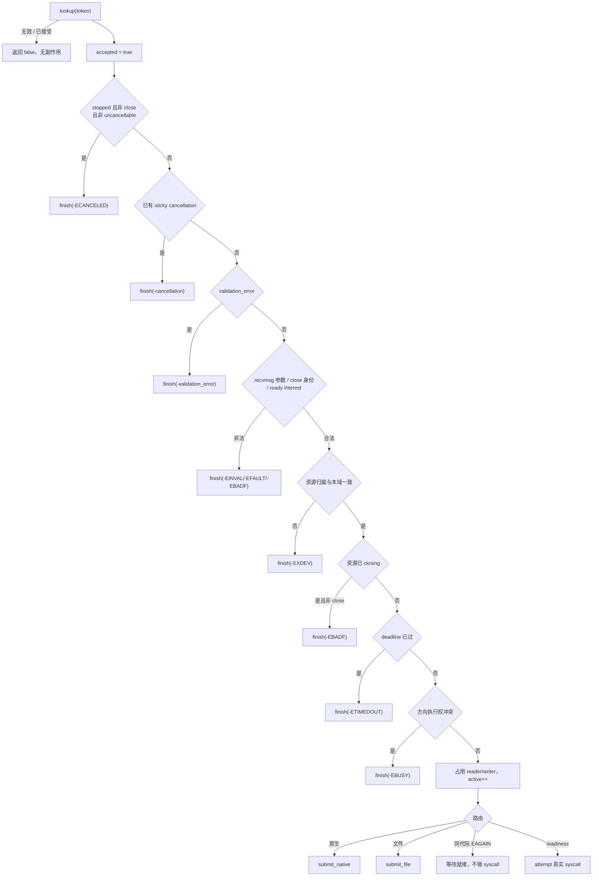

这张图值得记下来的原因是：**七级仲裁全部发生在锁内、全部在 `accepted` 之后**。也就是说，一旦进入这张图，无论走哪条分支，最终都会有一次 `finish`。不存在"落在图外面"的路径。

### 6.5 资源生命周期

四个入口与两个出口：

| 操作 | 语义 | 是否接管关闭 |
| --- | --- | --- |
| `adopt(fd, owns, regular)` | 创建控制块并登记 | 是（`owns=true`） |
| `borrow(fd)` | 外部 fd，先设非阻塞再 adopt | 否（`owns=false`） |
| `bind(resource)` | 为未归属资源发布首次归属 | 不变 |
| `detach(resource)` | 导出 fd，撤销登记 | 交出 |
| `release_resource(resource)` | 引用归零时注销 | 按 `owns_handle` |

```cpp
resource_ptr adopt(int fd, bool owns = true, bool regular = false) {
  std::lock_guard lock(mutex_);
  if (stopped()) throw std::system_error(ECANCELED, std::generic_category(), "IO domain 已停止");
  if (fd < 0) throw std::system_error(EBADF, std::generic_category());
  if (auto it = descriptors_.find(fd); it != descriptors_.end()) {
    if (auto old = it->second.lock()) {
      if (owns && old->owns_handle)
        throw std::system_error(EBUSY, std::generic_category(), "fd 已有拥有者");  // ①
    }
  }
  if (resources_.size() >= max_resources_)
    throw std::system_error(ENFILE, std::generic_category());
  auto r = std::make_shared<resource_state>();
  r->owner = shared_from_this();
  r->id = ++next_resource_;
  if (!r->id) throw std::overflow_error("IO resource token exhausted");           // ②
  r->handle.store(fd, std::memory_order_release);
  r->socket_family = unix_operations::query_socket_family(fd);
  resources_.emplace(r->id, r);
  // ... descriptors_[fd] = r; ...
  r->owns_handle = owns;                                                          // ③ 最后才接管
  return r;
}
```

① 只拒绝"两个拥有者"。两个 `owns=false` 的借用可以共存——这正是 `borrow` 对同一个 fd 重复调用的场景。

② `id` 溢出直接抛异常。资源 id 是后端事件识别的唯一依据，回绕会让迟到事件命中新资源，因此宁可在 2^64 个资源后拒绝服务。

③ `owns_handle` 放在**最后**赋值。前面任何一步失败都不会留下"声称拥有但未完成登记"的控制块。这个顺序是全库一致的纪律：**接管所有权必须是最后一步**。

`bind` 的关键是双锁：

```cpp
void bind(const resource_ptr& resource) {
  std::lock_guard binding_lock(resource->binding_mutex);   // ① 串行首次绑定
  std::lock_guard lock(mutex_);
  if (resource->owner) {
    if (resource->owner.get() != this) throw std::system_error(EXDEV, ...);
    return;                                                // 已被本域绑定：幂等
  }
  if (stopped()) throw std::system_error(ECANCELED, ...);
  // ... 登记两张表 ...
  resource->owner = shared_from_this();                     // ② release 发布
}
```

① `binding_mutex` 是资源自带的锁，只保护首次绑定，不进普通 IO 热路径。两把锁的顺序是**资源锁 → 域锁**，与别处一致。

② 赋值 `owner` 是 release store，配合 `domain_owner::get()` 的 acquire 读。此后 `owner` 不可变。

`release_resource` 是析构路径，必须谨慎：

```cpp
void release_resource(resource_state& resource) noexcept {
  std::lock_guard lock(mutex_);                             // 可重入锁，可能已在锁内
  const auto fd = resource.owns_handle ? resource.handle.exchange(-1, acq_rel) : -1;
  if (resource.registered && fd >= 0) backend_.detach(fd);   // ① 先撤销注册
  resources_.erase(resource.id);
  if (fd >= 0) descriptors_.erase(fd);
  if (resource.owns_handle && fd >= 0) {
    if (defer_native_close(fd)) return;                      // ② 原生 CLOSE 优先
    if (unix_operations::needs_deferred_close(resource, fd))
      defer_cleanup([fd] { (void)unix_operations::close_descriptor(fd); });   // ③ 保留通道
  }
}
```

① 撤销注册必须在关闭之前。否则 epoll 里会留下指向已关闭 fd 的注册，fd 号复用后事件会命中新资源。

② `defer_native_close` 在有原生 CLOSE 能力且槽可用时提交一个真正的 SQE，把关闭也变成异步完成。这避免"关闭时同步阻塞在 close() 上"。

③ 无法异步关闭时走保留清理通道。**注意这里不用普通文件队列**：关闭责任不能被背压丢弃。

### 6.6 `drive`：唯一驱动入口

```cpp
drive_result drive(drive_budget budget = {}, std::optional<int> wait = 0) noexcept {
  if (current_driver_domain) return {0, false, false, EBUSY};        // ① 同线程重入
  std::unique_lock driver_lock(driver_mutex_, std::try_to_lock);
  if (!driver_lock.owns_lock()) return {0, false, false, EBUSY};     // ② 他线程已驱动
  driver_session_guard session{this};

  std::array<backend_event, 256> events;
  {
    std::lock_guard lock(mutex_);
    pump_native_pending();                    // ③ 重试积压的原生提交
    expire_deadlines();                       // ④ 处理已到期请求
    if (completed_head_) wait = 0;            // ⑤ 有本地结果先交付，不阻塞
    if (next_deadline_) {                     // ⑥ 用最近截止时间收紧等待
      const auto remaining = ceil<milliseconds>(*next_deadline_ - now()).count();
      const int ms = clamp<std::int64_t>(remaining, 0, INT_MAX);
      if (!wait || ms < *wait) wait = ms;
    }
  }

  int flush_error{};
  if (!backend_.poll_flushes_submissions()) { // ⑦ 只有不自提交的后端才单独 flush
    std::lock_guard lock(mutex_);
    if (!fatal_error_) flush_error = backend_.flush().error;
  }
  if (flush_error) enter_failure(flush_error);

  const int count = backend_.poll(
      std::span(events).first(std::clamp<std::size_t>(budget.max_events, 1, events.size())),
      wait);
  if (count < 0) { /* 永久故障：先 enter_failure，再给每个 accepted 操作交付失败 */ }
  else {
    std::lock_guard lock(mutex_);
    for (int i = 0; i < count; ++i) {
      const auto event = events[static_cast<std::size_t>(i)];
      if (!event.key) continue;                                  // ⑧ 控制唤醒
      if (event.kind != backend_event_kind::readiness) complete_native(event);  // ⑨
      else { /* ⑩ 就绪：查表、更新代际、重试 reader/writer/observers */ }
    }
    expire_deadlines();
  }
  const auto published = publish_completed(std::max<std::size_t>(budget.max_completions, 1));  // ⑪
  // ... 重查 more_work、通知 quiescent_cv_ ...
}
```

① 同线程重入直接返回 `EBUSY`，不去尝试已经持有的锁。

② 他线程已驱动时 `try_lock` 失败，也返回 `EBUSY`。这里**不等待**：等待会让 worker 阻塞在一个可能很长的 `poll` 上。

③ `pump_native_pending` 每轮最多重试 256 项，避免 SQ 持续满载时在 worker 上忙循环。

④ 先处理过期请求，再算等待时间。顺序很重要：如果先算等待时间再处理过期，可能算出一个基于已过期 deadline 的负值。

⑤ 已有本地完成时把 `wait` 强行改为 0。**先交付用户结果，再进内核等待**，否则用户会为了一次 `poll` 多等一个超时周期。

⑥ 把"最近的 deadline"折进 `wait`。这样 `drive` 即使在没有 IO 事件时也会按时醒来处理超时，不需要额外的定时线程。

⑦ `poll_flushes_submissions` 为真时跳过 `flush`，避免为一次空操作取域锁。

⑧ `key == 0` 是控制唤醒事件（eventfd/`NOTE_TRIGGER`），不匹配任何资源，直接跳过。

⑨ 非 readiness 事件统一交给 `complete_native`。它内部按 `cancel_ack`/`buffer_release`/`result` 再分流。

⑩ readiness 事件的处理见 8.4。

⑪ 完成批量在**锁外**发布。这是 `drive` 中唯一不持域锁的实质工作。

#### 就绪事件的处理

```cpp
auto it = resources_.find(event.key);          // ① key 是资源 id，不是 fd
if (it == resources_.end()) continue;          // 迟到事件：fd 已复用或已 detach
auto resource = it->second.lock();
if (!resource || resource->closing) continue;  // ② 资源已销毁或正在关闭
++resource->readiness_generation;              // ③ 每批递增
resource->readiness |= event.flags;            // ④ 粘性提示
if (resource->reader && event.flags & (readable_bit | error_bit)) attempt(*resource->reader);
if (resource->writer && event.flags & (writable_bit | error_bit)) attempt(*resource->writer);
while (observer) { attempt(*observer); observer = next; }   // ⑤ 观察者逐个重试
```

① 查表用资源 id，不用 fd。这是"fd 复用不会混淆"的实现点。

② `closing` 的资源不再重试任何操作。它上面已接受的操作都已被标记取消，等排空即可。

③ 代际在每批事件递增一次。旧 guard 用自己记录的代际做条件清除，因此不会抹掉本批新事件。

④ `readiness` 是**粘性提示**，只用于唤醒判断，最终字节数/EOF 由真实 syscall 决定。

⑤ 观察者不消费数据，因此可以多个并存，且每个都要重试。

### 6.7 完成链：领取、发布、回收

完成不是"调用回调"，而是三步分离的状态机：

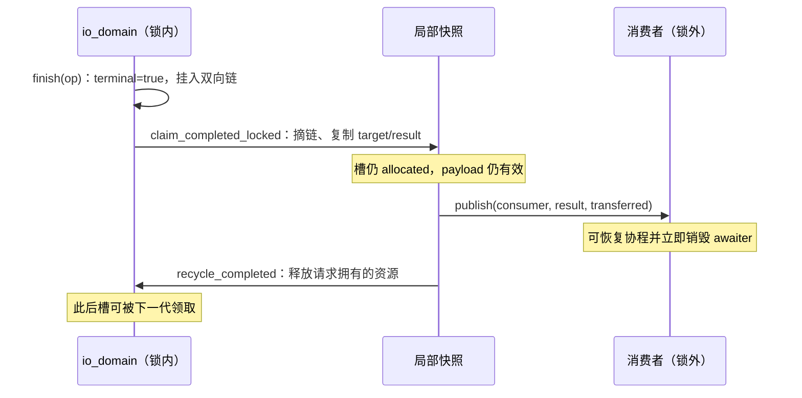

```cpp
claimed_completion claim_completed_locked(operation_token token) noexcept {
  auto* operation = lookup(token);
  if (!operation || !operation->queued_completion) return {};   // ① 已被别的发布者领取
  remove_completed(*operation);                                 // ② 独占摘链
  return {operation, operation->target, operation->result, operation->transferred};  // ③
}
```

① `queued_completion` 是领取标记。多个发布者（driver、`submit` 的快路径、跨域提交）可能同时尝试领取同一个完成，只有第一个成功。

② 摘链但不回收。槽仍处于 `allocated`，因为回调可能还在读 `claimed_completion`。

③ `target` **按值复制**。回调可能立即销毁 awaiter，之后不能再回槽里读。

回收必须等回调返回：

```cpp
void publish_claimed(claimed_completion delivery) noexcept {
  if (delivery.target.publish)
    delivery.target.publish(delivery.target.consumer, delivery.result, delivery.transferred);
  {
    std::lock_guard lock(mutex_);
    recycle_completed(*delivery.operation);   // ① 回调返回后才释放
    if (free_.size() + retired_slots_ == operations_.size())
      quiescent_cv_.notify_all();             // ② 可能唤醒停机等待者
  }
}
```

① `recycle_completed` 做四件事：清空 `counts_active` 之类计数、`request.resource.reset()`（解除资源租约）、`swap` 掉 `vectors`/`path`/`path2` 的容量、把槽推回 `free_`。

注意 `std::vector<iovec>{}.swap(op.request.vectors)` 而不是 `clear()`：`clear()` 保留容量，一个曾经处理 1MB iovec 数组的槽会永久占用那块内存。空容器 swap 才是真正释放。

② 槽全部空闲时通知 `quiescent_cv_`。这让 `shutdown()` 的等待不需要轮询。

批量发布用固定栈批次：

```cpp
std::array<delivery, 64> batch;
while (published < budget) {
  std::size_t count = 0;
  {
    std::lock_guard lock(mutex_);
    const auto limit = std::min(batch.size(), budget - published);
    while (count < limit && completed_head_) {
      auto* operation = completed_head_;
      remove_completed(*operation);
      batch[count++] = {operation, operation->target.consumer,
                        operation->target.publish, operation->result, operation->transferred};
    }
    if (!count) { flush_deferred_cleanup(); break; }
  }
  for (std::size_t i = 0; i < count; ++i)
    if (batch[i].publish) batch[i].publish(batch[i].consumer, batch[i].result, batch[i].transferred);
  published += count;
}
```

这里的关键是**每批 64 个、每批都放锁**。如果一次性摘下全部完成再统一发布，那么一个长时间运行的回调会阻塞所有新的提交；分批让"发布"和"接受"交替进行，保证调度公平。同时 `budget` 限制本轮总量，防止回调不断新增工作导致驱动永远不返回。

### 6.8 低负载即时完成机会

原生后端通常走"提交 → 挂起 → 等下一轮 drive 收割"。这对高并发是对的（批量、摊销 syscall 成本），但对低负载不利：一个单连接 echo 服务每次读写都要等一轮驱动。

`try_complete_local_native` 在提交后**立即**尝试收割一次，条件是负载足够低：

```cpp
claimed_completion try_complete_local_native(operation_token token) noexcept {
  if (current_domain != this || current_driver_domain || !backend_.native()) return {};  // ①
  std::unique_lock driver_lock(driver_mutex_, std::try_to_lock);
  if (!driver_lock.owns_lock()) return {};              // ② 已有消费者：不争抢
  driver_session_guard session{this};                    // ③ 防重入
  claimed_completion delivery;
  {
    std::lock_guard lock(mutex_);                        // 锁序 driver → domain → SQ
    if (!can_complete_local_native(token)) return {};     // ④ 二次校验资格
    std::array<backend_event, 8> events;
    const int count = backend_.poll(events, 0);           // ⑤ 一次 flush + 非阻塞收割
    for (int i = 0; i < count; ++i) complete_native(events[i]);
    delivery = claim_completed_locked(token);             // ⑥ 只摘本 token
  }
  return delivery;
}
```

① 三个条件同时满足才尝试：在本域上、不在驱动栈内、后端是原生。

② 用 `try_lock` 而不是 `lock`。已有消费者在驱动时**不等待**——等待会让提交线程阻塞在一个可能很长的 `poll` 上，比"直接挂起等下一轮"更差。

③ session 在这里的作用不是"防重入到 drive"（已经 `try_lock` 成功），而是标记"当前线程在驱动栈内"，让 `poll` 过程中的回调提交不再触发第二次机会。

④ 资格在两把锁之间可能变化（另一线程取消、远程提交），必须重新校验。

⑤ `poll(events, 0)` 是非阻塞的：后端先 `flush` 把 SQE 推下去，然后立刻看有没有 CQE。最多读 8 条。

⑥ 只领取**本 token**。即使这一批里还有别的完成，也留在原完成链上由所有者 driver 发布。这避免"帮别人发布"导致的跨线程恢复问题。

资格判断本身很保守：

```cpp
bool can_complete_local_native(operation_token token) noexcept {
  const auto allocated = operations_.size() - free_.size() - retired_slots_;
  if (allocated > 8 || resources_.size() > 8 || !native_controls_.empty()
      || !native_pending_.empty() || completed_head_ || fatal_error_ || stopped())
    return false;                                   // ① 七项前置条件
  auto* operation = lookup(token);
  return operation && operation->accepted && operation->native_inflight && !operation->terminal
         && !operation->request.internal_control && operation->target.publish;   // ②
}
```

① 七项都是"便宜的现成计数"：在途槽不超过 8、资源不超过 8、没有控制记录、没有待提交积压、完成链为空、无永久故障、未停止。任一条不成立就放弃快路径，回到批量驱动。用现成容器大小而不是精确统计，是为了不打破正在进行的提交批次。

② 五个条件描述"这个 token 值得单独收割"：已接受、原生在途、未终态、不是内部控制、有业务消费者。最后一条尤其重要：内部 close 与半关闭提交时可能仍在外层域锁内，去取 driver 锁会自锁。

### 6.9 取消、关闭、停机、故障

#### 取消：只记录原因，不解放载荷

```cpp
void request_cancel(operation_token token, cancel_reason reason = cancel_reason::user) noexcept {
  {
    std::lock_guard lock(mutex_);
    if (auto* op = lookup(token); op && !op->terminal && !op->request.uncancellable) {
      if (!op->cancellation) op->cancellation = reason_to_errno(reason);   // ① 首次原因固定
      if (op->accepted) cancel_operation(*op);
    }
  }
  wake();                                                                  // ② 锁外唤醒
}
```

① 只有第一次写入。后续的 deadline 到期、停机取消都不覆盖已记录的原因。"先观察到的停止原因固定"这条规则让错误码可预测：用户取消就是 `ECANCELED`，即使随后 deadline 也到期了。

② `wake()` 在锁外调用。它可能触发一次系统调用，不应持锁。

```cpp
void cancel_operation(operation_state& op) noexcept {
  if (op.native_close || op.request.uncancellable) return;    // ① 关闭责任不可取消
  if (op.native_inflight) {
    if (!op.native_cancel_requested) {
      op.native_cancel_requested = true;
      backend_.request_cancel({op.token.value, &op.request}); // ② 精确 token，不按 fd
    }
  } else if (!op.running_file) {
    op.native_pending = false;
    finish(op, -op.cancellation);                             // ③ 尚无内核引用：直接终态
  }
}
```

① 已接管关闭的操作不能被取消跳过。否则会出现"取消了 close，但 fd 已经 `exchange(-1)` 取出"的泄漏。

② 取消身份用完整 token 加稳定请求指针，**不按数字 fd**。按 fd 取消会命中复用后的资源。

③ 只有确定没有内核引用（未 in-flight、未在文件服务中）才直接建立终态。否则必须等原 CQE。

`running_file` 那个分支尤其重要：文件服务线程可能正在执行一次阻塞 `write`，此刻 `finish` 会让槽被回收，而服务线程仍在往 `request.buffer` 写字。

#### 关闭：三段式协商

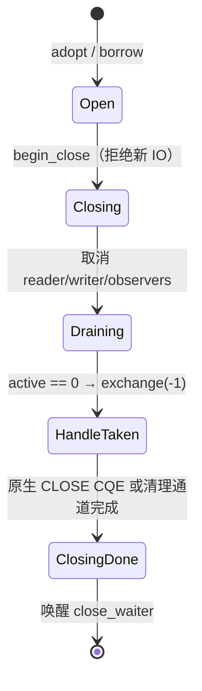

```cpp
void begin_close(resource_state& resource, operation_state* waiter) noexcept {
  if (waiter) {
    waiter->request.uncancellable = true;          // ① close 自己不可被取消
    waiter->observer_next = resource.close_waiter;
    resource.close_waiter = waiter;                // ② 关闭等待者链
  }
  resource.closing = true;                         // ③ 先发布，拒绝后续 IO
  for (auto& entry : operations_)                  // ④ 取消该资源上全部已接受操作
    if (entry->allocated && entry->accepted && !entry->terminal && entry.get() != waiter
        && entry->request.resource.get() == &resource
        && entry->request.kind != operation_kind::close)
      if (!entry->cancellation) entry->cancellation = ECANCELED;
  // ⑤ 取消 reader / writer / observers
  if (!resource.active) close_handle(resource);    // ⑥ 已经空闲：立即推进
}
```

① close 请求本身标记 `uncancellable`。它是"关闭责任"的载体，被取消就等于放弃关闭。

② `close_waiter` 是一条链而不是单个指针，因为多个 `co_await file.close()` 可能并发，它们都观察同一个完成状态。

③ `closing = true` 必须在取消之前。这样新的 `attempt` 不会在取消过程中重新取得执行权。

④ 遍历整个槽池而不是只看 `reader`/`writer`。因为 `fsync`、`statx` 这类无方向操作也可能在该资源上执行。

⑤ 三个链分别处理：`reader`/`writer` 各一个，`observers` 可能多个。

⑥ `active == 0` 时立即关闭，不需要等下一轮。

```cpp
void close_handle(resource_state& resource) noexcept {
  if (resource.close_pending) return;
  const int fd = resource.handle.exchange(-1, std::memory_order_acq_rel);   // ① 唯一接管
  if (fd >= 0) {
    if (resource.registered) backend_.detach(fd);                            // ② 先撤注册
    resource.registered = false;
    descriptors_.erase(fd);
    if (resource.owns_handle) {
      if (supports_native(operation_kind::close)) {                          // ③ 异步 CLOSE
        // 构造 close 请求，或复用已有 close_waiter，等真实 CQE
      } else {
        // ④ 走保留清理通道
      }
    }
  }
}
```

① `exchange(-1)` 是**唯一接管点**。之后的任何代码都不会再拿到这个 fd 值。

② 撤销注册在关闭之前。顺序反了会留下指向已关闭 fd 的就绪注册。

③ 原生后端提交真正的 CLOSE SQE。此后 `resource` 的生命周期由**内核**保证——直到 CQE 到达，fd 不会被复用。这也是为什么关闭也占用一个操作槽。

④ reactor 后端没有原生 CLOSE，只能交给清理通道。清理通道独立于普通文件队列，容量压力更大时也不会丢关闭责任。

#### 停机与永久故障

```cpp
void begin_shutdown(shutdown_policy policy = shutdown_policy::cancel_all) noexcept {
  if (stopped_.exchange(true, std::memory_order_acq_rel)) return;   // ① 幂等
  if (policy == shutdown_policy::cancel_all) stop_.request_stop();  // ② 广播协作取消
  {
    std::lock_guard lock(mutex_);
    backend_.begin_shutdown();
    cleanups.swap(shutdown_cleanups_);                              // ③ 锁内取出回调
    if (policy == shutdown_policy::cancel_all) {
      for (auto& entry : operations_)
        if (entry->allocated && !entry->terminal && !entry->request.uncancellable) {
          if (!entry->cancellation) entry->cancellation = ECANCELED;
          cancel_operation(*entry);
        }
    }
    for (auto it = resources_.begin(); it != resources_.end();) {
      auto weak = (it++)->second;
      if (auto resource = weak.lock();
          resource && (policy == shutdown_policy::cancel_all || !resource->active))
        begin_close(*resource, nullptr);                            // ④ 关闭资源
    }
  }
  for (auto& [token, cleanup] : cleanups) { cleanup(); }            // ⑤ 锁外执行回调
  wake();
}
```

① `stopped_.exchange(true)` 同时完成"检查"和"设置"，重复调用直接返回。

② `stop_.request_stop()` 触发所有 `stop_callback`，包括第 5 章注册的取消回调。这是协作取消的入口。

③ 回调在锁内**移出**、锁外**执行**。回调可能做任意事情（包括再次进入域），持锁执行必然自锁。

④ 两种策略的区别：`cancel_all` 关闭所有资源；`drain` 只关闭已经没有活跃操作的资源，有活跃操作的等它自己完成。

⑤ 注意 `drain` 策略下 `stopped_` 依然为真，因此**新请求仍被拒绝**。`drain` 不是"继续服务"，是"停止接受，等已有的做完"。

永久故障走另一条路：

```cpp
void enter_failure(int error) noexcept {
  {
    std::lock_guard lock(mutex_);
    if (fatal_error_) return;
    fatal_error_ = error;
    if (!backend_.begin_failure(error)) std::terminate();   // ① 无法证明安全排空
    for (auto& entry : operations_)
      if (entry->allocated && entry->accepted && !entry->terminal
          && !entry->request.uncancellable)
        if (!entry->cancellation) entry->cancellation = error;   // ② 记录原因，先不 finish
  }
  begin_shutdown();                                          // ③ 锁外
}
```

① `begin_failure` 返回 false 表示"后端无法证明内核已解除 payload 借用"。此时继续运行会 UAF，因此 `terminate`。这是全库唯一主动终止进程的地方，理由充分：宁可崩溃也不静默越界写。

② 只记录原因，**不立即 finish**。因为原生请求可能 still in-flight，立刻回收槽会让内核写入已释放内存。

③ `begin_shutdown` 在锁外调用，因为它会执行清理回调。

### 6.10 Linux 域与 Windows 域的分叉

两份 `domain.hpp` 共享同一套 prepare/accept/terminal/publish/recycle 协议（这是它们各 2200 行的原因——协议部分几乎逐行对应），差异集中在原生交互：

| 关注点 | POSIX（`platform/unix/domain.hpp`） | Windows（`platform/windows/domain.hpp`） |
| --- | --- | --- |
| fd 类型 | `int` | `intptr_t` + `native_handle_kind` |
| 注册 | `adopt` 只登记，就绪注册延后到 `ensure_registration` | `adopt` **立即关联完成端口** |
| 关联可撤销 | 是（`backend_.detach`） | **否**，只删用户态缓存 |
| 借用准备 | `FIONBIO` / `O_NONBLOCK` | `FIONBIO`（socket）或无需设置（文件） |
| 关闭 | 原生 CLOSE SQE 或清理通道 | `CloseHandle`/`closesocket`，先 `forget_native_handle` |
| 错误编码 | 负 errno | 负值带 Win32/Winsock 来源标签（见 7.4） |
| accept | `accept4` / 原生 ACCEPT | `AcceptEx` + `SO_UPDATE_ACCEPT_CONTEXT` |
| connect | 原生 CONNECT + `EINPROGRESS` 状态机 | `ConnectEx` + `SO_UPDATE_CONNECT_CONTEXT` |
| 文件 | 原生 read/write 或服务 | OVERLAPPED `ReadFile`/`WriteFile` |
| 半关闭 | `shutdown(fd, SHUT_WR)` | `shutdown(SD_SEND)` |
| 迁移 | `detach` + 重新 `adopt` | 同域可保留关联重新导入；跨域 `EXDEV` |

Windows 的 `adopt` 值得单独看，因为它在**注册阶段就与后端耦合**：

```cpp
resource_ptr adopt(native_descriptor fd, bool owns = true, bool regular = false) {
  std::lock_guard lock(mutex_);
  auto r = std::make_shared<resource_state>();
  r->owner = shared_from_this();
  r->id = ++next_resource_;
  r->handle.store(fd, std::memory_order_release);
  r->regular_file = regular;
  r->native_kind = regular ? native_handle_kind::windows_handle
                           : native_handle_kind::windows_socket;   // ①
  if (const int error = backend_.attach({static_cast<std::uintptr_t>(fd), r->native_kind}, r->id);
      error)
    throw std::system_error(-error, std::generic_category(), "IOCP attach");  // ②
  r->registered = true;
  r->socket_family = query_socket_family(fd);
  resources_.emplace(r->id, r);
  descriptors_[fd] = r;
  r->owns_handle = owns;                                            // ③ 最后接管
  return r;
}
```

① 句柄种类在 `adopt` 时就固定。后续所有 `WSARecv`/`ReadFile` 的区分都基于它，不会在请求阶段再猜。

② 关联失败直接抛异常，**不接管**。这保证"adopt 成功"等价于"句柄已经可以被 IOCP 投递"。

③ 与 POSIX 相同：所有权最后才生效。

`forget_native_handle` 是 Windows 特有的收尾动作：

```cpp
// 所有关闭路径先 forget_native_handle 移除域缓存，再 CloseHandle。
```

因为 IOCP 的内核关联**无法解除**，如果句柄数值被复用，新句柄的完成包会带着旧的 `lpCompletionKey`。删除用户态缓存让 `registrations_` 在下次 `attach` 时重建，避免命中旧配置。

---
## 7. 主线一：原生 Proactor

> **本章依赖**：第 4 章的合同（`attach`/`try_submit`/`flush`/`poll`/`request_cancel`）与三态提交结果；第 6 章的 `submit_native`、`complete_native`、`pump_native_pending`。
>
> **叙述顺序按"实现一个后端要先写什么"排列**：先建内核对象（构造），再写注册（`attach`），然后写提交（`try_submit`），再写推进（`flush`/`poll`），最后写取消与释放。这个顺序也是读源码的顺序。

### 7.1 两条主线各自要补哪一段

Proactor 与 Reactor 的差别不在"谁更快"，而在**"完成"由谁产生**：

| 环节 | 原生 Proactor（uring / IOCP） | Reactor（epoll / kqueue） |
| --- | --- | --- |
| 提交 | `try_submit` 把请求写进内核队列 | 无提交，`try_submit` 恒拒绝 |
| 谁执行 syscall | **内核**（异步执行） | **域**（`attempt` 里同步执行） |
| 完成 | 内核回传真实结果 | 内核只回传"可能就绪"，域再执行一次 |
| 缓冲区借用 | 内核持有到 CQE/完成包 | 内核从不持有 payload |
| 取消 | 独立取消命令 + 独立 ACK | 无需通知内核，改状态即可 |
| 唤醒 | eventfd / 控制包 | eventfd / `NOTE_TRIGGER` |

因此两条主线共享**同一份域状态机**，差别全部封在后端内部。这也是为什么 `io_domain` 有两千多行而每个后端各一千行左右——协议是共享的，机制是各自的。

### 7.2 uring_backend（Linux）

#### 7.2.1 整体结构与数据流

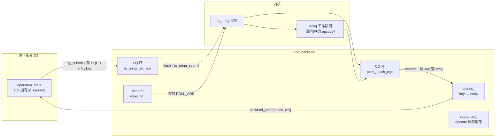

三个关键点：

1. **CQE 只带整数 key**。entry 表把 key 映射回 `io_request*` 与完整 token，内核完全不接触协程地址。
2. **`entries_` 用 `pmr::unordered_map`**，节点地址稳定。`open_how`、`__kernel_timespec` 存在节点内部，rehash 不移动它们。
3. **`io-wq` 是隐式的第三层**。`read`/`write` 在普通文件上无法真正异步，内核会把这类 SQE 交给 io-wq 线程池执行；`IOSQE_ASYNC` 显式要求走这条路径（管道写需要它来规避 SIGPIPE）。

#### 7.2.2 主要成员

| 成员 | 类型 | 所有权 | 说明 |
| --- | --- | --- | --- |
| `ring_` | `io_uring` | **拥有** | 内核 ring，值内嵌；析构 `queue_exit` |
| `entries_` | `pmr::unordered_map<uint64, entry>` | **拥有** | 节点地址稳定，保存 `request*` 与扩展参数 |
| `pending_cancels_` | 队列 | **拥有** | 待提交的 ASYNC_CANCEL 责任 |
| `next_key_` | `uint64_t` | — | 单调递增、永不回绕的完成键 |
| `wake_key_` | `uint64_t` | — | `UINT64_MAX`，保留给控制 POLL_ADD |
| `wake_fd_` | `int` | **拥有** | eventfd 控制通道 |
| `wake_armed_` | `bool` | — | 控制 POLL_ADD 是否已 armed |
| `wake_pending_` | `atomic<bool>` | — | 跨线程唤醒责任合并门 |
| `control_progress_` | `bool` | — | 本轮是否消费了控制完成 |
| `sigpipe_operations_` | 计数 | — | 在途的 SIGPIPE 敏感写 |
| `supported_` | `array<bool, N>` | — | 构造期一次 probe 的 opcode 能力缓存 |
| `socket_commands_` / `accept_nowait_` | `bool` | — | 版本决定的子命令能力 |
| `statistics_` | `backend_statistics` | **拥有** | 提交/完成/ACK/NOTIF/实际 flush 计数 |

`wake_key_` 取 `UINT64_MAX` 是有讲究的：`next_key_` 从 1 开始单调递增，`if (!key || key >= wake_key_) std::terminate();` 保证业务键**永不**等于控制键，也不会回绕到 0（0 表示"未登记"）。

#### 7.2.3 构造：先把可能失败的事做完

```cpp
explicit uring_backend(unsigned capacity = 256, bool use_extended_wait = true) {
  const auto preheated_entries = static_cast<std::size_t>(capacity) * 2 + 2;   // ①
  entries_.reserve(preheated_entries);
  for (std::size_t index = 1; index <= preheated_entries; ++index)
    entries_.try_emplace(index);                                               // ②
  entries_.clear();                                                            // ③

  io_uring_params params{};
  params.flags = IORING_SETUP_CLAMP;                                           // ④
  const int result = ::io_uring_queue_init_params(capacity, &ring_, &params);
  if (result < 0)
    throw std::system_error(-result, std::generic_category(),
        "io_uring_queue_init: 原生后端初始化失败；使用 epoll 请重新构建 FAIO_ENABLE_IO_URING=OFF");
  initialized_ = true;

  extended_wait_ = use_extended_wait && (params.features & IORING_FEAT_EXT_ARG);
  wake_fd_ = ::eventfd(0, EFD_CLOEXEC | EFD_NONBLOCK);                          // ⑤
  if (wake_fd_ < 0) { /* 回收 ring 后抛错 */ }

  auto* probe = ::io_uring_get_probe_ring(&ring_);
  for (unsigned i = 0; i < supported_.size(); ++i)
    supported_[i] = ::io_uring_opcode_supported(probe, static_cast<int>(i));    // ⑥
  ::io_uring_free_probe(probe);

  utsname info{};
  if (::uname(&info) == 0) {
    const auto version = parse_kernel_version(info.release);
    socket_commands_ = version.major > 6 || (version.major == 6 && version.minor >= 7);
    accept_nowait_   = version.major > 6 || (version.major == 6 && version.minor >= 10);  // ⑦
  }
}
```

① 预分配 `capacity * 2 + 2` 个节点：两批 SQ 深度（普通记录 + 取消 ACK），再加两个常见控制槽（TIMEOUT 与其 ACK）。这是**预热**不是上限——真正的在途上限由域的 `max_operations` 约束，峰值超出时 map 会增长。

② 用 `try_emplace` 而不是 `operator[]`，是为了在构造期就分配好 bucket 与节点，让后续真实请求的插入不触发 rehash。

③ 立刻 `clear()` 把节点还回私有池，`next_key_` 不变。预热键从未提交给内核，因此不会被误认为真实记录。

④ `IORING_SETUP_CLAMP` 允许内核把 SQ 容量收缩到它支持的上限，而不是直接失败。

⑤ 所有可能抛分配异常的操作都在 `queue_init` **之前**完成，这样初始化失败时不需要回收尚未存在的内核映射。

⑥ opcode 能力在构造期探测一次。热路径的 `supports()` 只是一次数组索引，不查版本、不调 syscall。

⑦ 有些能力 opcode probe 反映不出来（同一条 `IORING_OP_URING_CMD` 在不同版本上语义不同），因此补一次版本判定。`parse_kernel_version` 失败时 `socket_commands_` 保持 false——选择等价短 syscall，不假装支持。

#### 7.2.4 attach / detach：原生路径不需要注册

```cpp
int attach(int, std::uint64_t) noexcept { return 0; }
void detach(int) noexcept {}
```

这两个空实现不是省略，而是**语义正确**：io_uring 的每个请求自带 fd 参数，不需要像 epoll 那样先把 fd 加入兴趣集。域里的 `ensure_registration` 对原生后端因此是无害的空操作。

```cpp
bool supports(std::uint32_t kind) const noexcept {
  const auto operation = static_cast<operation_kind>(kind);
  if (operation == operation_kind::accept_nowait && !accept_nowait_) return false;   // ①
  if ((operation == operation_kind::getsockopt || operation == operation_kind::setsockopt
       || operation == operation_kind::socket_inq || operation == operation_kind::socket_outq)
      && !socket_commands_)
    return false;                                                                    // ②
  return supported_[static_cast<std::size_t>(opcode_for(operation))];                // ③
}
```

① `accept_nowait` 依赖 `IORING_ACCEPT_MULTISHOT` 之外的 `ACCEPT_DONTWAIT` 语义，6.10 之前不支持。**在接受前**返回 false，让域改走 `attempt`。

② `URING_CMD` 的设备能力不代表 socket 扩展命令可用。6.7 之前这些命令必须在提交前改走短 syscall，否则会在内核里阻塞。

③ 其余按构造期探测结果回答。未知 opcode 的 `opcode_for` 返回 -1，此时需要额外防护（源码里先判 `opcode_for` 是否有效）。

#### 7.2.5 opcode 映射

```cpp
static int opcode_for(operation_kind kind) noexcept {
  switch (kind) {
    case operation_kind::recv: return IORING_OP_RECV;
    case operation_kind::send: return IORING_OP_SEND;
    case operation_kind::recvfrom: case operation_kind::recvmsg: return IORING_OP_RECVMSG;  // ①
    case operation_kind::sendto: case operation_kind::sendmsg: return IORING_OP_SENDMSG;
    case operation_kind::send_zc: return IORING_OP_SEND_ZC;
    case operation_kind::sendmsg_zc: return IORING_OP_SENDMSG_ZC;
    case operation_kind::connect: return IORING_OP_CONNECT;
    case operation_kind::accept: case operation_kind::accept_nowait: return IORING_OP_ACCEPT;
    case operation_kind::read: return IORING_OP_READ;
    case operation_kind::write: return IORING_OP_WRITE;
    case operation_kind::readv: return IORING_OP_READV;
    case operation_kind::writev: return IORING_OP_WRITEV;
    case operation_kind::open: return IORING_OP_OPENAT;
    case operation_kind::open2: return IORING_OP_OPENAT2;
    case operation_kind::fsync: return IORING_OP_FSYNC;
    case operation_kind::close: return IORING_OP_CLOSE;
    case operation_kind::shutdown: return IORING_OP_SHUTDOWN;
    case operation_kind::socket: return IORING_OP_SOCKET;
    case operation_kind::ready: return IORING_OP_POLL_ADD;
    case operation_kind::getsockopt: case operation_kind::setsockopt:
    case operation_kind::socket_inq: case operation_kind::socket_outq: return IORING_OP_URING_CMD;
    case operation_kind::statx: return IORING_OP_STATX;
    case operation_kind::mkdirat: return IORING_OP_MKDIRAT;
    case operation_kind::unlinkat: return IORING_OP_UNLINKAT;
    case operation_kind::renameat: return IORING_OP_RENAMEAT;
    case operation_kind::linkat: return IORING_OP_LINKAT;
    case operation_kind::symlinkat: return IORING_OP_SYMLINKAT;
    case operation_kind::ftruncate: return IORING_OP_FTRUNCATE;
    default: return -1;                                                                  // ②
  }
}
```

① `recvfrom`/`sendto` **没有独立 opcode**，映射到 `RECVMSG`/`SENDMSG`，用一个内嵌的单元素 `iovec`（`scalar_vector`）填充。这是"中立请求"与"内核 opcode"不是一一对应的典型例子。

② 返回 -1 表示"没有内核 opcode"。`supports` 与 `prepare` 都必须先处理这种情况，否则会写出非法 opcode 的 SQE。目录填充（`getdents`）、`chmod`、`readlink` 都属于这一类，因此在提交前就改走文件服务。

#### 7.2.6 try_submit：只准备 SQE，不发生 syscall

```cpp
backend_submit_result try_submit(backend_operation operation) noexcept {
  std::lock_guard lock(mutex_);                                   // ①
  auto& request = *static_cast<io_request*>(operation.request);
  if (!supports(static_cast<std::uint32_t>(request.kind)))
    return {backend_submit_status::rejected, EOPNOTSUPP};
  if (!pending_cancels_.empty())
    issue_cancels();                                              // ②

  auto* sqe = ::io_uring_get_sqe(&ring_);
  if (!sqe)
    return {backend_submit_status::would_queue, 0};               // ③

  const auto key = ++next_key_;
  if (!key || key >= wake_key_) std::terminate();                 // ④
  try {
    auto [it, inserted] = entries_.try_emplace(key);
    auto& entry = it->second;
    entry.token = operation.token;
    entry.request = &request;                                     // ⑤
    entry.sigpipe_sensitive = request.resource && !request.resource->regular_file
                              && (request.kind == operation_kind::write
                                  || request.kind == operation_kind::writev);
    prepare(*sqe, request, entry);                                // ⑥
    request.native_completion_key = key;                          // ⑦
    if (entry.sigpipe_sensitive) sqe->flags |= IOSQE_ASYNC;
  } catch (...) {
    ::io_uring_prep_nop(sqe);                                     // ⑧
    ::io_uring_sqe_set_data64(sqe, 0);
    entries_.erase(key);
    request.native_completion_key = 0;
    return {backend_submit_status::rejected, ENOMEM};
  }
  ::io_uring_sqe_set_data64(sqe, key);                            // ⑨
  ++statistics_.native_submitted;
  return {backend_submit_status::accepted, 0};
}
```

① SQ 写入、entry 表、取消队列共用一把短锁。driver 的 `poll` 会取这把锁，但只在准备阶段，**不在 `io_uring_enter` 等待期间**持有。

② 取消责任**先于**业务请求取得 SQ 容量。否则在持续满载时，取消会被业务请求饿死。

③ 无 SQ 槽时返回 `would_queue`。域把它排入 `native_pending_` 稍后重试，请求本身仍留在稳定槽里，参数地址不变。

④ 键单调且永不回绕。`>= wake_key_` 直接终止：继续分配会与保留值冲突。

⑤ `entry.request` 是 `io_request*`，指向域的稳定槽。**这是"地址稳定"的直接用途**：内核借用期间槽不能回收，entry 可以安全地持有这个指针。

⑥ `prepare` 只写 SQE 字段，**不调用 `io_uring_submit`**。真正的提交发生在 `flush_locked`。因此 `accepted` 的语义是"后端已占用 SQ 槽与 entry"，而非"内核已接管"。

⑦ `native_completion_key` 保存在请求里，让取消无需再查一张表就能找回 key。

⑧ 异常路径用 NOP 占位已保留的 SQ 槽。原因是 `io_uring_get_sqe` 已经把 SQ 尾指针推进了，如果直接返回，这个槽会处于"已分配但未初始化 opcode"的状态，下次提交可能写入内核一个垃圾 opcode。

⑨ `sqe_set_data64` 放在 `prepare` 之后、返回之前。CQE 只携带这个整数。

#### 7.2.7 flush / poll / harvest

```cpp
backend_flush_result flush_locked() noexcept {
  // ... 先 arm 控制 POLL_ADD（若未 armed 且有唤醒需求）...
  if (!::io_uring_sq_ready(&ring_) && !needs_arm) return {};
  const int submitted = ::io_uring_submit(&ring_);       // ①
  if (submitted < 0) return {0, false, -submitted};
  statistics_.native_flushed += static_cast<std::uint64_t>(submitted);
  return {static_cast<std::size_t>(submitted), /*pending=*/::io_uring_sq_ready(&ring_) != 0, 0};
}
```

① `io_uring_submit` 可能只提交一部分（部分 SQE 被内核拒绝进入 overflow），因此返回 `pending` 让域知道"还有责任没交出去"。

```cpp
int poll(std::span<backend_event> output, std::optional<int> timeout) noexcept {
  bool protect_wait;
  int count;
  {
    std::lock_guard lock(mutex_);
    protect_wait = sigpipe_operations_ != 0;                 // ①
    sigpipe_scope signals{protect_wait};

    const bool pending_notice = wake_pending_.load(std::memory_order_seq_cst);
    const bool noticed = pending_notice && wake_pending_.exchange(false, std::memory_order_seq_cst);  // ②

    control_progress_ = false;
    const auto flushed = flush_locked();                     // ③
    if (flushed.error) return -flushed.error;

    count = harvest(output);                                 // ④

    if (count || control_progress_ || noticed || flushed.pending || (timeout && !*timeout))
      return count;                                          // ⑤

    if (timeout && !extended_wait_) {
      // 老内核：先 arm 一个原生 TIMEOUT 再进入无限 GETEVENTS（⑥）
    }
    // ... 进入 io_uring_enter(GETEVENTS) 等待 ...
  }
  // ... 等待返回后再次 harvest ...
}
```

① 有在途的 SIGPIPE 敏感写时，整个等待窗口要屏蔽 SIGPIPE。原因写在 `sigpipe_scope` 的注释里：io-wq 执行管道写时内核仍可能发 SIGPIPE，而默认动作是终止进程。网络 `SEND` 用 `MSG_NOSIGNAL`，不受影响。

② `wake_pending_` 用 `seq_cst` 的 load + exchange 两步，而不是一次 `exchange`。目的是与 `wake()` 的 seq_cst store 形成全序：**入口之后到达的新通知不会被本轮排空撤销**。

③ 先提交再收割。这是 `poll_flushes_submissions = true` 的含义。

④ `harvest` 有界消费现成 CQE。

⑤ 六个条件任一成立就**不进入内核等待**，直接返回给宿主重查任务。这保证"有活干时不睡"，也保证控制通知不会因为内核队列里没有业务事件而被延迟。

⑥ 旧内核没有 `IORING_FEAT_EXT_ARG`，只能用 `IORING_OP_TIMEOUT` 模拟有界等待。这一步必须先把 TIMEOUT SQE 提交下去，然后才能安全进入无限等待，否则等待可能永不返回。

`harvest` 是唯一 CQ 消费者，也是四类事件的分流点：

```cpp
int harvest(std::span<backend_event> output) noexcept {
  std::size_t count = 0;
  std::array<io_uring_cqe*, 256> pending;
  const auto available = ::io_uring_peek_batch_cqe(&ring_, pending.data(),
      static_cast<unsigned>(std::min(output.size(), pending.size())));   // ①

  for (unsigned index = 0; index < available; ++index) {
    auto* cqe = pending[index];
    const auto key = ::io_uring_cqe_get_data64(cqe);

    if (key == wake_key_) {                                              // ②
      wake_armed_ = false;
      control_progress_ = true;
      std::uint64_t ignored;
      while (::read(wake_fd_, &ignored, sizeof(ignored)) > 0) {}         // ③
    }

    const auto found = entries_.find(key);
    if (found != entries_.end() && (found->second.control_timeout
                                    || (found->second.ack && !found->second.token))) {
      control_progress_ = true;
      entries_.erase(found);                                            // ④
    } else if (found != entries_.end()) {
      auto& value = found->second;
      auto kind = value.ack ? backend_event_kind::cancel_ack : backend_event_kind::result;
      if (value.ack) ++statistics_.cancel_ack;
      else if (cqe->flags & IORING_CQE_F_NOTIF) {
        kind = backend_event_kind::buffer_release;                      // ⑤
        ++statistics_.buffer_notifications;
      }
      const bool more = !value.ack && (cqe->flags & IORING_CQE_F_MORE);
      output[count++] = {kind, value.token, cqe->res, more ? 1u : 0u};
      if (!more) {
        if (value.request) value.request->native_completion_key = 0;    // ⑥
        entries_.erase(found);
      }
    }
  }
  ::io_uring_cq_advance(&ring_, available);                             // ⑦
  return static_cast<int>(count);
}
```

① `peek_batch_cqe` 取出指针数组但**不推进 head**。整批解码完成后才 `cq_advance`，保证每条 CQE 对应的 entry 在其生命周期内不会被提前回收。

② 控制唤醒完成：只清 `wake_armed_`、标记本轮有控制进展，**不生成业务事件**。

③ 必须把 eventfd 计数读空。ET 模式下如果只读一次，剩余的计数会让后续 `POLL_ADD` 立即再次触发，形成忙循环。

④ 控制记录（TIMEOUT、取消 ACK 且 token 为零）不产生业务结果。

⑤ NOTIF 是零拷贝发送的"负载已释放"通知，必须单独成类。它的 `res` 不是字节数。

⑥ 非 MORE 时清 `native_completion_key`。这样后续取消不会命中已经消费完的记录。

⑦ 一批一次 head 更新。这比逐条 `cqe_seen` 快得多，也是"批处理"在 CQ 侧的实现。

#### 7.2.8 取消协议

```cpp
void request_cancel(backend_operation operation) noexcept {
  std::lock_guard lock(mutex_);
  auto& request = *static_cast<io_request*>(operation.request);
  const auto key = request.native_completion_key;
  if (!key) return;                                     // ①
  pending_cancels_.push_back({key, operation.token});   // ②
}
```

① `native_completion_key == 0` 表示记录已被消费（业务已完成）。此时取消无意义。

② 取消责任先入队，真正准备 `ASYNC_CANCEL` SQE 在 `try_submit`/`flush` 里做。这样即使 SQ 当前满，取消责任也不会丢。

取消 SQE 携带**独立的 ACK key**，它的 CQE 是 `cancel_ack`：

| CQE | 含义 | 域的处理 |
| --- | --- | --- |
| ACK 的 CQE | 取消命令本身完成 | 什么都不做（`complete_native` 直接 return） |
| 原请求的 CQE | 原请求真实结束 | 建立业务终态 |

这两条 CQE 的**到达顺序不确定**。ACK 可能先到（内核接受了取消），也可能后到（原请求恰好完成）。无论顺序，业务生命周期只由原请求的 CQE 决定。

#### 7.2.9 quiescent 与释放

```cpp
bool quiescent() const noexcept {
  return entries_.empty() && pending_cancels_.empty() && ::io_uring_sq_ready(&ring_) == 0;
}
```

三个条件都必须满足：没有登记中的记录（说明所有 CQE 已消费）、没有待发取消、SQ 里没有未提交的 SQE。少任何一个，`queue_exit` 都可能释放内核仍在使用的映射。

析构因此是"检查后释放"：

```cpp
~uring_backend() {
  if (initialized_) ::io_uring_queue_exit(&ring_);
  if (wake_fd_ >= 0) ::close(wake_fd_);
}
```

域保证先 `drain` 再析构后端，所以这里不再重复检查。

### 7.3 iocp_backend（Windows）

#### 7.3.1 整体结构与数据流

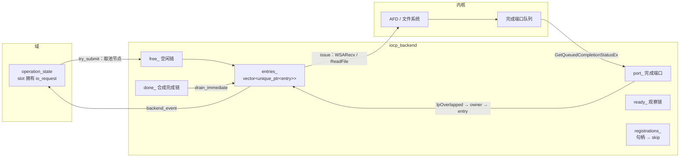

与 uring 的最大结构差异：**内核只保存 `OVERLAPPED*`，不保存任何 key**。因此完成包回来时，需要从 `OVERLAPPED` 地址反推出池节点——这就是"标准布局前缀"存在的原因。

#### 7.3.2 entry 与 OVERLAPPED 前缀

```cpp
struct overlapped_operation_state {
  OVERLAPPED overlapped{};  // 必须是首成员
  void* owner{};            // 纯用户态：回指池节点
};
static_assert(std::is_standard_layout_v<overlapped_operation_state>);
static_assert(offsetof(overlapped_operation_state, overlapped) == 0);
```

内核把 `OVERLAPPED*` 原样回传。因为它必须是首成员，`reinterpret_cast<native_prefix*>(packet.lpOverlapped)` 与 `reinterpret_cast<entry*>(...)` 得到同一个地址，于是：

```cpp
auto* node = static_cast<entry*>(reinterpret_cast<native_prefix*>(packet.lpOverlapped)->owner);
```

`owner` 是**纯用户态字段**，不指向协程帧，也不指向可移动的包装对象。它只指向 `entries_` 里那个 `unique_ptr` 拥有的节点。

`entry` 的其余成员：

| 成员 | 所有权 | 说明 |
| --- | --- | --- |
| `native` | **拥有** | 标准布局前缀，内核借用至最终包消费 |
| `token` | — | 域操作完整代际，防止迟到取消误伤复用槽 |
| `request` | **持有** | 只借用已接受的域请求，完成前域不得释放 |
| `next` / `ready_next` | **持有** | 空闲链 / 就绪链，两个独立链接 |
| `scalar` | **拥有** | 内联 2 个 `WSABUF`，避免单次读写分配 |
| `vectors` | **拥有** | 向量容量随节点复用，只复制描述符 |
| `message` | **拥有** | 稳定 `WSAMSG` |
| `address` / `address_length` | **拥有** | 地址输出存储 |
| `accept_addresses` | **拥有** | AcceptEx 的本地/远端地址缓冲 |
| `accepted` | **拥有** | AcceptEx 产生的临时 socket，交付前失败由池清理 |
| `bytes` / `flags` | — | 原生输出 |
| `immediate` | — | 合成完成的结果 |
| `active` / `synthetic` / `skip` / `cancelled` / `short_io` / `polling` | — | 状态标志 |

`scalar` 用 `std::array<WSABUF, 2>` 而不是直接指向用户缓冲：`WSABUF` 是 Windows 的向量描述符，必须保持到完成包消费。内联 2 个元素覆盖了绝大多数单缓冲读写，不触发分配。

#### 7.3.3 构造：先池后端口

```cpp
explicit iocp_backend(std::size_t capacity = 4096) {
  if (auto network = initialize_winsock(); !network)
    throw std::system_error(network.error().value(), std::system_category(), "WSAStartup");
  entries_.reserve(capacity);
  for (std::size_t i = 0; i < capacity; ++i) {
    auto node = std::make_unique<entry>();
    node->native.owner = node.get();       // ① 内核前缀与真实节点身份固定
    node->next = free_;                    // ② 节点内链表，提交不分配
    free_ = node.get();
    entries_.push_back(std::move(node));   // ③ unique_ptr 转移不移动节点
  }
  port_ = ::CreateIoCompletionPort(INVALID_HANDLE_VALUE, nullptr, 0, 1);  // ④
  if (!port_) throw std::system_error(::GetLastError(), std::system_category(),
                                      "CreateIoCompletionPort");
}
```

① `owner` 在构造时固定。此后节点永远住在 `entries_` 里，`owner` 永远有效。

② 空闲链用节点自带的 `next`，提交路径不需要额外容器或分配。

③ `unique_ptr` 转移的只是指针，节点地址不变。若用 `vector<entry>` 直接存放，扩容时搬移会让内核借用的地址失效。

④ 并发度参数为 1：每个域**一个**完成消费者。不是性能保守，而是与 `driver_mutex_` 的"单消费者"约束一致。

```cpp
~iocp_backend() {
  if (active_) std::terminate();   // 宿主必须先排空，绝不能释放内核仍借用的状态
  if (port_) ::CloseHandle(port_);
}
```

`active_` 是尚未消费的节点数。非零时终止，因为释放意味着内核之后会向已释放内存写完成包。

#### 7.3.4 attach 与"合成完成"

IOCP 的句柄必须**先关联完成端口**才能投递重叠操作，因此 `attach` 不是可选的：

```cpp
int attach_locked(native_registration handle) noexcept {
  // 已缓存且种类一致：直接复用
  // ...
  if (!::CreateIoCompletionPort(native, port_, 0, 0)) {
    DWORD error = ::GetLastError();
    registrations_.erase(it);                  // 失败不缓存
    return -encode_windows_error(error);
  }
  it->second.skip = ::SetFileCompletionNotificationModes(
      native, FILE_SKIP_COMPLETION_PORT_ON_SUCCESS) != FALSE;   // ①
  return 0;
}
```

① `FILE_SKIP_COMPLETION_PORT_ON_SUCCESS` 让"同步成功"的重叠操作**不再投递完成包**。这是一个重要的性能特性：`WSARecv` 常常同步成功，如果不设这个模式，每次都要多一次内核包往返。

但它带来一个协议问题：**同步成功的请求不会再有完成包，谁来交付结果？**

答案是"合成完成"：

```cpp
void complete_immediate(entry& node, std::int64_t result) noexcept {
  node.synthetic = true;                    // ①
  node.immediate = result;
  node.next = nullptr;
  if (done_tail_) done_tail_->next = &node;
  else done_ = &node;                       // ② 挂入内部 done 链
  done_tail_ = &node;
}

std::size_t drain_immediate(std::span<event> output) noexcept {
  std::size_t count{};
  while (done_ && count < output.size()) {
    auto* node = done_;
    done_ = node->next;
    if (!done_) done_tail_ = nullptr;
    output[count++] = {event_kind::result, node->token, finalize(*node, node->immediate), 0};
    --active_;                              // ③
    ++statistics_.native_completed;
    recycle(*node);                         // ④
  }
  return count;
}
```

① `synthetic` 标记"这个节点没有内核包要等"。它在 `poll` 里还有第二个用途：若收到一个 `synthetic` 节点的真实包，说明协议被破坏，直接终止。

② `done_` 是后端内部的链，与域的完成链**完全无关**。域看到的是普通的 `result` 事件。

③ `active_` 在这里递减。合成完成与真实完成在计数上完全一致。

④ `recycle` 与真实完成走同一个出口。

`poll` 的入口顺序因此是"先取合成，再取内核"：

```cpp
int poll(std::span<event> output, std::optional<int> timeout) noexcept {
  if (output.empty()) return 0;
  std::size_t count{};
  bool has_ready{};
  {
    std::lock_guard lock(mutex_);
    scan_ready();                             // ① 非消费观察
    count = drain_immediate(output);          // ② 先交付不用等内核包的结果
    has_ready = ready_ != nullptr;
  }
  if (count) return static_cast<int>(count);  // ③ 已有事件就不进内核等待

  std::array<OVERLAPPED_ENTRY, 256> packets;
  ULONG removed{};
  DWORD wait = timeout ? static_cast<DWORD>(std::max(*timeout, 0)) : INFINITE;
  if (has_ready) wait = std::min<DWORD>(wait, 1);   // ④

  if (!::GetQueuedCompletionStatusEx(port_, packets.data(),
        static_cast<ULONG>(std::min(output.size(), packets.size())), &removed, wait, FALSE)) {
    DWORD error = ::GetLastError();
    if (error != WAIT_TIMEOUT) return -encode_windows_error(error);
  }
  // ... 逐包解码 ...
}
```

① `scan_ready` 用非消费的方式查询就绪观察者（`WSAPoll` 零超时或 PEEK），**不会抢走业务 `recv` 的数据**。

② 合成完成优先。它们本来就不需要等内核。

③ 已有事件就返回，让宿主先处理。

④ `ready` 观察走 `WSAPoll`，而 `WSAPoll` 不会向 IOCP 投递通知。因此有观察者时把等待切成最多 1ms，用轮询代替通知。

#### 7.3.5 try_submit / issue

```cpp
submit_result try_submit(detail::backend_operation operation) noexcept {
  std::lock_guard lock(mutex_);
  auto& r = *static_cast<request_type*>(operation.request);
  if (!supports(static_cast<std::uint32_t>(r.kind))
      && r.kind != kind::send_zc && r.kind != kind::sendmsg_zc)
    return {submit_status::rejected, EOPNOTSUPP};
  if (!free_) return {submit_status::would_queue, 0};          // ①
  if (r.fd < 0) return {submit_status::rejected, EBADF};

  const native_registration handle{static_cast<std::uintptr_t>(r.fd), r.native_kind};
  if (int error = attach_locked(handle); error)
    return {submit_status::rejected, -error};                  // ②

  auto* node = free_;
  free_ = node->next;
  node->next = nullptr;
  node->native.overlapped = {};                                // ③
  node->token = operation.token;
  node->request = &r;
  node->bytes = node->flags = 0;
  node->address = {};
  node->address_length = sizeof(sockaddr_storage);
  node->message = {};
  node->accepted = INVALID_SOCKET;
  node->active = true;
  node->synthetic = node->cancelled = false;
  node->short_io = node->polling = false;
  node->skip = registrations_.at(handle.value).skip;
  r.native_completion_key = reinterpret_cast<std::uintptr_t>(node);   // ④

  if (int error = issue(*node); error) {
    recycle(*node);                                            // ⑤
    r.native_completion_key = 0;
    return {submit_status::rejected, error};
  }
  ++active_;
  return {submit_status::accepted, 0};
}
```

① 池节点耗尽返回 `would_queue`，域稍后重试。这是 IOCP 侧唯一的有界背压来源。

② 每次提交都尝试 `attach_locked`，但已缓存的句柄直接命中，不重复关联。

③ 必须清空 `OVERLAPPED`。上一代的 `Internal`/`Offset` 残留会让内核行为异常（尤其是文件读写偏移）。

④ 把节点地址存进请求，让取消能 O(1) 找回原 `OVERLAPPED`。这是与 uring 的 `native_completion_key` 对应的设计，但语义不同：uring 存的是**整数键**，IOCP 存的是**节点地址**。

⑤ 同步失败没有内核借用，节点立即回收。若 `issue` 内部创建了临时 accept socket，`recycle` 负责关闭它。

`issue` 按 opcode 分派到原生 API：

| opcode | 原生调用 | 备注 |
| --- | --- | --- |
| `recv`/`recvfrom`/`recvmsg` | `WSARecv`/`WSARecvFrom` | `MSG_PEEK` 走短非阻塞调用 |
| `send`/`sendto`/`sendmsg` | `WSASend`/`WSASendTo` | `send_zc` 降级为普通发送 |
| `connect` | `ConnectEx` | 完成后需 `SO_UPDATE_CONNECT_CONTEXT` |
| `accept`/`accept_nowait` | `AcceptEx` | 完成后需 `SO_UPDATE_ACCEPT_CONTEXT` |
| `read`/`write`/`readv`/`writev` | `ReadFile`/`WriteFile` | 偏移显式，append 用全一偏移 |
| `ready` | `WSAPoll`（非消费） | 不投递重叠操作 |
| `fsync` | `FlushFileBuffers` | 无重叠参数，同步完成走合成 |
| `close` | `CloseHandle`/`closesocket` | 不产生完成包 |

注意最后一行：close 不产生完成包，因此它在 IOCP 侧总是"合成完成"或者由域直接 `finish`。

#### 7.3.6 poll 的逐包解码

```cpp
for (ULONG i = 0; i < removed; ++i) {
  auto& packet = packets[i];
  if (!packet.lpOverlapped) {
    wake_pending_.store(false, std::memory_order_release);   // ① 控制包
    continue;
  }
  auto* node = static_cast<entry*>(reinterpret_cast<native_prefix*>(packet.lpOverlapped)->owner);
  if (!node->active || node->synthetic) std::terminate();    // ② 协议破坏
  output[count++] = {event_kind::result, node->token, decode(*node, packet), 0};
  --active_;
  ++statistics_.native_completed;
  recycle(*node);                                            // ③
}
```

① `lpOverlapped == nullptr` 是 `PostQueuedCompletionStatus` 投递的唤醒包。它只清合并门，不产生事件。

② 同一个节点收到两次真实包，或收到合成节点的包，都意味着"内核借用协议被破坏"。此时无法确定哪个完成是真的，继续运行会产生重复交付。

③ `recycle` 在解码之后立即执行：`decode` 已经把结果读进局部值，节点可以回到空闲链。但注意**用户的缓冲区不受影响**——`recycle` 只归还节点，不释放 `request.buffer`。

`decode` 是错误还原的关键：

```cpp
std::int64_t decode(entry& node, const OVERLAPPED_ENTRY& packet) noexcept {
  // socket：WSAGetOverlappedResult(handle, &node.native.overlapped, &bytes, FALSE, &flags)
  // file：  GetOverlappedResult(handle, &node.native.overlapped, &bytes, FALSE)
  // ... 还原为负错误码 ...
}
```

两条路径都必须用对应的 API，**绝不能读线程残留的 `GetLastError()`**：`GetQueuedCompletionStatusEx` 返回成功只表示"取到了包"，单个包的失败信息在 `OVERLAPPED::Internal` 里。

#### 7.3.7 取消仲裁

```cpp
void request_cancel(detail::backend_operation operation) noexcept {
  std::lock_guard lock(mutex_);
  auto& r = *static_cast<request_type*>(operation.request);
  auto* node = reinterpret_cast<entry*>(static_cast<std::uintptr_t>(r.native_completion_key));
  if (!node || !node->active || node->token != operation.token || node->cancelled) return;  // ①
  node->cancelled = true;
  if ((r.kind == kind::ready || node->polling) && !node->synthetic) {
    remove_ready(*node);                       // ② readiness 没有内核 OVERLAPPED
    complete_immediate(*node, -ECANCELED);
  } else if (!node->synthetic) {
    (void)::CancelIoEx(reinterpret_cast<HANDLE>(r.fd), &node->native.overlapped);   // ③
  }
  wake();
}
```

① 三重校验：节点存在、仍然 active、token 完整匹配。`cancelled` 防止重复提交取消。

② `ready` 观察没有内核重叠操作，因此取消必须自己合成一次完成。这也说明"取消"在不同 opcode 上机制不同。

③ `CancelIoEx` 的返回值被**有意忽略**。`ERROR_NOT_FOUND` 表示"该 OVERLAPPED 已经完成或不存在"，此时结果可能已经排队——不能因此提前完成或回收节点。这与 uring 的 ACK 语义一致：**取消请求的成败不等于原操作已结束**。

#### 7.3.8 finalize：完成后的上下文修复

某些 Winsock 操作在完成后需要"落地"：

| opcode | 完成后的动作 | 原因 |
| --- | --- | --- |
| `AcceptEx` | `SO_UPDATE_ACCEPT_CONTEXT` + 设为非阻塞 + 回写对端地址 | 临时 socket 默认继承监听 socket 属性，且地址在 `accept_addresses` 里 |
| `ConnectEx` | `SO_UPDATE_CONNECT_CONTEXT` | 让 socket 获得正确的本地/对端地址与选项 |
| `recv` | 处理 `WSAEMSGSIZE`（UDP 截断） | 返回已复制进度并置 `MSG_TRUNC` |
| `read` | `ERROR_HANDLE_EOF` → 0 | EOF 不是错误 |
| 全部 | 更新统计 | — |

`finalize` 与 `decode` 分开的原因是：`decode` 只负责"把原生结果翻译成负 errno 或字节数"，`finalize` 负责"修完 socket 上下文再交出去"。如果合成完成也要走 `finalize`，两条路径的结果对消费者才真正不可区分。

### 7.4 同一合同下的两种机制

| 关注点 | uring_backend | iocp_backend |
| --- | --- | --- |
| 内核持有的用户态地址 | 无（只存整数 key） | `OVERLAPPED*`（首成员前缀） |
| 反查方式 | `entries_.find(key)` | `overlapped->owner` 强转 |
| 提交是否已发生 | 否，要等 `flush` | **是**，`WSARecv` 即提交 |
| 背压来源 | SQ 满 | 池节点耗尽 |
| 完成批次 | `peek_batch_cqe` + 一次 `cq_advance` | `GetQueuedCompletionStatusEx` |
| 取消 ACK | 独立 ASYNC_CANCEL，独立 CQE | `CancelIoEx` 无 ACK，只等原包 |
| 同步成功 | 不存在 | 可发生，用 skip 模式 + 合成完成 |
| 唤醒 | eventfd + 控制 POLL_ADD | `PostQueuedCompletionStatus` |
| 错误空间 | errno | Win32 / Winsock 双空间，需标签 |

#### 错误编码：为什么需要标签

POSIX 的 errno 是一个小整数空间，负值即可表示错误。Windows 有两个相互重叠的空间：Win32 错误码（如 `ERROR_IO_PENDING = 997`）与 Winsock 错误码（如 `WSAEWOULDBLOCK = 10035`）。同一个 `997` 在两个空间里含义不同。

解法是在**内部**给高 4 位打来源标签，只在公开边界解码：

```cpp
inline constexpr int win32_error_tag   = 0x10000000;
inline constexpr int winsock_error_tag = 0x20000000;
inline constexpr int native_error_mask = 0x0fffffff;

inline Error make_io_error(int value, std::uint64_t progress = 0) noexcept {
  if ((value & 0xf0000000) == win32_error_tag)
    return make_windows_error(static_cast<std::uint32_t>(value & native_error_mask), progress);
  if ((value & 0xf0000000) == winsock_error_tag)
    return make_winsock_error(value & native_error_mask, progress);
  return Error{value, progress};              // 普通 errno（取消/超时/背压）
}
```

标签位只在**内部**传输中使用。`finish` 保存的 `result` 是带标签的负值，`await_resume` 调 `make_io_error` 还原成 `Error`。这样 18 个 awaiter 的 `await_resume` 不需要各自判断平台，只需要一处 `#if defined(_WIN32)`。

---

## 8. 主线二：Reactor 转异步

> **本章依赖**：第 4 章的 `readiness_adapter`；第 6 章的 `attempt`、`ensure_registration`、就绪事件处理。
>
> **核心判断**：Reactor 本身**不是异步**。它只回答"这个 fd 现在能不能读写"，不产生任何字节数。把它变成异步的，是**域里的 `attempt`**——先真实 syscall、遇到 `EAGAIN` 才挂起等待。因此本章的重点不在两个 reactor 的源码（各两百多行），而在 8.4 的 `attempt` 协议。

### 8.1 封装顺序与理由

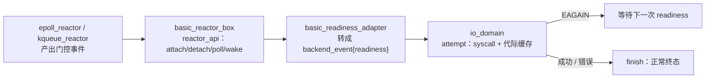

这个顺序不能颠倒：

- reactor 必须**先**有具体类型，`reactor_box` 才能在编译期固定它；
- adapter 必须**先**有 `backend_event` 形状，才能与原生后端共用域的状态机；
- 域必须**最后**接入，因为它需要 `backend_api` 的完整合同。

### 8.2 epoll_reactor

**主要功能**：Linux epoll ET 后端。注册一次、永久有效；每次操作先执行 syscall，只有 `EAGAIN` 才等待，因此短读不会丢边沿。

| 成员 | 所有权 | 说明 |
| --- | --- | --- |
| `poll_fd_` | **拥有** | epoll 实例 |
| `wake_fd_` | **拥有** | eventfd 控制通道 |
| `wake_pending_` | — | 唤醒责任合并门 |

```cpp
int attach(int fd, std::uint64_t key) noexcept {
  epoll_event event{};
  event.events = EPOLLIN | EPOLLOUT | EPOLLRDHUP | EPOLLET;   // ①
  event.data.u64 = key;                                       // ②
  return ::epoll_ctl(poll_fd_, EPOLL_CTL_ADD, fd, &event) == 0 ? 0 : -errno;
}

int poll(std::span<readiness_event> output, std::optional<int> timeout) noexcept {
  if (output.empty()) return 0;                               // ③
  std::array<epoll_event, 256> events;
  const int count = ::epoll_wait(poll_fd_, events.data(),
      static_cast<int>(std::min(output.size(), events.size())), timeout.value_or(-1));
  if (count < 0) return errno == EINTR ? 0 : -errno;          // ④
  for (int i = 0; i < count; ++i) {
    const auto& event = events[static_cast<std::size_t>(i)];
    if (event.data.u64 == 0) { /* 控制通道：把 eventfd 计数读空 */ }
    std::uint32_t flags{};
    if (event.events & EPOLLIN)    flags |= readable_bit;
    if (event.events & EPOLLOUT)   flags |= writable_bit;
    if (event.events & EPOLLERR)   flags |= error_bit;
    if (event.events & EPOLLHUP)   flags |= readable_bit | writable_bit | closed_bit;   // ⑤
    if (event.events & EPOLLRDHUP) flags |= readable_bit | read_closed_bit;             // ⑥
    output[static_cast<std::size_t>(i)] = {event.data.u64, flags};
  }
  return count;
}
```

① **同时注册读写两个方向 + ET**。这样注册一次就永久有效，不需要每次操作 `EPOLL_CTL_MOD` 重新 arm。代价是"就绪可能假阳性"——因为 ET 只在状态变化时触发，而域每次都会先真实 syscall，假阳性不会造成错误，只会多一次 `EAGAIN`。

② `data.u64` 存**资源 id**，不是 fd。这是"fd 复用不混淆"的实现点。

③ 空输出不调用 `epoll_wait`。`maxevents == 0` 在 Linux 上返回 `EINVAL`。

④ `EINTR` 返回 0 而不是错误。信号中断不是故障，下一轮继续。

⑤ `EPOLLHUP` 表示两个方向都关闭，因此同时置 `readable`/`writable`/`closed`。如果只置 `closed`，等待可写的 `write_all` 永远收不到唤醒。

⑥ `EPOLLRDHUP` 只表示**对端**关闭了写方向，因此只置 `readable` 与 `read_closed`。本端仍然可写——这是 TCP 半关闭必须区分两个方向的原因。

`wake` 用 eventfd 非阻塞累加：

```cpp
void wake() noexcept {
  std::uint64_t one = 1;
  while (::write(wake_fd_, &one, sizeof(one)) < 0) {
    if (errno == EINTR) continue;
    break;                         // EAGAIN：计数器已满，内核已有待处理唤醒
  }
}
```

`EAGAIN` 不是错误：eventfd 计数器是 `uint64_t`，只有累加到接近上限才会出现，此时内核里已经有一个待处理的唤醒事件。

### 8.3 kqueue_reactor

**主要功能**：kqueue 用**独立的读/写过滤器**，每个过滤器单独注册、单独回执。与 epoll 版有三处实质差异。

| 差异 | epoll | kqueue |
| --- | --- | --- |
| 注册 | 一次 `epoll_ctl` 同时表达读写 | 两个 `kevent` 变化，需逐条回执 |
| 边沿 | `EPOLLET` | `EV_CLEAR` |
| 唤醒 | eventfd | `EVFILT_USER` + `NOTE_TRIGGER` |
| 关闭信息 | `EPOLLRDHUP`/`EPOLLHUP` 分方向 | `EV_EOF` 是过滤器特定条件 |

```cpp
int attach(int fd, std::uint64_t key) noexcept {
  std::array<struct kevent, 2> changes{}, receipts{};
  auto* token = reinterpret_cast<void*>(static_cast<std::uintptr_t>(key));   // ①
  EV_SET(&changes[0], static_cast<uintptr_t>(fd), EVFILT_READ,
         EV_ADD | EV_CLEAR | EV_RECEIPT, 0, 0, token);
  EV_SET(&changes[1], static_cast<uintptr_t>(fd), EVFILT_WRITE,
         EV_ADD | EV_CLEAR | EV_RECEIPT, 0, 0, token);
  const int count = ::kevent(poll_fd_, changes.data(), 2, receipts.data(), 2, nullptr);
  if (count < 0) return -errno;
  for (int i = 0; i < count; ++i)
    if (receipts[static_cast<std::size_t>(i)].data != 0) {                   // ②
      const int error = static_cast<int>(receipts[static_cast<std::size_t>(i)].data);
      detach(fd);                                                            // ③
      return -error;
    }
  return 0;
}
```

① `udata` 存整数 token（强转成 `void*`），**绝不解引用**。这与 epoll 的 `data.u64` 等价。

② `EV_RECEIPT` 让每个变化产生一条回执：`data == 0` 表示成功，非零表示该条的 errno。因此两条变化可能一条成功一条失败。

③ 失败时必须 `detach(fd)` 回滚**已经成功的另一条**。否则会留下"只有读方向注册、没有写方向"的半注册状态，之后 `EPOLLOUT` 类事件永远不来，而 `detach` 又要处理不存在的过滤器。

```cpp
int poll(std::span<readiness_event> output, std::optional<int> timeout) noexcept {
  struct timespec wait_storage{}, *wait = nullptr;
  if (timeout) {
    wait_storage.tv_sec = *timeout / 1000;
    wait_storage.tv_nsec = (*timeout % 1000) * 1000000L;   // ①
    wait = &wait_storage;
  }
  const int count = ::kevent(poll_fd_, nullptr, 0, events.data(),
      static_cast<int>(std::min(output.size(), events.size())), wait);
  if (count < 0) return errno == EINTR ? 0 : -errno;
  for (int i = 0; i < count; ++i) {
    const auto& event = events[static_cast<std::size_t>(i)];
    std::uint32_t flags{};
    if (event.filter == EVFILT_READ)  flags |= readable_bit;
    if (event.filter == EVFILT_WRITE) flags |= writable_bit;
    if (event.flags & EV_ERROR)       flags |= error_bit;
    if (event.flags & EV_EOF) {
      if (event.filter == EVFILT_READ)       flags |= readable_bit | read_closed_bit;
      else if (event.filter == EVFILT_WRITE) flags |= writable_bit | write_closed_bit;   // ②
    }
    output[static_cast<std::size_t>(i)] = {
        event.filter == EVFILT_USER ? 0                                           // ③
            : static_cast<std::uint64_t>(reinterpret_cast<std::uintptr_t>(event.udata)),
        flags};
  }
  return count;
}
```

① `tv_nsec` 必须小于 1e9，所以 `*timeout % 1000` 只能乘以 `1e6`。

② `EV_EOF` 在写过滤器上表示"不能再写"，在读过滤器上表示"读到 EOF"。必须按 filter 区分，否则半关闭会被误报成双向关闭。

③ `EVFILT_USER` 是唤醒通道，key 记为 0。与 epoll 的 `data.u64 == 0` 对应。

### 8.4 域内 `attempt`：把就绪变成完成

这是整条 Reactor 主线的核心。`submit_locked` 的第七级仲裁里，非原生、非文件的请求会调用 `attempt`：

```cpp
void attempt(operation_state& op) noexcept {
  if (op.terminal || op.running_file || op.native_inflight) return;   // ①
  const auto& resource = op.request.resource;
  if (op.cancellation) { finish(op, -op.cancellation); return; }      // ②

  if (op.request.kind == operation_kind::ready) { /* 登记观察者，见下 */ }
  else if (op.request.kind == operation_kind::cancel) { /* 批量取消，见下 */ }
  else {
    if (op.request.kind == operation_kind::sendmsg)
      op.request.message.msg_iov = op.request.vectors.data();         // ③
    const auto result = unix_operations::perform(op.request, op.connecting);  // ④
    if (result == -EAGAIN || result == -EWOULDBLOCK
        || result == -EINPROGRESS || result == -EALREADY) {
      if (!resource) { finish(op, result); return; }                  // ⑤
      resource->readiness &= ~direction_of(op.request.kind);           // ⑥
      if (const int error = ensure_registration(*resource); error) finish(op, error);
      return;                                                          // ⑦
    }
    finish(op, result);                                                // ⑧
  }
}
```

① 三个"不能动"的条件：已终态、文件 job 持有请求、原生请求在途。任一成立时触碰 `request` 都可能与另一方竞争。

② 取消优先于执行。已记录 sticky 原因时不再发起 syscall。

③ `sendmsg` 的 `msg_iov` 指向请求拥有的 `vectors`。每次 `attempt` 前重新绑定，因为请求可能经过移动。

④ **真实 syscall**。这是"先尝试、后等待"的落点：大多数情况下数据已经在，syscall 直接成功。

⑤ 无资源（raw fd 尚未借用）时不能登记就绪，只能把 `EAGAIN` 当作结果交付。

⑥ **真实 `EAGAIN` 才清除就绪位**。这是 ET 正确性的关键：只有在确认"上次的提示是假阳性"时才清缓存，否则会丢掉真实的边沿。

⑦ 登记就绪。`ensure_registration` 只在该资源第一次需要等待时调用后端 `attach`，之后复用同一注册。

⑧ 成功、短读、EOF、真实错误都立即建立终态。**短读不重试**——重试是组合算法（`read_exact`）的责任，不是单次 IO 的责任。

#### 就绪代际缓存：消除重复 syscall

每次 `EAGAIN` 都要付一次 syscall 的成本。如果一个协程反复读一个暂时没数据的 socket，`submit → attempt → EAGAIN → 挂起 → 就绪 → attempt` 的循环里会有一半是无效 syscall。

解法是记录"刚才已经试过、确认没有数据"这个事实：

```cpp
if (result == -EAGAIN || result == -EWOULDBLOCK) {
  resource->readiness &= ~direction;
  request.observed_would_block = true;                              // ①
  request.observed_readiness_generation = resource->readiness_generation;   // ②
  return {};
}
```

① `observed_would_block` 随请求一起移入稳定槽。下一次提交时，它还在。

② `observed_readiness_generation` 记录观察发生时的代际。

域在 `submit_locked` 里据此跳过 syscall：

```cpp
else if (req.observed_would_block && r && r->registered
         && req.observed_readiness_generation == r->readiness_generation
         && !(r->readiness & (direction_of(req.kind) | error_bit))) {
  // 同一已注册 ET 资源、没有更新事件：真实 EAGAIN 已执行，直接等待就绪。
}
```

四个条件缺一不可：

| 条件 | 作用 |
| --- | --- |
| `observed_would_block` | 这个请求确实试过并得到 `EAGAIN` |
| `r->registered` | 资源已注册，保证后续一定有事件 |
| 代际相等 | 从那时到现在没有新事件进来 |
| 对应方向位为空 | 就连"可能就绪"的提示都没有 |

如果代际变了（说明有事件到达），或方向位被置上（说明可能已经可读），就必须再试一次。

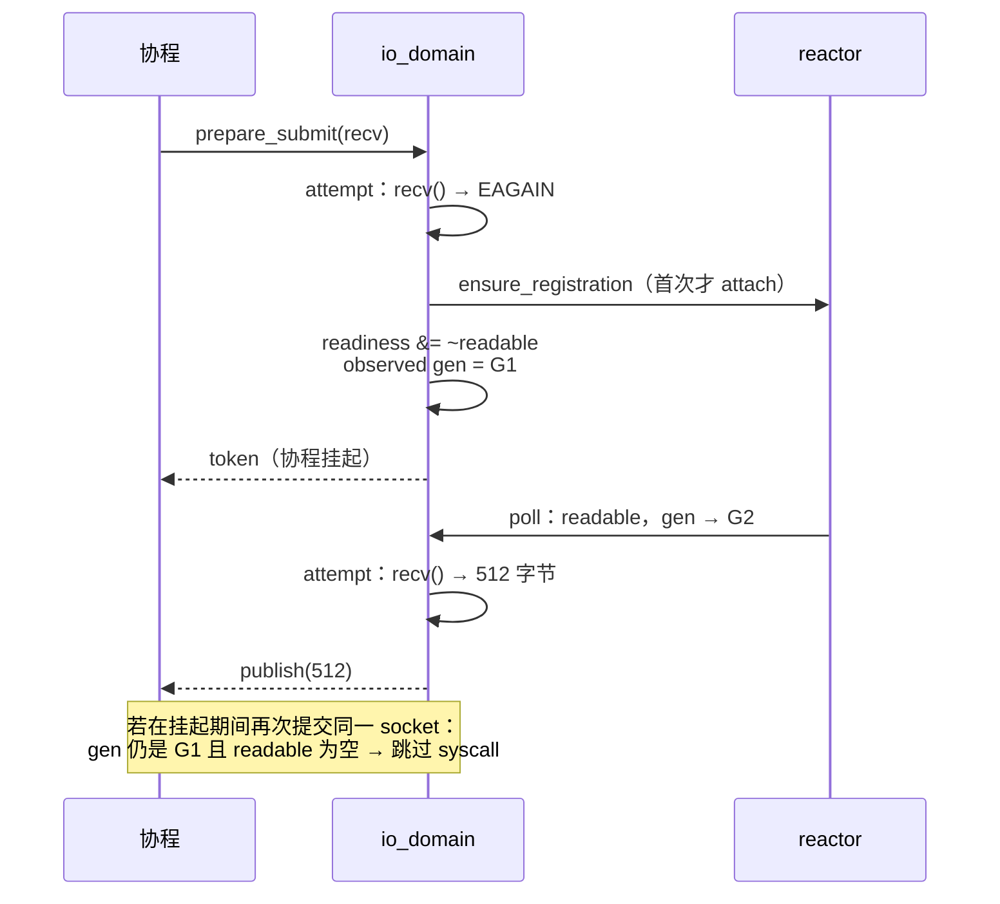

这个优化的边界很重要：它只在**同一个已注册资源、同一代际、无新事件**时生效。任何一次真实事件都会推进代际，使缓存失效。因此它不会漏掉数据，只会在"确认无数据"的窗口里省掉一次必然失败的 syscall。

#### `ready` 的操作：只登记，不消费

```cpp
if (op.request.kind == operation_kind::ready) {
  const auto mask = static_cast<std::uint32_t>(op.request.argument);
  if (!mask || mask > 3 || !resource) { finish(op, -EINVAL); return; }
  if (const int e = ensure_registration(*resource); e) { finish(op, e); return; }
  if (resource->readiness & (mask | error_bit))
    finish(op, resource->readiness);        // ① 已经就绪：立即完成
  return;                                   // ② 否则挂起，等 drive 重试
}
```

① 已经缓存的就绪提示可以直接交付。注意这里也检查 `error_bit`：错误状态应当唤醒所有观察者。

② 不消费数据。观察者只报告方向状态，因此可以多个并存（`observers` 链），而 `reader`/`writer` 各只能一个。

#### `cancel` 的操作：批量、按代际

```cpp
if (op.request.kind == operation_kind::cancel) {
  if (static_cast<unsigned>(op.request.flags) & ~3u) { finish(op, -ENOTSUP); return; }
  if (resource) {
    for (auto& entry : operations_)
      if (entry.get() != &op && entry->allocated && entry->accepted && !entry->terminal
          && (entry->request.resource == resource
              || (entry->request.bypass_resource_registration && !entry->request.resource
                  && entry->request.fd == op.request.fd))
          && entry->request.kind != operation_kind::close
          && !entry->request.uncancellable) {
        if (!entry->cancellation) entry->cancellation = ECANCELED;
        cancel_operation(*entry);
      }
  }
  finish(op, 0);
  return;
}
```

两个细节：

- **flags 只接受 0/1/2/3**。`FD_FIXED`、`ANY` 需要额外身份（固定 fd 表、任意 fd 扫描），无法等价实现，因此返回 `ENOTSUP` 而不是假装支持。
- **匹配用共享身份，不用整数 fd**。唯一的例外是 File 的 bypass 请求：它们没有 `resource`，只能按 fd 匹配，但这条路径被 `bypass_resource_registration` 严格限定。

### 8.5 AsyncFd 与就绪守卫

`AsyncFd` 是"任意可非阻塞描述符"的通用包装，用于管道、FIFO、`eventfd`、`signalfd` 这类没有专门类型封装的对象。

```cpp
template <native_fd_owner Owner = OwnedFd>
class AsyncFd : public detail::FileDescriptor {
 public:
  explicit AsyncFd(Owner owner, io_context context = io_context::current())
      : FileDescriptor(std::move(context), owner.get(), false),
        owner_(std::move(owner)) {}                                    // ①

  static expected<AsyncFd> create(io_context context, Owner owner) {
    // detail_fd::prepare_fd：拒绝普通文件/目录/块设备，设置 O_NONBLOCK + FD_CLOEXEC
  }

  auto readable() { return detail_fd::observe(resource(), Interest::readable); }
  auto writable() { return detail_fd::observe(resource(), Interest::writable); }
  auto ready(Interest interest) { return detail_fd::observe(resource(), interest); }
 private:
  Owner owner_;   // 拥有：在 FileDescriptor 的生命周期之外独立持有句柄
};
```

① 基类构造接管 fd（`regular = false`），成员 `owner_` 同时持有原生资源。这里有一个隐含约束：`FileDescriptor` 析构会请求关闭，`owner_` 析构也会关闭，两者不能都生效。实际实现让基类先释放（它只请求域关闭，不直接 close），`owner_` 的析构在 `into_inner` 之后才可能真正 close。

`create` 会做三项检查：

```cpp
inline int prepare_fd(int descriptor) {
  struct stat attributes;
  if (::fstat(descriptor, &attributes)) throw std::system_error(errno, std::generic_category());
  if (S_ISREG(attributes.st_mode) || S_ISDIR(attributes.st_mode) || S_ISBLK(attributes.st_mode))
    throw std::system_error(EINVAL, std::generic_category(),
                            "AsyncFd不支持普通磁盘文件，请使用fs::File");   // ①
  const int flags = ::fcntl(descriptor, F_GETFL, 0);
  if (flags < 0 || ::fcntl(descriptor, F_SETFL, flags | O_NONBLOCK) < 0
      || ::fcntl(descriptor, F_SETFD, FD_CLOEXEC) < 0)                      // ②
    throw std::system_error(errno, std::generic_category());
  return descriptor;
}
```

① 普通文件/目录/块设备的 `read` **永远不会**返回 `EAGAIN`——它们要么立即返回，要么阻塞在磁盘上。对它们做就绪等待毫无意义，而且会阻塞 worker。这类对象必须用 `fs::File`（走文件服务）。

② `O_NONBLOCK` 是保证 worker 不被内核阻塞的前提；`FD_CLOEXEC` 防止 fd 泄漏到子进程。

`AsyncFdReadyGuard` 是"就绪快照 + 条件清除"：

```cpp
class AsyncFdReadyGuard {
 public:
  Ready ready() const noexcept { return ready_; }

  void clear_ready() noexcept {                                   // ①
    if (resource_->owner)
      resource_->owner->clear_readiness(resource_, interest_, generation_);
  }

  template <class F>
  auto try_io(F&& function) -> std::invoke_result_t<F, int> {      // ②
    return detail::with_resource(resource_, interest_, [&] {
      return std::invoke(std::forward<F>(function), resource_->fd());
    });
  }
 private:
  detail::resource_ptr resource_;   // 拥有：跨挂起固定句柄身份与归属
  Interest interest_;
  Ready ready_;
  std::uint64_t generation_;        // 获取提示时的资源代际
};
```

① `clear_ready` 只清**自己观察到的那一代**。如果从获取 guard 到现在有新事件到达，代际已变，清除无效——旧 guard 不能抹掉新事件。

② `try_io` 在取得方向执行权的前提下执行回调。回调内部若遇到 `EAGAIN`，`with_resource` 会清除对应就绪位（因为 `EAGAIN` 是权威的"还没就绪"）。

调用方必须理解 guard 的三个语义：

| 语义 | 含义 |
| --- | --- |
| `ready()` 可能假阳性 | 边沿触发的提示不代表此刻一定有数据 |
| `try_io` 必须是非阻塞的 | 已设置 `O_NONBLOCK`，但仍要处理 `EAGAIN` |
| `clear_ready` 是可选的优化 | 不清也能工作，只是下次可能多一次无效 `EAGAIN` |

### 8.6 同一封装在两种平台上的差异

| 关注点 | epoll（Linux） | kqueue（macOS / FreeBSD） |
| --- | --- | --- |
| 注册单位 | 一个 fd + 一个事件掩码 | 每个 filter 一条变化 |
| 注册回执 | 返回值即结果 | `EV_RECEIPT` 逐条回执，需回滚 |
| 边沿语义 | `EPOLLET` | `EV_CLEAR` |
| 读关闭 | `EPOLLRDHUP` | `EV_EOF` + `EVFILT_READ` |
| 写关闭 | `EPOLLHUP`（全关闭） | `EV_EOF` + `EVFILT_WRITE` |
| 唤醒 | eventfd | `EVFILT_USER` + `NOTE_TRIGGER` |
| 一次性事件 | `EPOLLONESHOT`（未使用） | `EV_ONESHOT`（未使用） |
| 空批次 | 必须避免 `maxevents == 0` | 允许，但仍提前返回 |

两个 reactor 的行为在上层完全一致，因为 `readiness_adapter` 把它们都映射到同一个 `readiness_bits` 空间。这也是"一份合同"在就绪型后端上的体现：**内核 API 的差异被限制在两百多行里**。

---
## 9. 文件与目录：双路封装

> **本章依赖**：第 3 章的 `FileDescriptor`/`resource_state`；第 5 章的 `IORegistrantAwaiter`；第 6 章的 `defer_native_close`/`defer_cleanup`/`shutdown_cleanup`；第 7 章的 `uring` 文件 opcode。
>
> **核心判断**：文件与网络的区别不在 API，而在**内核是否真的支持异步**。socket/pipe 天然可非阻塞，普通磁盘文件不能——`read` 要么立即返回（页缓存命中），要么在磁盘上阻塞整个线程。因此文件层必须是"双路"：能原生的走原生 opcode，不能的在提交前改走有界线程服务。

### 9.1 双路架构

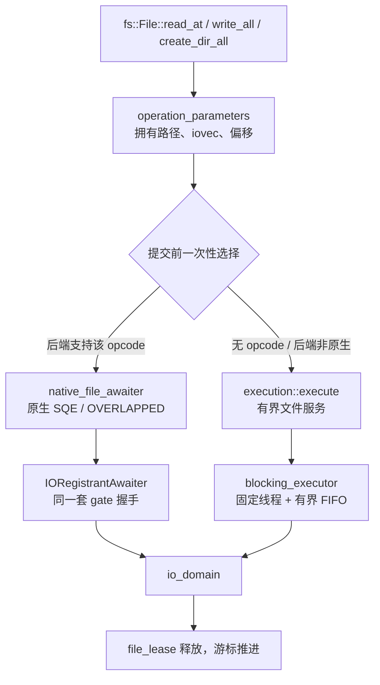

三处关键约束：

1. **选择只发生一次**，在提交之前。已接受的请求失败后**不改走另一条路径**——那样会重做副作用（例如 `open` 已经创建了文件）。
2. 两条路径**共用同一套域协议**。原生分支复用 `IORegistrantAwaiter`，fallback 分支把结果也送回 `finish`。消费者看到的 `expected<T>` 完全一致。
3. **文件租约独立于 IO 资源租约**。`file_lease` 保护 fd 与游标，`resource_ptr` 保护句柄身份。两者的排空点不同。

#### 哪些操作能原生

| 操作 | uring 原生请求 | 无原生时的处理 |
| --- | --- | --- |
| 打开 | `OPENAT` / `OPENAT2` | `::open` in service |
| 标量/聚集读写 | `READ`/`WRITE`/`READV`/`WRITEV` | `::pread`/`::pwrite` in service |
| 同步 | `FSYNC` | `::fsync` in service |
| 关闭 | `CLOSE` | `::close` in cleanup lane |
| 属性 | `STATX`（`AT_EMPTY_PATH` / `AT_SYMLINK_NOFOLLOW`） | `::fstat` / `::lstat` |
| 截断 | `FTRUNCATE` | `::ftruncate` |
| 目录创建 / 删除 | `MKDIRAT` / `UNLINKAT`（`AT_REMOVEDIR`） | 同名 syscall |
| 重命名 / 链接 | `RENAMEAT` / `LINKAT` / `SYMLINKAT` | 同名 syscall |
| **目录枚举** | **无 `GETDENTS` opcode** | `getdents64` in service |
| **权限修改** | **无 `CHMOD` opcode** | `::fchmod` in service |
| **读取链接** | **无 `READLINK` opcode** | `::readlink` in service |

最后三行是"双路"存在的最直接原因：Linux UAPI 至今没有 `IORING_OP_GETDENTS`。目录枚举永远有一段要在服务线程里跑，问题只是"怎么把这段做小"。

### 9.2 native_file_awaiter：复用协议但不建第二个资源

文件的原生请求有一个特殊之处：**fd 的生命周期已经由 `file_lease` 固定**，如果 `IORegistrantAwaiter` 再为它 `adopt` 一个 `resource_state`，就会有两个拥有者争同一个 fd。

解法是 `bypass_resource_registration`：

```cpp
class native_file_awaiter : public detail::IORegistrantAwaiter<native_file_awaiter> {
 public:
  native_file_awaiter(io_context context, detail::io_request request, bool cancellable)
      : IORegistrantAwaiter{mark_borrowed(std::move(request), cancellable),
                            std::move(context), cancellable} {}

  expected<std::int64_t> await_resume() const noexcept {
    if (_user_data.result < 0)
      return std::unexpected{detail::decode_io_error(
          static_cast<int>(-_user_data.result), _user_data.transferred)};
    return _user_data.result;
  }

 private:
  static detail::io_request mark_borrowed(detail::io_request request, bool cancellable) {
    request.bypass_resource_registration = true;   // ①
    request.uncancellable = !cancellable;          // ②
    return request;
  }
};
```

① 跳过 `submit_locked` 里的 `borrow(req.fd)`。注意这**不影响**路径、iovec 的拥有关系——它们仍然随请求进入稳定槽，只是"不再登记第二个资源拥有者"。

② 已接管 CLOSE 的请求不可取消。因为如果取消后立即返回，调用方可能复用那个"还没真正关掉"的 fd 号。

`native_file_awaiter` 没有自己的协程帧，`await_suspend`/`await_resume` 完全走基类的三态 gate。**约 20 行代码换来整条 SQE/CQE 管线**，这是"桥只写一份"的直接收益。

关闭则多一层兜底：

```cpp
class native_file_close_awaiter {
  template <class Promise>
  bool await_suspend(std::coroutine_handle<Promise> continuation) {
    const bool suspended = native_.await_suspend(continuation);
    if (suspended || native_.was_prepared() || fd_ < 0)
      return suspended;                                     // ①
    fallback_.emplace(context_, close_work{fd_}, context_.cleanup(), false);   // ②
    return fallback_->await_suspend(continuation);
  }

  expected<std::int64_t> await_resume() {
    if (fallback_) return fallback_->await_resume();
    return native_.await_resume();
  }

 private:
  detail::native_descriptor fd_;        // 拥有：移动请求前保存唯一关闭对象
  native_file_awaiter native_;          // 拥有：普通原生提交与真实 CQE 发布桥
  io_context context_;                  // 拥有：关闭服务租约
  std::optional<execution::execute_awaiter<close_work>> fallback_;   // 拥有：仅准备前失败才构造
};
```

① 三种情况直接返回原生结果：已挂起（正常异步）、已准备（已进入稳定槽，必须等 CQE）、fd 无效（没什么可关）。**"已准备"这一条是防重复关闭的关键**——已经提交的 CLOSE 绝不能再走一次 fallback。

② 只有"从未准备稳定槽"的失败（例如没有 context、槽位耗尽）才接管兜底责任。此时 fallback 走**清理通道**（`context_.cleanup()`）而不是普通文件队列，因为关闭责任不能被背压丢弃。

`close_work` 只调用一次 `::close`：

```cpp
struct close_work {
  int fd;
  std::int64_t operator()() const {
    if (::close(fd) != 0 && errno != EINTR) return -errno;
    return 0;                     // EINTR 也返回成功：数字 fd 可能已释放，重试会关错对象
  }
};
```

`EINTR` 返回成功而不是重试，这个判断在 3.1 已经出现过一次。它的依据是 POSIX 的模糊规定：`close` 被信号中断时，fd 是否已释放是未指定的。重试的唯一"安全"解释依赖于"fd 未被释放"，而这个假设无法验证。

### 9.3 fs::provider：提交前的一次性选择

[provider/file_request.hpp](../include/faio/detail/fs/provider/file_request.hpp) 用一个 variant 保存所选分支，两条路径共用同一个参数对象：

```cpp
struct operation_parameters {
  io::detail::operation_kind kind() const noexcept;
  io::detail::io_request into_request() &&;    // ① 仅选中原生分支后构造稳定请求
  expected<std::size_t> operator()() const;    // ② 仅 fallback 服务线程执行 syscall
};
```

① `into_request()` 是**惰性**的：只有在确定走原生路径时才物化完整 `io_request`。epoll/kqueue 构建下这个函数根本不会被调用，因此不会白白构造路径字符串与 iovec 数组。

② `operator()` 在服务线程执行。它和 `into_request()` 共享同一份参数（路径、偏移、缓冲区描述），不会出现"两条路径参数不一致"。

调用形态是一个普通协程：

```cpp
auto operation = detail::execute_file_request(context, std::move(parameters));
auto result = co_await operation;
```

`execute_file_request` 返回的 awaiter 内部按能力分成两支：原生分支用 `native_file_awaiter`，fallback 分支用 `execution::execute_awaiter`。**两者都没有自己的协程帧**，因此一次文件读不会产生"转发协程"这样的额外调度层。

#### 为什么不能"失败后改道"

考虑 `open`：原生 `OPENAT` 已经在内核里创建了文件，此时若 CQE 返回 `EOPNOTSUPP`（旧内核不支持某个 flag），改走 fallback 会**再 open 一次**——如果用了 `O_CREAT | O_EXCL`，第二次必然 `EEXIST`；如果没用，就会泄漏第一个 fd。

因此源码的规则是：**已向内核提交的操作失败后不改走另一条路径重做**。能力判断必须在提交前完成，而 `supports(opcode)` 与内核版本探测提供了这个能力。

### 9.4 有界 fallback：blocking_executor

```cpp
namespace execution {
class blocking_executor {
 public:
  blocking_executor(std::size_t threads, std::size_t queue_limit, std::size_t reserved,
                    executor_startup startup);
  bool try_submit(work_item item) noexcept;   // ① 队列满返回 false（EAGAIN）
  blocking_executor_ref ref() noexcept;
  void close() noexcept;                      // ② 关闭并等待线程退出
};
}
```

① `try_submit` **不阻塞**。队列满时立即返回失败，让调用方把 `EAGAIN` 作为已接受请求的完成结果交付——绝不在协程 worker 上等待容量。

② `close()` 排空并 join。文件、DNS、清理三个服务各自独立，容量互不影响。

启动策略由后端模型决定（见 6.1）：

| 后端 | 策略 | 原因 |
| --- | --- | --- |
| uring / IOCP | `on_demand` | 纯原生负载不需要辅助线程，第一次真实 fallback 才启动 |
| epoll / kqueue | `preheated` | 普通文件 IO 必然走服务，预热避免首个请求的启动延迟 |

任务提交的一个细节是**小对象内联**：

```cpp
// 小型且可无异常构造的 callable：容量检查通过后才在队列原位构造。
// 大型 / 过度对齐 / 构造可能抛出的 callable：先在锁外包装。
```

这个区分的作用是：拒绝提交时不搬走调用方的参数。如果先把 callable 移进队列再检查容量，一旦拒绝就必须把它移回来（或丢弃），而"移回来"对某些 callable 不成立（例如只能移动一次的捕获）。

`start_blocking` 把 callable 与 `join_handle` 的完成状态放在**同一次共享分配**里，队列只捕获一个 `shared_ptr`。超过 64 字节或高对齐的 callable 单独存储。这样无论句柄被保留多久，任务结束后 callable 的捕获都会被释放，不会因为"句柄还活着"而拖住大对象。

### 9.5 fs::File：控制块与活跃租约

#### 控制块

```cpp
struct file_state {
  std::uint64_t shutdown_registration{};   // 关闭后删除弱回调，重复 open 不累计控制面内存
  io::io_context context;                  // 拥有：不依赖析构线程 TLS
  std::atomic<int> descriptor{-1};         // 拥有：仅在所有操作租约排空后失效
  bool append{};
  std::shared_ptr<cursor_state> cursor{std::make_shared<cursor_state>()};  // 拥有：clone 共享逻辑游标
  std::mutex mutex;                        // 拥有：保护 admission、close 与活跃登记
  bool closing{}, shutdown_pending{}, shutdown_close_started{};
  std::optional<Error> close_error;        // 关闭错误，供重复关闭等待者取得同一结果
  ::faio::detail::completion_event close_completion;   // 带记忆的关闭完成事件
  active_file_operations active;           // 拥有：共享操作块与可换位更新的索引
};
```

六个字段组承担六件事：

| 字段组 | 解决的问题 |
| --- | --- |
| `descriptor` | fd 的唯一持有者；`exchange(-1)` 是失效点 |
| `mutex` + `closing` | admission 与 close 互斥，close 开始后新请求一律 `EBADF` |
| `active` | 已接受操作的登记表，close 等它排空 |
| `close_completion` | 带记忆的一次性事件，多个 `co_await close()` 共享同一结果 |
| `context` | 关闭归属，不依赖调用线程的 TLS |
| `cursor` | 逻辑游标；`try_clone` 共享它 |

`descriptor` 是 `atomic<int>` 而不是 `int`，因为 `try_clone` 出来的多个包装可能在**不同线程**上并发关闭。`exchange(-1)` 保证只有一个线程拿到有效值。

`close_completion` 用 `completion_event` 而不是 `condition_variable`，原因是等待者是协程：`condition_variable` 会阻塞 worker 线程，而 `completion_event` 能挂起协程（见《协程封装》7.4）。

#### file_lease：admission 与排空

```cpp
class file_lease {
 public:
  static expected<file_lease> acquire(const std::shared_ptr<file_state>& state, bool write = false) {
    if (!state) return std::unexpected{make_error(EBADF)};
    auto operation = std::make_shared<active_file_operations::operation>(write);
    std::lock_guard lock(state->mutex);
    if (state->closing || state->context.stopped() || !state->valid())
      return std::unexpected{make_error(EBADF)};      // ①
    state->active.insert(operation);                   // ②
    return file_lease{state, std::move(operation)};
  }

  ~file_lease() {
    // ③ 锁内按索引移除；最后一个租约触发停机关闭，再 notify 排空事件
  }

 private:
  std::shared_ptr<file_state> state_;   // 拥有
  std::shared_ptr<active_file_operations::operation> operation_;   // 拥有
};
```

① 三个条件合并成一次检查：正在关闭、域已停止、fd 已失效。它们都在同一把锁内，因此不存在"检查通过后立刻关闭"的窗口。

② `active` 只保留**当前活跃**的操作，插入/删除都是摊销 O(1)，不需要每次 admission 扫描弱引用。

③ 析构时按索引移除。`operation` 是 `shared_ptr`，因为 `flush`/`close` 会**快照**当前活跃集合——快照要比单个租约活得更久，才能等到那些操作真正结束。

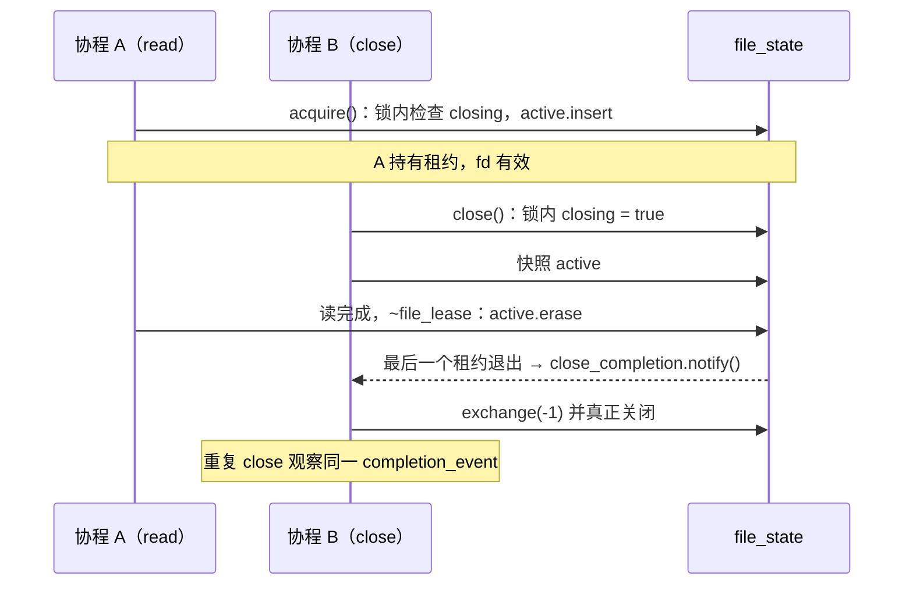

#### fd 失效的唯一时点

`descriptor.exchange(-1)` 只发生在**所有租约排空之后**：

| 触发路径 | 说明 |
| --- | --- |
| 显式 `co_await close()` | 等 active 排空后关闭 |
| runtime 停机回调 | 只设 `shutdown_pending` 并 `retain_cleanup_wait()`，真正关闭等最后一个租约退出 |
| 最后一个 `file_lease` 析构 | 若已 `shutdown_pending`，由它触发关闭 |
| `file_state` 析构 | 兜底路径，此时必然没有租约 |

停机路径值得单独看：

```cpp
inline void finish_shutdown_file(const std::shared_ptr<file_state>& file) noexcept {
  int fd;
  {
    std::lock_guard lock(file->mutex);
    if (!file->shutdown_pending || !file->active.empty() || file->shutdown_close_started)
      return;                                        // ① 还有活跃操作，等最后一个租约
    file->shutdown_close_started = true;
    fd = file->descriptor.exchange(-1);
  }
  file->context.unregister_shutdown_cleanup(file->shutdown_registration);
  if (fd < 0) {
    file->close_completion.notify();
    file->context.domain()->release_cleanup_wait();   // ②
    return;
  }
  if (file->context.domain() && file->context.domain()->defer_native_close(fd, [file](int error) {
        if (error) file->close_error = make_error(error);
        file->close_completion.notify();
        file->context.domain()->release_cleanup_wait();   // ③ 真实 CQE 后才释放
      }))
    return;
  file->context.defer_cleanup([file, fd] { /* ::close + notify + release_cleanup_wait */ });
}
```

① 三个前置条件都不满足时**直接返回**，不阻塞等待。等待由"最后一个租约析构"触发再次进入。这样停机过程中不会有任何 worker 卡在等锁上。

②③ `release_cleanup_wait()` 必须与 `retain_cleanup_wait()` 配对。这是驱动"不能提前宣告排空"的票据机制：只要还有一张票没还，`quiescent()` 就不为真。

**这里的关键是顺序**：先 `close_completion.notify()`，再 `release_cleanup_wait()`。如果反过来，驱动可能在关闭结果写入之前就认为排空完成并销毁域。

#### 游标语义

| 操作 | 是否占游标 | 说明 |
| --- | --- | --- |
| `read` / `write` | 是 | 推进逻辑游标 |
| `read_vectored` / `write_vectored` | 是 | 同上 |
| `seek` | 是 | 修改逻辑游标 |
| `read_at` / `write_at` | 否 | positional，可与游标操作并行 |
| `read_vectored_at` / `write_vectored_at` | 否 | 同上 |
| append 模式下的 `write_at` | — | **被拒绝**（`EINVAL`） |

游标用 `cursor_state::lane` 异步锁串行，worker 不阻塞等锁。append 模式用 `O_APPEND` + `write`/`writev`，由内核保证追加原子性；此时指定偏移的写没有意义，因此拒绝。

`try_clone` 共享**逻辑游标**而不是 OS 文件偏移。这是必然而非选择：如果用 OS 隐式偏移，两次 `read` 会互相干扰，而库的语义是"一个 File 对象一个逻辑位置"。

#### 对外 API 与语义

| API | 行为 |
| --- | --- |
| `open` / `create` | 显式或当前 context；`create` 以写入、创建、截断方式打开 |
| `read` / `write` | 短 IO；`span`、借用缓冲、拥有型缓冲三种重载 |
| `read_at` / `write_at` | positional，不改变逻辑游标 |
| `read_vectored` / `write_vectored` | 拷贝 iovec 数组，payload 借用，推进游标 |
| `read_exact` / `write_all` | 全程持共享游标与活跃租约，每个文件 job 至多 64 KiB |
| `seek` | `seek_from::start/current/end`，逻辑游标不依赖 OS 偏移 |
| `metadata` / `permissions` | 原生 STATX 或 `fstat` fallback，返回拥有型快照 |
| `set_permissions` / `set_len` | `fchmod` fallback；长度用原生 `FTRUNCATE` |
| `flush` | 等待调用前已登记的写操作，**不做隐式 fsync** |
| `sync_data` / `sync_all` | 先等已有写，再 `fdatasync`/`fsync`；macOS 的 `sync_data` 用 `fsync` |
| `try_clone` | `dup` fd，共享 faio 游标；关闭一个不影响另一个 |
| `close` | 等操作排空并真正关闭；重复关闭观察同一完成状态 |
| `native_handle` / `context` | 借用 fd / 复制所属服务租约 |

`read_exact`/`write_all` 的"每个 job 至多 64 KiB"是一个有意的分块：单次 `read` 64 KiB 以上时，服务线程占用时间过长会拉高其他请求的排队延迟。分块后每次回到协程侧，顺带让出协作预算。

### 9.6 目录：把枚举做小

#### Linux：fill 与 take 分离

因为内核没有 `GETDENTS` opcode，目录枚举必然有一次阻塞调用。可以做的是**把"读"和"解析"分开**：

```cpp
struct native_directory_cursor {
  static constexpr std::size_t buffer_size = 4096;
  io::io_context context;                 // 固定原生关闭归属
  int descriptor{-1};                     // release 后为 -1，只有一个调用者接管关闭
  std::array<char, buffer_size> buffer{}; // 拥有：getdents64 输出
  std::size_t position{}, size{};
  bool eof{};

  expected<void> fill() {                 // ① 唯一在服务线程执行的调用
    if (position != size || eof) return {};
    long count;
    do {
      count = ::syscall(SYS_getdents64, descriptor, buffer.data(), buffer.size());
    } while (count < 0 && errno == EINTR);
    if (count < 0) return std::unexpected{make_error(errno)};
    position = 0;
    size = static_cast<std::size_t>(count);
    eof = !size;                          // ② 零字节才是终点
    return {};
  }

  expected<std::optional<entry>> take() { // ③ 只在 worker 上解析，不发 syscall
    for (;;) {
      if (position == size) return std::optional<entry>{};
      constexpr std::size_t name_offset = 19;
      if (size - position <= name_offset) return std::unexpected{make_error(EIO)};
      const char* record = buffer.data() + position;
      std::uint16_t length;
      std::memcpy(&length, record + 16, sizeof(length));     // ④
      if (length <= name_offset || length > size - position)
        return std::unexpected{make_error(EIO)};
      const char* name = record + name_offset;
      const char* end = static_cast<const char*>(std::memchr(name, 0, length - name_offset));
      if (!end) return std::unexpected{make_error(EIO)};
      position += length;
      std::string owned{name, end};                          // ⑤
      if (owned == "." || owned == "..") continue;
      return std::optional<entry>{entry{std::move(owned), static_cast<unsigned char>(record[18])}};
    }
  }
};
```

① `fill` 是**唯一**交给文件服务的 `getdents64`。一次最多读 4 KiB，服务线程占用时间可控。

② 短批次不是 EOF。内核可能在任意记录边界截断，只有 `count == 0` 才是终点。这一点很容易写错——把 `count < buffer_size` 当 EOF 会导致目录被截断。

③ `take` 只解析缓存。它可能被调用很多次（每条记录一次），如果每次都要进服务线程，枚举一个万级目录就要上万次线程切换。

④ 固定字段用 `memcpy` 提取，**不把变长 ABI 映射成 C++ 结构体**。原因有两个：`linux_dirent64` 的名字是柔性数组，无法用普通 struct 表示；对齐要求也不保证。`name_offset = 19` 是 `ino(8) + off(8) + reclen(2) + type(1)`。

⑤ 返回**拥有型** `std::string`。如果返回指向 `buffer` 的视图，下一次 `fill` 就会让它悬空。

任何畸形记录（长度为 0、越界、无终止符）都以 `EIO` 拒绝，而不是信任内核布局。这是防御性设计：如果缓冲区被部分覆盖或 ABI 变化，宁可报错也不要越界读。

打开与关闭也走原生：

```cpp
inline task<expected<std::shared_ptr<native_directory_cursor>>>
open_native_directory(io::io_context context, int parent, std::string filename, bool no_follow) {
  io::detail::io_request request;
  request.kind = io::detail::operation_kind::open;
  request.fd = parent;                         // ① 以已打开父目录为锚点
  request.path = std::move(filename);          // ② 稳定请求拥有路径
  request.flags = O_RDONLY | O_DIRECTORY | O_CLOEXEC | (no_follow ? O_NOFOLLOW : 0);
  auto opened = co_await io::native_file_op(context, std::move(request));
  if (!opened) co_return std::unexpected{opened.error()};
  const int fd = static_cast<int>(*opened);
  try {
    co_return std::make_shared<native_directory_cursor>(context, fd);
  } catch (const std::bad_alloc&) {
    if (!context.domain()->defer_native_close(fd))
      context.defer_cleanup([fd] { ::close(fd); });   // ③ 分配失败仍要关掉新 fd
    co_return std::unexpected{make_error(ENOMEM)};
  }
}
```

① fd 相对打开。递归遍历时不需要拼绝对路径，也从根上避免了 `..` 逃逸与路径长度问题。

② 路径由请求拥有到 CQE。这里若存 `string_view`，协程帧一销毁内核就读到已释放内存。

③ 构造游标失败时，`fd` 已经被创建。必须显式关闭，否则每次 OOM 泄漏一个 fd。

#### 递归操作

| 操作 | Linux 原生路径 | 说明 |
| --- | --- | --- |
| `create_dir_all` | 逐级 `MKDIRAT`；`EEXIST` 时 `STATX` 确认是目录 | 不是目录则报 `ENOTDIR` |
| `remove_dir_all` | fd 相对深度优先，不跟随目录符号链接 | 每批回协程侧让出预算 |
| `remove_file` | `UNLINKAT` | — |
| `rename` | `RENAMEAT` | 两个路径都拥有 |
| `canonicalize` | 无 `READLINK` opcode → fallback | 必须逐段解析 |

`create_dir_all` 的 `EEXIST` 分支是必须的：`MKDIRAT` 遇到已存在目录返回 `EEXIST`，而"目录已存在"对 `create_dir_all` 是成功。但不能盲目当成功——如果同名的是普通文件，后续操作会以奇怪的方式失败，因此要用 `STATX` 确认类型。

#### Windows：句柄、宽字符与真异步

Windows 的文件路径不是字节串，因此高层 FS 用 `std::filesystem::path`（宽字符），并固定为 UTF-16 扩展绝对路径（`\\?\` 前缀）。低层 `io::open` 的 UTF-8 输入由 IO 平台适配转换。

| 关注点 | 实现 |
| --- | --- |
| 定位读写 | 真正的 IOCP 完成；`transfer_block` 为每块构造显式偏移 |
| append | 用全一偏移（`0xFFFFFFFFFFFFFFFF`）交给内核原子追加 |
| 隐式游标读写 | 只用于低层默认偏移；在服务内用 64 条带锁记录串行维护 OS 文件指针 |
| 父目录相对打开 | `NtCreateFile` 的 `RootDirectory`，**不拼接路径字符串** |
| 克隆 | `ReOpenFile` 建立可单独关联的新文件对象，共享逻辑游标 |
| 关闭 | 先 `forget_native_handle` 移除域缓存，再 `CloseHandle` |
| 目录枚举 | `GetFileInformationByHandleEx(FileIdBothDirectoryInfo)`，同样 fill/take 分离 |

`RootDirectory` 那个细节值得解释：如果把 `parent + "\\" + name` 拼成一个字符串再打开，会有三个问题——路径长度受限、`..` 可能逃逸、`name` 里的保留名（如 `CON`）行为异常。用 `RootDirectory` 让内核直接按句柄解析，绕开全部字符串层面的坑。

`forget_native_handle` 是 Windows 特有的收尾（见 6.10）：IOCP 的内核关联无法解除，必须删掉用户态缓存，否则句柄数值复用后新的 `attach` 会命中旧配置。

### 9.7 文件层的平台分叉

| 关注点 | POSIX | Windows |
| --- | --- | --- |
| fd 类型 | `int` | `HANDLE`（`intptr_t`） |
| 关闭 API | `::close` | `CloseHandle` |
| 定位读写 | `pread`/`pwrite` 或原生 READ/WRITE + offset | 显式偏移的 OVERLAPPED `ReadFile`/`WriteFile` |
| append | `O_APPEND` | 全一偏移 |
| 游标 | faio 逻辑游标 + 服务端串行 | 同左；低层隐式游标另用 64 条带锁记录 |
| 元数据 | `STATX` / `fstat` | `GetFileInformationByHandleEx` |
| 权限 | `fchmod` fallback | 只读属性（`FILE_ATTRIBUTE_READONLY`），语义更窄 |
| 同步 | `FSYNC` / `fdatasync` | `FlushFileBuffers` |
| 路径 | 字节串 | UTF-16 扩展绝对路径 |
| 目录枚举 | `getdents64` in service | `FileIdBothDirectoryInfo`，同样 fill/take |
| 克隆 | `dup`（共享 OS 偏移） | `ReOpenFile`（新文件对象，共享逻辑游标） |

---

## 10. 横切契约

### 10.1 缓冲借用

| 类型 | 所有权与有效期 |
| --- | --- |
| `std::span<char>` / `borrowed_buffer` | 借用可写内存；覆盖整个等待、取消与排空期间 |
| `std::span<const char>` / `borrowed_const_buffer` | 借用只读内存；等待期间不能修改或销毁 |
| `io_buffer` | 移动独占，区分 capacity 与已初始化 size |
| `shared_const_buffer` | 共享不可变存储，适合多个发送请求 |
| `io_transfer` | 返回拥有型 buffer 与实际传输字节数 |
| `read_buf` | 记录已填充区与剩余可写区的借用适配器 |

三条不可违反的规则：

1. **借用请求取消后，不会在内存仍被后台访问时恢复调用方**。取消只标记原因，恢复要等真实终态与内核借用排空。
2. **拥有型请求错误时销毁其拥有的缓冲区**，进度通过 `Error::progress()` 获取。
3. **`vectors` 拥有数组、不拥有 payload**。iovec 描述符随请求进槽，数据区仍借用。

### 10.2 错误与进度

异步 IO 返回 `faio::expected<T>`；错误包含 `value()`、`domain()`、`progress()`。

| 情况 | 语义 |
| --- | --- |
| 字节流空 buffer | 立即成功 0，不表示 EOF |
| 非空读返回 0 | 字节流 EOF |
| `read_exact` 遇 EOF | `Error::UnexpectedEOF`，保留部分进度 |
| `write_all` 遇零进度 | `Error::WriteZero`，避免无限循环 |
| 同方向网络执行冲突 | `EBUSY`；一读一写可并行 |
| 普通服务等待队列满 | `EAGAIN`，请求未被接受 |
| 父 stop / runtime `cancel_all` | `ECANCELED`，等待已开始的 syscall 排空 |
| IO deadline | `ETIMEDOUT`，遵守借用排空 |
| 已关闭 File / ReadDir | `EBADF` |
| 参数非法（iov 数量、偏移溢出） | 等待时返回，**不执行 syscall** |

`progress()` 的存在解决了一个常见困惑："读失败了，已经读到的字节呢？"答案是：`transferred` 在成功与失败路径上都被保留，组合算法据此决定是否重试剩余部分。

### 10.3 取消的四条规则

| 规则 | 依据 |
| --- | --- |
| 先观察到的停止原因固定 | `cancellation` 只在首次写入 |
| ACK 不等于完成 | `cancel_ack` 不解除 payload，不恢复协程 |
| 关闭不可取消 | `uncancellable` 请求跳过停机与取消 |
| 已开始的磁盘工作不保证即时停止 | 必须等真实终态与借用排空 |

这四条合起来的意思是：**取消是"尽快停止"，不是"立即停止"**。任何依赖"取消后立刻可以复用缓冲区"的写法都是错的。

### 10.4 组合算法

组合算法是比 raw IO 更高一层的字节流层。concept 检查**实际等待结果**而不是类型名：

| concept | 期待的结果形状 |
| --- | --- |
| `async_reader` / `async_writer` | `io_buffer` → `expected<io_transfer>` |
| `borrowed_async_reader` / `borrowed_async_writer` | `span` → `expected<size_t>` |
| `async_seeker` | `expected<uint64_t>` |
| `async_buf_reader` | `fill_buf` / `consume` |

| 分组 | 类型 / 函数 |
| --- | --- |
| 完整传输 | `read_exact`、`write_all`、`write_all_buf` |
| 有界累计 | `read_to_end`、`read_to_string`、`copy`、`copy_bidirectional` |
| 缓冲 | `BufReader`、`BufWriter`、`BufStream` |
| 行/分隔符 | `read_until`、`read_line`、`Lines`、`SplitByDelimiter` |
| 适配 | `take`、`chain`、通用 `split` |
| 内存流 | `MemoryStream`、`duplex`、`empty`、`repeat`、`sink` |
| 字节序 | `read_integer`/`write_integer`、`u8`–`u64`、`i8`–`i64` 及 `_le` 版本 |

四条容易踩的语义：

- `BufReader` 默认 8192 字节；`fill_buf` 返回指向内部缓冲的**借用子视图**，在 `consume` 或下一次读取后可能失效。
- `BufWriter` 默认 8192；写成功可能只表示"进了用户缓冲"，必须显式 `flush`/`shutdown`。析构**不执行异步 IO**。
- `BufWriter::flush` 出错时保留未提交尾部，可用 `pending_bytes`/`take_pending` 恢复。
- `read_until`/`read_line` 默认单条最多 1 MiB，超限返回 `EMSGSIZE` 并保留进度。

组合算法会让出协作预算，但**不强制抢占用户自己的同步计算**——如果用户在两行 `await` 之间跑了 10 秒的循环，那是用户的选择。

---

## 11. 服务配置与停机

### 11.1 两套默认值

配置有两个来源，默认值不同，容易混淆：

| 来源 | 文件服务线程 | DNS 线程 | 等待容量 | 说明 |
| --- | --- | --- | --- | --- |
| `engine_config`（独立引擎） | 2 | 1 | 4096 | 单域独立使用的保守值 |
| `runtime_config`（运行时） | 4 | 2 | 4096 / 1024 | 多域共享，容量更大 |

| `config_builder` 方法 | 默认值 / 含义 |
| --- | --- |
| `set_mode` / `set_num_workers` | `multi_thread`；worker 默认硬件并发数 |
| `set_filesystem_threads` / `set_filesystem_queue_limit` | 4 线程 / 4096 项 |
| `set_resolver_threads` / `set_resolver_queue_limit` | 2 线程 / 1024 项 |
| `set_max_blocking_threads` / `set_blocking_queue_limit` | 64 线程 / 4096 项 |
| `set_num_events` | 1024，实际截取到 1–256 |
| `set_io_interval` / `set_global_queue_interval` | 61 |
| `set_idle_spin_count` | 启动前自动选择：Linux 双后端为 0，其他平台 32；显式值优先 |

`idle_spin_count` 的自动值依赖后端模型：Linux 的两个后端都能在空队列后进入完整休眠握手（eventfd 唤醒），因此不需要自旋；kqueue/IOCP 的通知延迟特性不同，保留 32 次有限轮询。

### 11.2 停机顺序

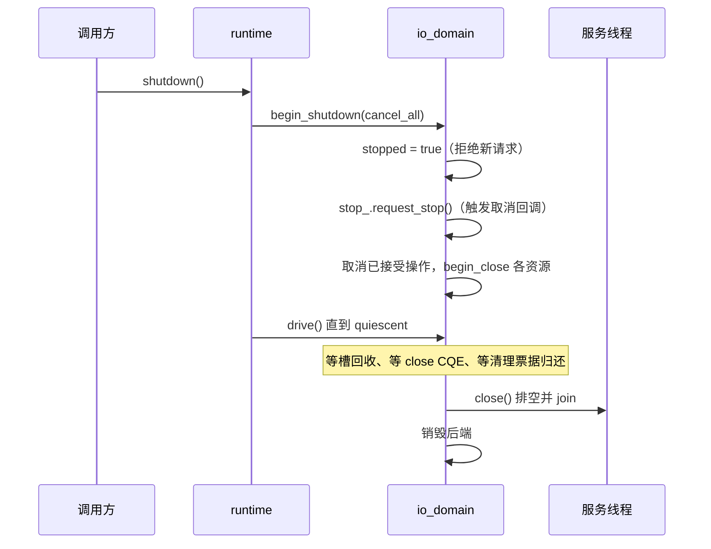

五个阶段不可调换：

| 阶段 | 动作 | 为什么必须在这个位置 |
| --- | --- | --- |
| 停止接受 | `stopped = true` | 必须先于取消，否则取消过程中还有新请求进来 |
| 请求取消 | `stop_.request_stop()` | 触发协程侧的 `stop_callback` |
| 排空 | `drive` 直到 `quiescent` | 必须继续收割 CQE，否则永远排不空 |
| 关闭服务 | `fs_->close()` 等 | 必须在排空之后，服务可能还有 job 在跑 |
| 销毁后端 | `~backend_box` | 最后，此时已经没有内核借用 |

`quiescent()` 的完整条件：

```cpp
bool quiescent() const noexcept {
  std::lock_guard lock(mutex_);
  return free_.size() + retired_slots_ == operations_.size()   // 槽全空闲
         && publishers_.load(std::memory_order_acquire) == 0    // 没有线程在锁外发布
         && native_controls_.empty()                            // 控制记录清空
         && backend_.quiescent();                               // 后端无内核引用
}
```

`publishers_ == 0` 这一条容易被忽略：某个线程可能刚好摘下一个完成、正在锁外调用回调。此时槽已经"回收"（`free_` 里有它），但消费者还在读 `claimed_completion`。域必须等它退出才能销毁。`backend_.quiescent()` 则把"内核是否还持有 SQE/entry/节点"这一问题交给后端回答（见 7.2.9、7.3.3）。

`drain` 与 `cancel_all` 的差别：

| 策略 | 行为 | 适用 |
| --- | --- | --- |
| `drain` | 拒绝新请求；已接受的继续执行到完成；只关闭没有活跃操作的资源 | 优雅退出，不丢工作 |
| `cancel_all` | 拒绝新请求；取消所有可取消操作；关闭所有资源 | 快速退出 |

注意 `drain` **也拒绝新请求**。它不是"继续服务到空闲"，而是"停止接受，等已有的做完"。

### 11.3 跨越运行时寿命的包装

包装对象（`File`、`TcpStream`）可能活得比 runtime 更久。此时：

- 控制块仍然存在，`valid()` 仍为真（`descriptor` 尚未 `exchange(-1)`）；
- 但 `context.stopped()` 为真，所有提交返回 `ECANCELED` 或 `EBADF`；
- 析构时 `defer_native_close` 找不到可用的域，退回 `defer_cleanup` → 再退回直接 `::close`。

最后那一级兜底是必要的：清理不能因为域已经不在而放弃。

---

## 12. 构建与验证

macOS 使用 Homebrew LLVM：

```sh
cmake --preset macos-clang23
cmake --build --preset macos-clang23 -j4
ctest --preset macos-clang23 --output-on-failure
```

Linux 的 uring 构建（需要支持 C++23 显式对象参数的 Clang 与标准库）：

```sh
cmake --preset linux-clang22-uring
cmake --build --preset linux-clang22-uring -j4
ctest --preset linux-clang22-uring --output-on-failure
```

不需要 liburing 的 epoll 构建：

```sh
cmake --preset linux-clang22-epoll
cmake --build --preset linux-clang22-epoll -j4
ctest --preset linux-clang22-epoll --output-on-failure
```

Windows 的 MSVC、clang-cl、MinGW-w64 预设覆盖真实完成包、同步完成唯一交付与双运行时模式合同。

`FAIO_SANITIZERS=address,undefined` 启用 ASan/UBSan。`scripts/check_installed_headers.py` 验证安装包、平台适用头独立编译及双翻译单元消费。

测试覆盖的重点与本文的章节对应：

| 测试关注点 | 对应章节 |
| --- | --- |
| 引擎协议与后端合同 | 第 4、7、8 章 |
| 就绪与代际清除 | 8.4、8.5 |
| 文件游标与分批目录 | 9.5、9.6 |
| 借用取消与载荷排空 | 5.4、10.2 |
| 槽位代际复用 | 6.2、6.7 |
| 关闭与停机顺序 | 6.9、11.2 |

`tcp_counter_server --self-test` 是会自行退出的多客户端 TCP 应用场景；常驻 TCP/UDP 服务与其他用法见[示例指南](../examples/README.md)。
